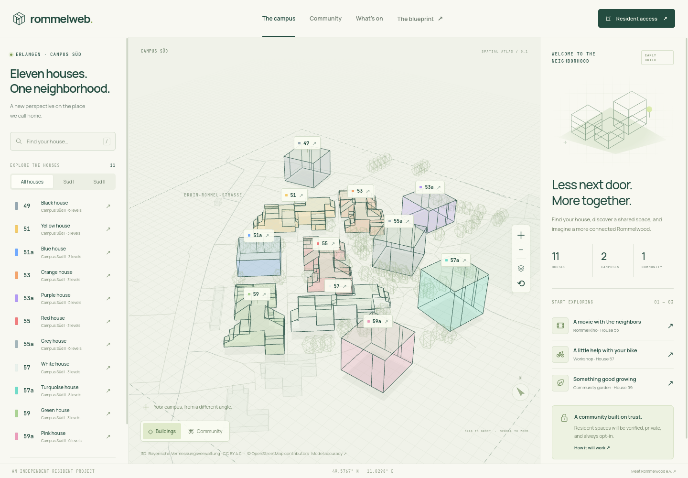

# Rommelweb

A spatial community home for **Campus Süd I and II**, Erwin-Rommel-Straße, Erlangen.

**Live demo:** https://mteyra.github.io/rommelweb/

The repository and GitHub Pages demo are public. See [release checks](docs/RELEASE-CHECKS.md) for build, browser and publication verification.

This independent resident project starts with the actual eleven houses and grows toward a private, verified community. It is not an official FAU, Studierendenwerk or Rommelwood e.V. service.



Preview details: [daylight campus](docs/preview/day-campus.png) · [group carousel](docs/preview/groups.png) · [expanded group details](docs/preview/group-details.png) · [timber and window study](docs/preview/timber-detail.png) · [daylight detail](docs/preview/day-timber-detail.png) · [older windows](docs/preview/older-windows.png) · [aligned Blue House windows](docs/preview/blue-house.png) · [isolated house floors](docs/preview/unfolded-levels.png) · [House 55, 2. OG](docs/preview/single-floor.png) · [published room references](docs/preview/room-references.png) · [phone layout](docs/preview/mobile.png) · [timeline](docs/preview/timeline.png).

## This release

- An interactive Three.js map using **official Bavarian LoD2 geometry**: 289 wall, roof and ground surfaces across eleven address-matched buildings.
- A full-screen spatial interface with **day/night mode**, defaulting to night, and a lower overview from the southwest. Daylight uses warm off-white ground and neutral light panels; geographical alignment, metre scale, source roof shapes, heights and relative building-base elevations remain unchanged.
- Hover a house to highlight it, then click to focus. A primary click on empty map space restores the campus overview; dragging, cancelled gestures and multi-pointer gestures do not trigger that action. The Rommelweb brand also restores the overview. Drag to orbit and use the wheel to zoom.
- Buildings and their address-label buttons are the navigation, with keyboard access through the labels. The selected house's unfold control starts at bottom left; a selected floor uses a compact control bar below its drawing.
- Photo-informed façade linework: vertical timber seams on the newer houses and horizontal plate courses with faint short joints on the older houses. Natural timber and older brown façades sit beneath neutral charcoal/gray roofs. Colors, seam spacing and floor bands are schematic; source polygons are unchanged.
- A separate **schematic window layer** adds narrow dark frames, lower transoms and head strips to the newer houses. Blue House **51a has vertically aligned upper rows**, following a resident correction; the other newer houses retain illustrative row offsets. Typical width is referenced to a resident sketch, while positions, heights and repetition remain unmeasured. Newer-house ground-floor glazing, stairs and loggias remain unmodeled. See the [newer-window evidence](docs/WINDOW-REFERENCES.md).
- Older houses now have three aligned appearance rows where complete windows fit the source shell, including regular ground-row windows. Their approximately 1.05 × 1.55 m profile and 0.95 m sill come from one unassigned room sketch. Row spacing uses a broad horizontal roof as a visual guide and leaves the floor-section elevations unchanged. No opening establishes a room, occupancy or usable roof space. See the [older-window evidence](docs/OLD-WINDOW-REFERENCES.md).
- Continuous streets and paths from retained OSM geometry: joined outlines at intersections, mapped widths where available and crisp screen-width centerlines otherwise. Decorative trees and gray context-building blocks remain absent.
- An unfolded **level study** isolates the selected house and separates thin horizontal sections through its actual LoD2 shell. Selecting a floor hides the other levels and moves to a nearly overhead view. Upper outlines can shrink or split beneath the older houses' stepped roofs. OSM floor counts and provisional heights determine the initial sections; they do not establish occupancy or usable headroom.
- **Red House 55** has studies for **EG, 1. OG and 2. OG**. Upstairs, the resident confirms **20 rooms** and **24 exterior windows**, including one per L room and four shared-area windows. The latest correction matches L1's overlap to W4's approximately **0.45 m perpendicular overlap**, retaining L's roughly **2.94 m gross bays**. The stairwell follows the confirmed **one-quarter L3/west, three-quarters R1/east** alignment across the extended source edge, yielding an estimated **1.78 m gross width**. The other seventeen upstairs room polygons, including R's earlier extension, remain unchanged. EG and 1. OG now extrapolate the corrected core, keeping their full source outlines and unassigned extra wings; the observed top-floor windows and possible wall bands are not copied down. The west stairwell entry is retained and east access remains unconfirmed. See the [House 55 study](docs/HOUSE55-INTERIOR-STUDY.md) and [dimension evidence](docs/HOUSE55-DIMENSION-REFIT.md).
- A framework for approved **room, corridor and physical-door wireframes**, including selectable spaces and doors, a low display cutaway and sourced swing arcs when known. Approved `interiors.json` remains empty; the sketch uses its own `interior-studies.json` dataset and cannot set verified floor heights. Study popups explain their evidence and accept correction-file suggestions. No resident identity or physical room number is assigned.
- The top-right **Groups** button opens and closes a readable card centered beneath the breadcrumb. Floating previous/next arrows browse groups; **Details** expands into a large centered panel with a smooth transition. Locally generated QR codes lead to public activity pages and known houses: cinema at 55, bicycle workshop at 57, garden behind 59, and Sprachcafé at 51a. House WhatsApp cards remain locked and expose no invite link or private QR.
- A quiet, silent interface: camera, floor, theme and group transitions ease between states; façade line density adjusts to the view, and cached QR codes change with their titles. Reduced-motion preferences are respected. No audio code or media is included.
- **Published room designs**, available under floor details and map information, links to resident sketches for both campuses and the operator's 2026 categories. Approximate living-zone dimensions remain separate from category-average areas and geolocated interior geometry.
- The top-right **Timeline** button is the timeline's sole entry point. Its compact, aligned drawer supports personal event drafts, house links, removal and `.ics` export. Drafts exist only in the open tab's memory and disappear on reload or close; no events are published or sent.
- Groups and Timeline are mutually exclusive at every viewport width. Both animate into and out of view, safely reverse an interrupted transition, and switch immediately for reduced motion.
- A 2D fallback with keyboard-accessible house buttons when WebGL is unavailable.
- Local correction-file downloads for building details. The form uploads nothing.
- A concrete architectural brief, residency-validation workflow and proposed API contract.

## What still requires evidence or infrastructure

**Interiors:** the first selected pilot is **Red House 55, second floor (2. OG)**. Its confirmed counts and relative hallway/stair constraints support an envelope study. The resident's “one hand length” variation is qualitative; neither the absolute room dimensions nor a precise tolerance is measured. The fitted depth comes from prior modeling assumptions. The public 2.70 × 3.30 m reference describes only a living zone; full apartment dimensions, wall material/thickness, services and precise doorway geometry remain unknown. Matching the W4/L1 overlap resolves that modeling alignment, not its physical construction. R's living-zone fit and the east hall's stairwell connection remain open questions. R retains its separate 0.20 m extension hypothesis; the earlier arbitrary 0.20 m L offset has been superseded. EG and 1. OG repeat the corrected shared core at the user's request; their counts and arrangements remain unverified assumptions, and additional wings have no assigned rooms or use. Current plans or measurements are still needed before approving geometry. All houses need plans identified by house and floor, with approved room labels, real floor elevations, stairs and accessible routes. Research found typical-room sketches and planning illustrations, but no verified current full-floor plan suitable for this model. See the [interior-plan evidence](docs/INTERIOR-PLAN-EVIDENCE.md) and [contribution format](docs/INTERIOR-FORMAT.md). The existing public map's individual room database has not been republished: its reuse rights are unclear and many coordinates are unsuitable for precise geometry. Its public room-data starter contains aggregate metadata and no individual source records; the sketch cells are independent study references.

**Resident services:** authentication, residency verification, WhatsApp invitations, discoverability, knocking, messages, shared event publishing and personal connection graphs. The interface explains these planned features; it does not simulate a secure backend.

GitHub Pages is a static host. Private records and invite secrets must be retrieved from a separate authenticated service with current-membership and scope checks on every request. See the [architectural brief](docs/ARCHITECTURE.md).

## Develop

Requires Node.js 22 or newer.

```sh
npm ci
npm run dev
npm test
npm run build
npm run preview
```

The base path is `/rommelweb/`. `npm run dev` prints the complete local URL. Dependencies, fonts, geometry and UI assets are served locally; the running map does not contact map tiles, analytics, geolocation or a third-party CDN. QR codes are generated in the browser from public activity URLs, without a QR service. External pages open only when their link or QR is followed.

The GitHub Actions workflow builds, tests and deploys `dist/` through GitHub Pages on pushes to `main`, using **Settings → Pages → Source: GitHub Actions**. Both the repository and demo are intended for public access. Keep resident records, private invitations and credentials out of source, Git history and static assets.

## Project guide

| Path | Purpose |
| --- | --- |
| `src/scene.js` | Official exterior rendering, OSM paths, hover/picking, day/night materials and separated level sections |
| `src/sections.js` | Horizontal intersections through the source shell, preserving holes and separate parts |
| `src/paths.js` | Path-source normalization, cache validation and lightweight rendering geometry |
| `src/path-network.js` | Development-time buffering and union of explicitly mapped path widths |
| `src/facade.js` | Photo-informed schematic seams clipped to unchanged exterior surfaces |
| `src/windows.js` | Separate newer/older window profiles, house-specific corrections and appearance-only row guides |
| `src/main.js` | House selection, animated group/QR carousel, theme control, local timeline and dialogs |
| `src/data.js` | Public community listings and small data helpers |
| `src/room-references.js` | Cited room typologies and approximate dimensions, without room placements |
| `src/events.js` | Order personal drafts and export calendar files |
| `src/interiors.js` | Validate approved spaces and doors; interpolate unknown floor guides around verified elevations |
| `src/interior-studies.js` | Validate unmeasured studies, prefer approved records, and apply separate display-floor outlines |
| `src/interior-wireframe.js` | Approved/study cutaways, evidence-styled walls, door gaps and selectable space targets |
| `src/styles.css` | Responsive day/night spatial interface and reduced-motion styles |
| `public/data/lod2.json` | Official exterior polygons transformed into campus coordinates |
| `public/data/campus.json` | OSM footprints, storey counts, context and house identity references |
| `public/data/path-network.json` | Precomputed OSM path joins with source records and SHA-256 |
| `public/data/campus.geojson` | OSM reference footprints and context in geographic coordinates |
| `public/data/room-markers.json` | Aggregate room-source research metadata; no individual records |
| `public/data/interiors.json` | Approved interior geometry; empty until plans are reviewed |
| `public/data/interior-studies.json` | House 55 / 2. OG hallway candidate and current core extrapolations on EG and 1. OG |
| `data/source/` | Retained source subset, snapshots and checksums |
| `data/source/house55-2og-sketch-baseline.json` | Historical twenty-room sketch used by the previous lower-floor studies |
| `data/source/house55-2og-dimension-baseline.json` | Historical top-floor candidate before the earlier L/stair correction |
| `data/source/house55-2og-left-correction.png` | Earlier resident L-block, stairwell and hallway-door annotation |
| `data/source/house55-2og-wall-offset-baseline.json` | Top floor immediately before the window and wall-face study |
| `data/source/house55-2og-window-marks.png` | Resident window-location marks |
| `data/source/house55-2og-wall-offsets.png` | Resident proposed wall-face offsets |
| `data/source/house55-2og-stair-ratio-baseline.json` | Top-floor window/wall candidate before the latest confirmed overlap and stair alignment |
| `data/source/house55-2og-overlap-reference.png` | W4 overlap reference supplied by the resident |
| `data/source/house55-2og-l-overlap-correction.png` | Resident correction requiring the same overlap at L1 |
| `data/source/house55-stair-ratio-mark.png` | Stair/source-edge relationship clarified as one quarter west and three quarters east |
| `scripts/acquire-lod2.py` | Reproduce official geometry using pinned projection tooling |
| `scripts/acquire-campus.py` | Reproduce the OSM reference and context dataset |
| `scripts/build-path-network.mjs` | Rebuild the path cache; `--check` rejects stale source references |
| `scripts/generate-house55-study.mjs` | Reproduce registration, the top-floor hallway correction and versioned lower-floor assumptions |
| `scripts/house55-window-wall-study.mjs` | Apply the later window observations and explicit wall-face hypothesis |
| `docs/ARCHITECTURE.md` | Product, privacy, data model, permissions and staged delivery |
| `docs/GEOMETRY.md` | Detailed geometry provenance, transformations and uncertainties |
| `docs/FACADE-REFERENCES.md` | Inspected photo references and schematic material-line limits |
| `docs/WINDOW-REFERENCES.md` | Identified-house photographs, narrow-window typology and unmeasured-placement limits |
| `docs/OLD-WINDOW-REFERENCES.md` | Older-house photographs, typical window dimensions, aligned-row character and roof safeguards |
| `docs/OLD-BUILDING-SECTIONS.md` | Older-house roof/floor evidence, clear-height limits and plate-cladding refinement |
| `docs/ROOM-TYPOLOGY-RESEARCH.md` | Public room drawings, dimensions, operator categories and evidence limits |
| `docs/INTERIOR-PLAN-EVIDENCE.md` | Full-floor plan search, usable evidence limits and minimum inputs for an accurate interior |
| `docs/HOUSE55-INTERIOR-STUDY.md` | Confirmed upstairs counts, estimated geometry and versioned lower-floor assumptions |
| `docs/HOUSE55-SCALE-AUDIT.md` | Raw UTM/web distances, exterior versus floor extents, registration and projection limits |
| `docs/HOUSE55-DIMENSION-REFIT.md` | Candidate bay dimensions, living-zone fit checks and unresolved R-block width |
| `docs/RESEARCH.md` | Source register and confirmed campus/community facts |
| `docs/RESIDENT-VALIDATION.md` | Collaborative validation and first-resident pilot |
| `docs/INTERIOR-FORMAT.md` | How to add approved room/corridor outlines, doors, labels and floor elevations |
| `docs/RELEASE-CHECKS.md` | Validation performed and current publication status |
| `docs/api-contract.yaml` | Proposed future API; no deployed endpoints |

## Reproduce and improve the model

The official source subset is retained so reproduction does not depend on a changing external tile:

```sh
uv run scripts/acquire-lod2.py
python3 scripts/acquire-campus.py
npm run paths:build
```

Read the scripts' `--help` and [geometry notes](docs/GEOMETRY.md) before refreshing sources. Explicit fetches can update upstream data; review the resulting diff and source dates.

Rebuild the path cache whenever mapped paths change. `npm run build` checks that its source digest is current. Polygon union runs during development, not on the browser's animation thread; missing or invalid cache data falls back to the original source centerlines.

`src/windows.js` keeps appearance parameters in `WINDOW_PROFILE` and `OLD_WINDOW_PROFILE`; `getWindowProfile` applies the resident correction for 51a. Candidate openings must fit the source-wall union before their rendering batches are clipped to individual surfaces. `getOldFacadeRowGuides` supplies separate appearance rows for older houses without modifying the floor-section guides. Changing a bay pitch, row offset or frame detail changes an illustration; it does not update the authoritative geometry. Use the [newer](docs/WINDOW-REFERENCES.md) and [older](docs/OLD-WINDOW-REFERENCES.md) window evidence before refining this layer, and collect address-and-direction façade evidence before claiming exact opening positions. House 55 index 2 overrides the repeated pattern with its resident-located complete-floor inventory. All 24 openings must fit their referenced source walls; invalid placements are reported rather than silently clipped or resized. Lower rows are preserved.

Start an interior contribution by selecting a house, choosing **Unfold the floors**, opening a level's details and selecting **Add a floor detail**. The downloaded JSON is a proposal, not an automatic geometry edit. Establish plan reuse permission, remove personal/security details, and follow the validation checklist before adding it to the public model.

The [interior schema](docs/INTERIOR-FORMAT.md) and renderer support partial approved plans. Selecting the corresponding unfolded floor can show room/corridor outlines, door openings, labels and a low 1.05 m display cutaway. This display height is not a measured wall or ceiling height. Door swing is drawn only when supplied by the source. Approved `interiors.json` remains empty pending a reviewed plan; see the [interior-plan evidence](docs/INTERIOR-PLAN-EVIDENCE.md).

The separate `interior-studies.json` layer covers **House 55 / indexes 0, 1 and 2**. Index 2 combines resident-confirmed counts and relationships with estimated room/stair/corridor geometry. Lower records declare `extrapolatedFrom: 2` and explicitly repeat its corrected shared core as an unverified assumption. Every lower-floor space and door remains estimated, with a distinct ID for its floor. Each floor's full source section retains the extra wings without assigning rooms or routes; observed top-floor windows and possible wall bands are not copied down. Only index 2 omits the two resident-marked absent areas. `getDisplayLevel` prefers an approved plan if one is later added for the same floor. A study neither creates approval nor supplies a floor-height anchor, physical room numbers, hinges or swings.

Verified floor elevations anchor the model; unverified guides interpolate between them and remain provisional. Each guide produces an exterior section, rather than another full-footprint building volume. A verified elevation still does not turn that exterior section into an approved occupied-area boundary. See the [older-building research](docs/OLD-BUILDING-SECTIONS.md).

## Data credits

**Datenquelle: Bayerische Vermessungsverwaltung – www.geodaten.bayern.de.** Official LoD2-BY, [CC BY 4.0](https://creativecommons.org/licenses/by/4.0/). Coordinates have been reprojected and surfaces converted for web rendering. Individual footprint currency and model creation dates are retained; retrieval on 14 November 2026 is not a new survey.

The shared campus projection is not exactly distance-preserving. The [House 55 scale audit](docs/HOUSE55-SCALE-AUDIT.md) reproduces approximately 0.13–0.17% shorter web frontages than retained UTM grid distances and distinguishes the complete building from its provisional upper-floor section. This small distortion does not explain the interior fit uncertainties.

**© OpenStreetMap contributors**, [ODbL](https://www.openstreetmap.org/copyright). Original OSM geometry, storey counts and derived data remain separately identified. Streets and paths use this retained context; tree points and neighboring-building records are not rendered as decorative objects. Path elevation is a flat display plane because surveyed terrain is unavailable.

House names, color conventions and community facts are referenced to [Rommelwood e.V.](https://rommelwood.de/) and the [Studierendenwerk](https://www.werkswelt.de/). Their original map artwork, photographs, prose, contact lists and private invitations are not included.

Façade photographs are linked in the [material study](docs/FACADE-REFERENCES.md), [newer-window study](docs/WINDOW-REFERENCES.md) and [older-window study](docs/OLD-WINDOW-REFERENCES.md) and are not bundled. Procedural material seams and windows are separate approximate visual annotations. They are not measured façades, exact opening schedules or room placements.

Manrope and JetBrains Mono use the SIL Open Font License; notices are in `public/fonts/LICENSES.txt`. Third-party code retains its package licenses.
