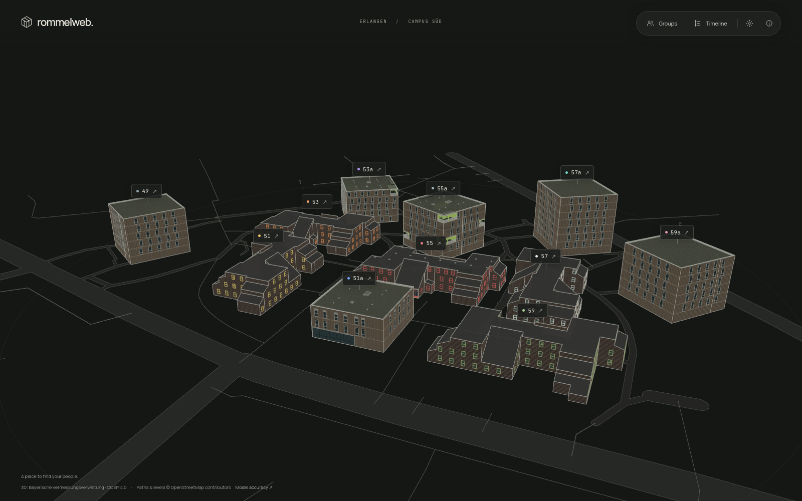

# Rommelweb

[](https://github.com/mteyra/rommelweb/actions/workflows/pages.yml) [](LICENSE)

**The student houses of Campus Süd, Erlangen, in 3D. Find your house, your floor and your people.**

Rommelweb is an interactive map of the eleven houses at Erwin-Rommel-Straße (Campus Süd I and II), built from official survey data. Open any house, unfold its floors, look at rooms and shared spaces, and find the groups that meet on campus.

[Live demo](https://mteyra.github.io/rommelweb/) · [Exteriors](docs/EXTERIORS.md) · [Floor plans](docs/INTERIORS.md) · [Software](docs/SOFTWARE.md) · [MIT license](LICENSE)



## Quick start

Open the [live demo](https://mteyra.github.io/rommelweb/). It runs in any modern browser, on phones too.

To run it locally, with Node.js 22 or newer:

```sh
git clone https://github.com/mteyra/rommelweb.git
cd rommelweb
npm ci
npm run dev
```

## What you can do

- **Explore the campus:** all eleven houses from official Bavarian 3D survey data, with streets and paths, in day or night mode.
- **Open a house:** click it to focus, then **Unfold the floors** to see each level from above.
- **Look inside:** select rooms, shared apartments, common rooms and doors, with their dimensions. For a single room you can view a sample furniture layout.
- **See the details:** façades, windows, balconies, entrances and bicycle cages are modelled from photographs of each house.
- **Find groups:** browse campus groups such as the cinema, the bicycle workshop and the community garden, each with a QR code.
- **Plan events:** draft events and export them to your calendar.

It works with keyboard only and respects reduced-motion settings. Without WebGL it falls back to a simple 2D map.

## How accurate is it?

| Part | Basis |
| --- | --- |
| Building shapes, heights and positions | Official survey data (LoD2), unchanged |
| Façades, windows, balconies | Matched to photographs; placement is relative, sizes are estimates |
| Floor plans, older houses (51–59) | Residents' annotated sketches and measurements; not surveyed |
| Floor plans, newer houses (49, 51a–59a) | Estimated from published room sizes |

Room labels are drawing references, not real room numbers. The map shows no residents, and no accuracy percentage is claimed. [Floor plans](docs/INTERIORS.md#evidence-and-open-questions) lists what evidence is still missing.

## Privacy

The site is fully static. It makes no analytics, map-tile or third-party requests, sets no cookies, and uploads nothing: correction and event forms only download a file for you. Resident accounts, private group invitations and messaging are planned, but they need a separate secure service and aren't part of this site ([details](docs/SOFTWARE.md#planned-resident-services)).

This is an independent resident project, not an official FAU, Studierendenwerk or Rommelwood e.V. service.

## Working on it

```sh
npm test         # 364 tests
npm run build    # production build in dist/
```

Pushing to `main` tests, builds and deploys to GitHub Pages.

Each area has one guide that covers its rules, files, data and tests:

| Guide | Covers |
| --- | --- |
| [docs/EXTERIORS.md](docs/EXTERIORS.md) | Building meshes, façades, windows, adding photo details to a house |
| [docs/INTERIORS.md](docs/INTERIORS.md) | Floor plans, room sizes per house and floor, layout generators |
| [docs/SOFTWARE.md](docs/SOFTWARE.md) | App structure, features, data files, tests, privacy rules |

Screenshots of every house and floor are in [docs/screenshots](docs/screenshots/README.md). The project's development history is in [docs/archive](docs/archive/README.md).

```
rommelweb/
├── index.html · src/          app (Three.js scene, UI, per-house exterior details)
├── public/data/               survey geometry and floor plans (JSON)
├── public/house55-layout/     House 55 layout sandbox
├── scripts/                   floor-plan generators, data acquisition, audits
├── data/source/               raw survey data and resident annotations
├── tests/                     test suite
├── docs/                      three guides, screenshots, archived write-ups
└── archive/                   superseded code from earlier interior stages
```

## Data credits

**Datenquelle: Bayerische Vermessungsverwaltung – www.geodaten.bayern.de.** LoD2-BY building models, [CC BY 4.0](https://creativecommons.org/licenses/by/4.0/), reprojected for web rendering.

**© OpenStreetMap contributors**, [ODbL](https://www.openstreetmap.org/copyright): footprints, storey counts, streets and paths.

House names, colors and community facts are referenced to [Rommelwood e.V.](https://rommelwood.de/) and the [Studierendenwerk Erlangen-Nürnberg](https://www.werkswelt.de/). None of their artwork, photographs or text is included.

Manrope and JetBrains Mono are under the SIL Open Font License ([notices](public/fonts/LICENSES.txt)).

## License

The code is under the [MIT License](LICENSE). Geodata stays under the licenses above. Resident photographs and annotations in `data/source/` and `docs/` are not covered by the MIT License.
