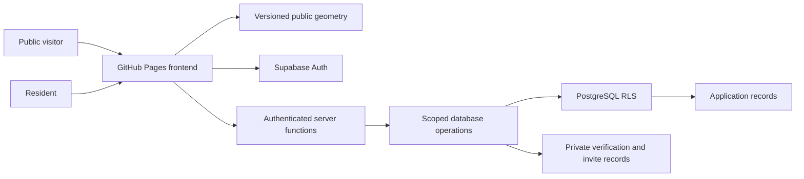

# Rommelweb architectural brief

Status: **proposed architecture and implementation roadmap** · 14 November 2026

This document describes the intended system. Authentication, membership checks, private messaging, private group access, shared event editing and the API below are future work unless a later release explicitly documents their implementation. A control displayed by the public prototype is not evidence of a working private service.

## 1. Product direction

Rommelweb is a spatial community home for Campus Süd I and Campus Süd II in Erlangen. Residents navigate the same campus they live in: a building opens its community, a shared place opens its activities, and an opt-in resident profile offers a way to connect. The map should help someone join dinner, find a bike repair session or meet a neighbor within a few interactions.

The 3D model is both a useful interface and a progressively verified record of the place. Its accuracy must be inspectable. A beautifully rendered estimate must never masquerade as a measured floor plan.

The current frontend establishes the map, building navigation, source trail and interaction framework. Its eleven exterior models use official Bavarian LoD2 wall, roof and ground surfaces. The unfolded floor study shows thin sections through that shell at provisional or approved elevations; it does not establish occupied floor boundaries. The spatial interface provides restored OSM streets and paths, selection through buildings and address-label buttons, a centered group card with public activity-page QR codes, and a right-side timeline for personal drafts. Day/night mode defaults to night.

Public QR codes lead to the cited activity websites. House WhatsApp cards show a locked state without an invitation URL or private QR. Timeline drafts exist only in the open tab's memory, can be exported as `.ics`, and disappear on reload or close. There is no connected community event feed, account system or publishing service.

The private resident service will be piloted in one building before wider enrollment. Public repository visibility and GitHub Pages publication are authorized for the static frontend; a separate backend will enforce resident access. See [RELEASE-CHECKS.md](RELEASE-CHECKS.md) for the verified publication state.

### Success criteria

- A first-time visitor can identify either campus, select a building, find known shared facilities and understand the model's limits.
- A verified resident can reach an appropriate group or event without exposing their phone number or room on the public website.
- A resident can participate while keeping their profile undiscoverable.
- A former resident loses access at their membership expiry, without depending on a steward remembering to run a cleanup job.
- A volunteer can maintain one building or club without gaining access to the whole resident directory.
- Corrected geometry, room labels and sources can be added without rebuilding the application's conceptual model.

## 2. The actual campus inventory

Use address labels as names and stable internal IDs as identifiers. The public Rommelwood map identifies eleven houses across the two campuses. House 51a is a community hub; official planning material also describes group apartments above its communal ground floor. Its current residential layout requires confirmation, so do not exclude its residents from enrollment. The color names and house numbers are wayfinding labels from that source, not additional buildings.

| Campus | Erwin-Rommel-Straße address | Public map label | Role |
|---|---|---|---|
| Süd I | 51 | Yellow house | Residence |
| Süd I | 53 | Orange house | Residence |
| Süd I | 55 | Red house | Residence |
| Süd I | 57 | White house | Residence |
| Süd I | 59 | Green house | Residence |
| Süd II | 49 | Black house / 11 | Residence |
| Süd II | 53a | Purple house / 12 | Residence |
| Süd II | 55a | Gray house / 13 | Residence |
| Süd II | 57a | Turquoise house / 14 | Residence |
| Süd II | 59a | Pink house / 15 | Residence |
| Süd II | 51a | Blue house / 16 | Community hub; residential layout to confirm |

Public facility evidence places the cinema in house 55, the bike workshop in house 57 on the forest side, and the garden behind house 59. These are useful map anchors. Their existence and location do not establish a current event schedule, organizer, WhatsApp invitation or precise interior boundary.

Primary references:

- [Existing Rommelwood map](https://rommelwood.de/map/).
- [Studierendenwerk: Campus Süd I](https://www.werkswelt.de/index.php?id=wohnanlage-campus-sud-i).
- [Studierendenwerk: Campus Süd II](https://www.werkswelt.de/index.php?id=wohnanlage-campus-sued-ii).
- [Architect's project description](https://www.karlundp.de/projekt/wohnanlage-fuer-studierende-erlangen/).
- [Studierendenwerk planning account including apartments in the community hub](https://www.werkswelt.de/?post=neubau-einer-wohnanlage-am-erlanger-suedcampus).
- [Cinema](https://rommelwood.de/rommelkino/), [bike workshop](https://rommelwood.de/fahrradwerkstatt/), [garden](https://rommelwood.de/garten/).

See [RESEARCH.md](RESEARCH.md) for the source audit, [GEOMETRY.md](GEOMETRY.md) for official model provenance and limitations, and [RESIDENT-VALIDATION.md](RESIDENT-VALIDATION.md) for the evidence collection process.

## 3. Digital twin specification

### Exterior baseline in this release

All eleven addresses have been matched to building objects in [Bayerische Vermessungsverwaltung LoD2-BY](https://geodaten.bayern.de/opengeodata/OpenDataDetail.html?pn=lod2), licensed under [CC BY 4.0](https://creativecommons.org/licenses/by/4.0/). The official tile `LoD2_32_646_5492_2_BY` supplies 289 exterior polygons, including articulated roof surfaces for the older houses. Source checksums, footprint currency and per-building model creation dates are retained. The source's millimetre serialization precision is not a claim of millimetre surveying accuracy.

Use the official exterior polygons directly. OSM supplies retained reference/context data and mapped storey counts; it does not replace the LoD2 roofs with rectangular approximations. LoD2 is a standardized exterior model, not a current detailed facade or interior survey. Source building-base height differences are preserved, but surveyed terrain between buildings is absent.

The presentation uses closer camera framing while retaining the original metre scale, footprints, heights and separations. Day/night mode changes display materials and interface colors together; it does not simulate observed sunlight, artificial lighting or resident activity. Streets and paths follow retained OSM geometry: mapped widths become ribbons, while unknown widths remain centerlines. Their flat display elevation is not surveyed terrain. Decorative trees and gray context-building volumes remain absent.

A separate procedural material layer adds vertical timber seams to the newer houses and horizontal plate courses with faint short joints to the older houses, clipped to the existing wall surfaces. The palette retains natural timber and older brown façades with neutral charcoal/gray roofs. Material direction follows inspected photos; colors, spacing and floor bands remain schematic. No façade photograph is embedded. See [FACADE-REFERENCES.md](FACADE-REFERENCES.md).

The newer houses also carry a replaceable **schematic upper-window layer** from `src/windows.js`: tall narrow dark frames, lower transoms, head strips and sideways offsets between rows. Blue House **51a overrides the family pattern with vertically aligned upper rows**, following a resident correction. The resident sketch supports approximately 1.10 m as a typical width; exact opening positions, heights and bay spacing remain unmeasured. Newer-house ground-floor glazing, stairs and loggias remain unmodeled. The patches do not cut or modify the LoD2 shell and do not create room records or suggest occupancy. This appearance study has separate evidence status from the official exterior and approved interior geometry. See [WINDOW-REFERENCES.md](WINDOW-REFERENCES.md).

The older houses use a separate aligned-window profile, including regular ground-row windows, with three appearance rows wherever complete openings fit the available source walls. One unassigned room sketch supports approximately 1.05 m width, 1.55 m height and a 0.95 m sill; a mid-height horizontal transom follows operator photographs. Pitch, frame tints and candidate positions remain illustrative. Row guides use the dominant broad horizontal roof height and preserve approved anchors, but **never alter floor-section elevations or establish occupied roof space**. Ground-connected multistorey wall and complete-opening checks reject low wall regions and roof-only fragments. Large shared-room glazing and entrances remain unmodeled. See [OLD-WINDOW-REFERENCES.md](OLD-WINDOW-REFERENCES.md).

Unfolding a building switches to a **level study** of thin horizontal intersections through the actual LoD2 shell, separated vertically for inspection. Upper outlines can shrink or split with the older houses' stepped and sloping roof geometry. The study does not repeat a full-footprint volume at every level or classify the resulting area as occupied space. Roof geometry is not converted into another resident floor.

Section elevations use mapped storeys and official model height, with approved floor elevations anchoring refinements. With the current empty interior dataset the guide intervals remain uniform and provisional. Neither a roof-height interpolation nor a section through the exterior establishes a finished-floor height, ceiling clearance or room boundary. The [older-building research](OLD-BUILDING-SECTIONS.md) separates typical-room ceiling evidence and resident roof-space observations from verified whole-floor plans. [GEOMETRY.md](GEOMETRY.md) documents the section method, coordinate transforms and reproducible acquisition.

The public **Published room designs** view is a separate reference catalog. It links to resident sketches and operator category charts for both campuses, distinguishing approximate clear living-zone dimensions from category averages that include communal space. Its records do not have house/floor/room placements and never populate `interiors.json`. See [ROOM-TYPOLOGY-RESEARCH.md](ROOM-TYPOLOGY-RESEARCH.md).

### Spatial model

Use the hierarchy `campus → building → entrance → level → space`. A space can be a bedroom, apartment, kitchen, corridor, lounge, workshop or other shared facility. A club can occupy a space, meet at an outdoor location or span several buildings.

Keep source coordinates in their original coordinate reference system and document every conversion. The renderer uses one shared local frame measured in metres, with a stored geospatial origin and explicit north direction. Do not independently center or rescale buildings before placing them on the campus map.

Footprints are polygonal geometry, including holes and separate parts where supported by evidence. A building envelope, floor slab, roof, room marker and room boundary are different objects:

- A sourced footprint supports the exterior's horizontal position.
- A documented floor count supports level separation, not ceiling height.
- A numbered point from the existing map supports a room label and approximate location, not its wall dimensions.
- A measured or licensed plan supports walls, circulation and room polygons.
- A roof or facade requires its own evidence; extrusion is explicitly an envelope approximation.

The existing Rommelwood map includes public room markers, but no license authorizing reuse of that custom room database has been established. The public starter therefore carries aggregate research metadata and an empty marker array. Individual records require a suitable license or permission before publication. Once cleared, any displayed points need a marker-level accuracy label; do not turn them into convincing rectangular rooms by inference. Empty areas in a model mean unknown geometry, not vacant rooms.

### Geometry evidence

Each revision records `source_id`, source URL, observation date, license/reuse status, transform, verifier and confidence by dimension:

| Dimension | Example evidence | What it does not prove |
|---|---|---|
| Exterior surfaces | Official address-matched LoD2 ground, roof and wall polygons | Detailed facade, current as-built condition or interior geometry |
| Footprint | Mapped polygon or licensed site plan | Roofline, height, interior layout |
| Vertical levels | Plan level labels or resident-confirmed floor count | Exact heights, split levels or roof access |
| Height | Measured elevations or authoritative drawing | Internal ceiling clearance |
| Window appearance | Identified-house photos and a typical-room sketch | Exact opening position, full façade schedule, floor elevation or room assignment |
| Room marker | Existing public map point | Wall outline, occupancy or accessibility |
| Room geometry | Dimensioned floor plan | Current resident or furniture arrangement |
| Entrance | Site observation or approved plan | Opening hours or access entitlement |

Confidence values are `authoritative`, `measured`, `source_mapped`, `resident_confirmed`, `estimated`, and `unknown`. Confidence is attached to a field or geometry component, not a single blanket "accurate" badge. Preserve the former revision when evidence changes.

### Interaction and performance

The normal path is campus overview → building focus → unfolded sections → selected floor/space. Hover highlights a house and a click focuses it. Address labels are keyboard-accessible buttons that select the same houses. A primary click on empty map space restores the overview, as does the Rommelweb brand. A gesture guard excludes orbit drags, cancelled gestures and multi-pointer gestures from that reset action. Dragging orbits and the wheel zooms. The selected-house unfolding control remains at bottom left.

The top-right **Groups** button toggles a larger, readable card centered below the breadcrumb. Floating previous/next arrows browse the groups; animated **Details** expansion reveals descriptions and destination links. Known group locations select the associated house; an unplaced group remains campus-wide. Public QR codes are generated locally; the expanded details provide the corresponding text link. The **Timeline** button in the same top-right bubble is the timeline's sole entry point. Its drawer orders personal drafts and supports viewing their house, removing them and exporting calendar files; shared event creation remains future work.

Groups and Timeline are mutually exclusive at every viewport width. Opening either closes the other. Both animate entry and exit with cancellation and reversal handling; only the currently open panel remains interactive. Reduced-motion mode applies the final state immediately.

The top-right appearance toggle switches between a warm daylight palette and the default night palette. The theme has no relationship to who is home, live weather or actual lighting. Camera, floor, group and theme motion respect reduced-motion preferences.

On mobile, use responsive overlays and the larger building-label hit targets, opening one main overlay at a time. Never require precise taps on a thin wireframe. Provide keyboard selection and text equivalents for map actions. The 2D fallback includes keyboard-accessible house buttons if WebGL fails. Screen-reader labels describe buildings and selected spaces without narrating every line segment.

Use instancing or merged line geometry for repeated elements, bounded device pixel ratio, and render-on-demand when idle. Lazy-load detailed floors after a building is selected. Do not fetch protected interior assets until the user is authorized. Keep data independent of Three.js objects so rendering changes do not rewrite the campus records.

The interface stays silent: no music, interaction sounds, speech or audio playback. Motion has a reduced-motion alternative. Mapped path unions are generated ahead of time and checked against source records; browsers receive the static result and retain a source-centerline fallback. Camera, QR content, group details and floor transitions have explicit continuity and cancellation handling so rapid interaction does not leave mismatched state.

## 4. Public and private boundaries

| Surface | Public GitHub Pages payload | Future protected service |
|---|---|---|
| Campus | Approved exterior geometry, public address labels and sources | Restricted plans when applicable |
| Buildings and clubs | Approved descriptions, public facility locations and locally generated QR codes for public activity URLs | Member-only group directory and organizers' private contacts |
| People | Explanation of opt-in participation | Profiles, account identities and discovery permissions |
| Rooms | Aggregate metadata initially; individual markers only with reuse permission and accuracy labels | Private residency-to-room association |
| Events | Current frontend: volatile personal drafts and local `.ics` export. Future: explicitly published public events | Resident-, building-, club- and invitation-scoped events, editors and publishing |
| Communication | Explanation and clearly labeled preview controls | Knocks, conversations, moderation and notifications |
| WhatsApp | Group purpose and explicit locked/unconnected state; no invitation QR | Actual invitation secrets and release audit |

No private record may be embedded in JavaScript, static JSON, source maps, Git history or a public build artifact. Client-side hiding, a secret URL and `robots.txt` do not enforce access. Real resident data must not be used as demonstration content.

## 5. Recommended backend

Use **Supabase Auth, an EU-region PostgreSQL database, Edge Functions/server functions and row-level security (RLS)**. This is the recommended implementation, not an integration installed by the public prototype.

The resident frontend will call an API adapter backed by authenticated server functions. The current static frontend loads public JSON and provides explicit unavailable states for resident services. Shared types and response schemas should keep future UI components independent of the hosting choice.

Prefer a dedicated domain/origin for the operational resident app. Unrelated project sites under the same `username.github.io` origin share browser origin boundaries. A custom domain also makes a later same-origin backend gateway easier.

### Database exposure and credentials

- Keep verification evidence, residency-to-room associations, invite secrets and sensitive audit details in a **private schema excluded from Supabase's exposed API schemas**.
- Use a small API schema of reviewed operations. RLS applies to application tables, with deny-by-default policies and explicit grants.
- Forward the validated user's JWT for ordinary operations so database authorization uses the real caller.
- Never expose a Supabase service-role key to the frontend. It bypasses RLS.
- Privileged verification/offboarding functions are narrowly implemented server operations. If they require privileged credentials, they recheck the caller's current stewardship, target building and grant expiry inside the same database transaction as the mutation.
- Security-definer helpers have fixed `search_path`, explicit grants, fully qualified tables and narrow return values. They must not become unrestricted resident lookup functions.
- Private responses use `Cache-Control: no-store`. Do not put private data in a service worker cache. Restrict CORS to the actual app origins; CORS supplements authorization rather than replacing it.

Use PKCE for authentication flows, short-lived access tokens and explicit session clearing on sign-out. Require MFA for stewards, moderators and platform operators. Authentication alone never proves residency.

## 6. Residency, expiry and authorization

### Enrollment

A university email establishes affiliation, not residence. Start the pilot with a steward-confirmed process:

1. An authenticated account requests membership of a residence building.
2. An authorized steward confirms current residence through an agreed in-person or housing process.
3. A hashed, short-lived, single-use enrollment token binds the invitation to that account and building.
4. The confirmation creates an active residency with `valid_from`, `valid_until`, `verified_at`, `verified_by` and verification method.
5. The resident chooses discovery settings separately. Enrollment does not publish a profile or room.

Store the confirmation outcome rather than copies of leases or identity documents. Any future document upload needs a private collection and deletion process before it is enabled. Do not use a permanent lobby QR code or knowledge of a room number as residence proof.

Suggested pilot renewal policy: validity ends at the earlier of the confirmed tenancy end and six months after verification. The exact renewal interval is an operator policy, recorded with each approval. Reminders may precede expiry; there is no grace period that quietly preserves access after expiry. Future tenants remain pending until `valid_from`.

### Live authorization rule

Every private read and mutation requires an authenticated account, no account suspension, an applicable non-revoked residency, current time inside its validity interval, and an applicable role/audience grant. Evaluate these in the database at request time. Check the relevant building or club scope, not just whether the person resides anywhere on campus.

JWT role claims and background cleanup jobs are insufficient because both can lag. Revoking an account's sessions is additional protection; database membership checks remain decisive.

### Edge cases that must be handled

- **Move to another building:** close the former residency and approve the new one separately; remove former discovery and inherited building grants. A short overlap must be explicitly authorized.
- **Community hub with potential residential use:** 51a has confirmed communal functions and planned upper-floor apartments. Allow a steward to verify legitimate residency there; do not infer nonresidential status from its community label.
- **Expiry during an edit:** keep transactions short and condition the final mutation on still-active membership/grant; do not rely only on a frontend check made when the editor opened.
- **Revocation during a long session:** the next read or write fails immediately even if the access token remains valid. Refresh protected screens when focus returns.
- **Two stewards approve concurrently:** lock the request and consume the token atomically; uniqueness and idempotency constraints prevent duplicate memberships.
- **Replayed or leaked invitation:** bind to intended account/building, store a token hash, expire quickly, consume once, rate-limit failures and provide generic invalid-token responses.
- **Steward departure:** their moderation/editor powers expire with their residency unless a separately authorized nonresident operator appointment applies. Another steward must remain before a handover completes.
- **Block/revocation race:** a knock or message transaction checks both participant memberships and both-direction blocks immediately before inserting.
- **Account recovery or deletion:** do not transfer residency to an arbitrary replacement account automatically. Recovery uses a verified process; deleted accounts cease all private access.
- **Backup restoration:** reapply revocations and expiry checks before service resumes. A restored backup must not resurrect access or old active invitation secrets.
- **Previously downloaded data:** access revocation prevents future retrieval; it cannot retract screenshots, downloaded calendar entries or external chat history.

## 7. Neighbor discovery and knocking

Profiles are hidden by default. Residents independently choose discoverability by building, floor, interests or disclosed room. A room association is optional; broad participation must work without it.

A knock is a consent request to a discoverable resident:

- Verified sender and recipient; consistent sender display identity.
- Receiver must have enabled knocks for the sender's audience.
- One pending request per pair, a low configurable daily limit, a per-recipient cooldown and an expiry.
- Accept, ignore, block and report; no online-presence or read-receipt requirement.
- Generic acknowledgement for ineligible/hidden/blocked targets, with consistent response shape and timing strategy to reduce enumeration.
- Accepted requests create an authorized conversation only if both participants are still eligible.

Do not offer anonymous door knocking, expose actual occupancy, show who is home, or infer a person's schedule. Blocking prevents new requests and messages without telling the blocked person which rule applied. A real-time connection must also enforce changing membership and blocks, not only its initial handshake.

Messaging follows the pilot rather than preceding it. Initially a knock can be a short structured introduction with no attachments. Moderation/report ownership, rate limits, notifications and retention must be operational before free-form messaging launches.

## 8. WhatsApp groups and offboarding

Represent group metadata separately from the invite secret. The server checks current residency, group audience and any club membership before releasing an approved link. Validate destination hosts; do not turn the endpoint into a generic redirect. Log the release without logging the URL/token.

Enable WhatsApp admin approval, restrict invitation permissions where available, maintain an administrator roster and rotate leaked links. A link already disclosed to someone remains copyable. Rommelweb membership expiry does not automatically remove that person from consumer WhatsApp. Group administrators need a manual offboarding queue and confirmation process.

Do not promise full chat integration, phone-number privacy inside WhatsApp or automated member synchronization until a supported integration and its actual capabilities have been verified. Participation in Rommelweb should not require joining WhatsApp.

## 9. Events, clubs and the network view

The current timeline is a personal drafting tool: entries remain in JavaScript memory for the open tab and can be removed, located on the map or exported as `.ics`. It has no server persistence, shared editing, live feed or invitations. The following requirements describe the future shared event service.

An event has an owner, venue, timezone, lifecycle and independent audience: public, all current residents, selected buildings, club members or named invitees. An editor's permission is a scoped grant. A bike-team organizer can manage that club's events without seeing residents' room records.

Support drafts, publication, cancellation, capacity and RSVP as separate states. Keep instants in UTC and display/recurrence timezone as `Europe/Berlin`; daylight-saving transitions and ambiguous times require explicit handling. Recurring events have occurrence exceptions. Public calendar exports contain public events only.

Private calendar feeds use revocable high-entropy tokens stored as hashes, scoped audiences and minimal fields. Rotating a feed token stops future retrieval but cannot delete entries a calendar already downloaded. RSVP lists default to organizers rather than all attendees.

Start the network view with buildings, facilities, clubs and events. If personal relationship edges are later introduced, both people must consent to each edge's visibility scope. Never infer friendship from messages, attendance, residence or WhatsApp membership. Do not expose hidden relationships through degree counts, rankings or recommendations.

## 10. Core records and roles

| Record | Important fields / invariant |
|---|---|
| `Campus`, `Building`, `Entrance`, `Level`, `Space` | Stable ID, parent, display label, geometry reference, space kind; labels may change |
| `Source`, `GeometryRevision` | URL, license, observation, transform, verifier and field-level confidence |
| `Account` | Auth subject, account status; legal identity and display name are separate |
| `MembershipRequest`, `EnrollmentToken` | Intended account/building, decision, token hash and expiry; consume once |
| `Residency` | Account, building, validity interval, verifier, revocation; room reference separately protected |
| `ProfileVisibility` | Opt-in fields, audience and knock preference; hidden by default |
| `RoleGrant` | Principal, role, resource scope, validity and grantor |
| `Club`, `ClubMembership` | Purpose, venues, audience and current membership |
| `GroupDirectoryEntry`, `InviteSecret` | Metadata separated from encrypted/restricted invitation material |
| `Event`, `EventOccurrence`, `RSVP` | Ownership, audience, venue, lifecycle, revision and attendance privacy |
| `Knock`, `Conversation`, `Message` | Participants, consent state, expiry; block/membership checks per operation |
| `Block`, `Report` | Private actor/target relationship and case access scope |
| `AuditEvent` | Actor, action, target ID, timestamp and minimal outcome; no secret URLs or message bodies by default |

Roles are `resident`, `building_steward`, `club_organizer`, `moderator` and `platform_operator`. Scope and expiry are required for elevated grants. Verification powers and content editing can be separate grants. Platform operations do not imply casual access to private conversations.

Retention periods are explicit operator policy before the pilot: define deletion/anonymization for verification requests, expired residencies, closed knocks, messages, invitations, security logs and reports. Apply a bounded retention exception only to documented abuse cases. Provide account export and deletion handling, a privacy notice, an incident contact and a named service operator. These are implementation requirements, not claims of legal compliance.

## 11. API and delivery plan

[api-contract.yaml](api-contract.yaml) is a future OpenAPI proposal for membership, group access, knocks and events. It is deliberately not a working endpoint configuration. Mutations require server-side authorization and idempotency where retries could create duplicate effects. Event updates use a revision precondition to prevent silent overwrites.

| Phase | Deliverable | Exit criterion |
|---|---|---|
| 0 — public foundation | Public day/night spatial frontend, eleven official LoD2 exteriors, OSM streets/paths, separate schematic façade/window detail, direct building/label selection, public group QR card, local timeline, provisional exterior-section study and accessible fallback | No private data or false security; successful Pages deployment and verified live assets |
| 1 — verified spatial detail | One building validated at a time; floor labels and room markers refined into supported geometry | Source, reuse permission, dimensions and uncertainty recorded |
| 2 — resident pilot | Supabase EU backend, Auth, expiring memberships, steward tools, protected groups and scoped event editing | Security and operational checks below pass with test accounts |
| 3 — neighbor connections | Opt-in discovery, knock requests, blocking/reporting and then accepted conversations | Abuse handling, revocation and retention tested |
| 4 — campus network | Club/event network and optional consent-based personal edges | Audience boundaries survive real usage and steward handover |

### Required pilot acceptance checks

1. An unauthenticated user cannot obtain private data by directly requesting the API, assets or database.
2. An expired, revoked or suspended resident cannot use an old JWT, open tab or realtime connection to retrieve or mutate protected data.
3. A resident of one building cannot request another building's private group link unless that group's policy explicitly permits it.
4. An organizer cannot edit an unrelated event or expose a private event by changing its audience without the proper publication grant.
5. A steward cannot approve a residence outside their active scope, approve their own elevated grant, or replay an enrollment token.
6. Static build files, repository history, error logs, analytics and calendar feeds contain no private invite secrets or resident records.
7. Hidden profiles and blocks cannot be enumerated through directory counts, knock responses or differing error details.
8. Duplicate/retried knock, membership and event operations produce one effect. Concurrent approval, block and expiry cases are tested.
9. A report reaches a named responsible moderator; a block stops further contact; emergency information does not suggest the platform is an emergency service.
10. Public/private calendars, recurring events across daylight-saving changes and event revision conflicts behave as specified.
11. Resident data export/deletion, backup restoration, invite rotation and steward departure have exercised procedures.
12. Building selection and group/event navigation work by keyboard, on mobile, with reduced motion and without WebGL.

## 12. Platform references

- [GitHub Pages creation and static hosting limitations](https://docs.github.com/en/pages/getting-started-with-github-pages/creating-a-github-pages-site).
- [WhatsApp group permissions and approval](https://faq.whatsapp.com/526742385997912/).
- [WhatsApp invitation and link reset](https://faq.whatsapp.com/3242937609289432/).
- [WhatsApp reset-link behavior](https://faq.whatsapp.com/1010627070036599/).
