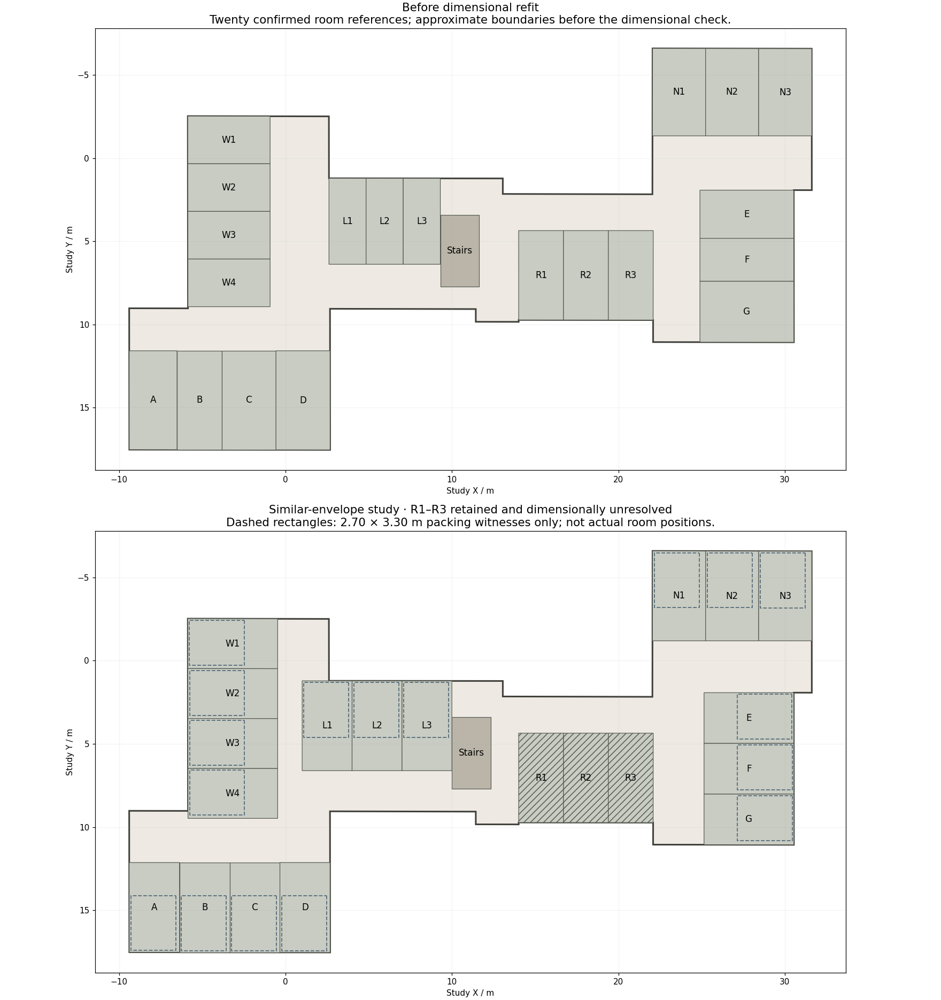

# House 55 · metric audit and similar-envelope refit

Computed 15 November 2026 for **2. OG / index 2**. The resident-confirmed counts remain **A–D: 4, E–G: 3, W: 4, L: 3, R: 3, N: 3 — twenty rooms**. This audit adjusts unmeasured study partitions and tests their dimensions. It does not establish actual apartment outlines or supersede a measured plan.

The resident describes **all top-floor rooms as singles, generally similar in size**, with dimensional variation closer to **“one hand length.”** A repeated single-apartment type with small variations is therefore the working hypothesis. Approximately **0.20 m** is a working interpretation of that description, not a measured hand length or apartment tolerance. A mismatch below questions our inferred boundaries, service zones or use of the reference drawing; it does not establish smaller apartments or a different apartment type in the building.

Seventeen revised candidate envelopes have widths near **3.00–3.19 m** and a fitted common gross depth near **5.40 m**. Each accommodates a **2.70 × 3.30 m rectangle**, allowing a hypothetical 0.10 m inset from its boundary. The retained **R1–R3** polygons remain unresolved and cannot accommodate that rectangle with the same inset. These are reproducible geometric results, not evidence that the witness rectangles are actual living-room positions or that seventeen complete apartment templates have been verified.

## Sources and scale

The exterior comes from the retained, address-matched Bavaria LoD2 model `DEBY_LOD2_3166499`, in [the original source subset](../data/source/dorms-lod2.gml). The study uses the orthonormal plan axes from its registered annotation. No building or exterior vertex is rescaled to make rooms fit.

| Quantity | Metric result | Meaning |
| --- | ---: | --- |
| Whole raw-source model, aligned with flat-roof edge 23→0 | Approximately **49.43 × 24.19 m** | An enclosing box in a building-aligned UTM frame; not a rectangular building |
| Whole web model, in the study's axes | Approximately **49.34 × 24.15 m** | Slightly different orientation and the existing local projection |
| Raw flat-roof polygon 39 | **512.168 m²** | Roof-plan polygon; not measured occupied floor area |
| Annotated flat-roof intersection used for these rooms | **510.616 m²** | Web-coordinate region available to this study |
| Full provisional index-2 exterior section | **637.124 m²** | Before the resident's two roof-wing exclusions |
| Retained floor plate after those exclusions | **561.339 m²** | Includes about 50.72 m² beyond the annotated room region, left unassigned |
| Official height attribute | **9.491 m** | Exterior model height; not a measured three-storey interior section |

Six independently matched GML edges are about **0.134–0.164% shorter in the web frame** than in raw UTM. For example, the R frontage is **8.090303 m raw**, **8.079456 m in the web frame**. The conversion difference is millimetres per bay; it cannot explain a former L bay only 2.23 m wide. Raw and web figures also use explicitly recorded axis conventions and must not be mixed at millimetre precision.

The [dimension evidence review](HOUSE55-DIMENSION-EVIDENCE.md) confirms that the older resident sketch labels an approximately **2.70 × 3.30 m living zone**. Its entrance, bathroom and kitchen extend beyond that rectangle, without a dimensioned overall apartment length. Scaling the full raster by its living zone suggests a depth around 6 m, but that illustration is not uniformly calibrated or dimensioned enough to supply a measured full template for House 55. The operator's **16.4 m² category average** includes allocation rules and is not a clear room or gross apartment measurement.

## Why the former rectangles were inconsistent

The old L run was **6.691933 m / 3 = 2.230644 m per gross bay**. A 2.70 m-wide rectangle cannot fit in such a narrow strip, even before allowing wall thickness. Rotating that rectangle does not help: its minimum projection width at any angle is 2.70 m.

The former unequal hand-stroke divisions also produced B at about **2.689 m** and F at **2.583 m**, while adjacent bays were much wider. These are approximate drawn boundaries, so equalizing them is a reasonable study revision. It does not require changing the confirmed counts.

The R conflict remains in the current envelopes. Their retained frontage has a nominal **2.693 m gross share per room**. The raw source gives **2.697 m** per share. Three exact 2.70 m clear widths would require **8.10 m before partitions or end-wall allowances**. The raw frontage is only about **9.7 mm short in total**: that centimetre-scale difference, against an approximate drawing dimension and LoD2 exterior geometry, cannot prove that the actual apartments fail to fit. LoD2 is not an interior survey, and its numerical coordinate precision does not establish that accuracy.

Partitions also need an unmeasured wall budget. For illustration, two hypothetical 0.10 m separating partitions raise the required run to **8.30 m**, still before end walls. This strengthens the need to measure the R arrangement; it does not validate the illustrative wall thickness or overturn the repeated-single working hypothesis.

## Changes tested

The width refit changes approximate dividers where hallway geometry has spare space:

- **A–D:** equally divide the existing 12.065919 m run; nominal bays are **3.016480 m**. Preserve the exterior outline.
- **E–G:** equally divide the existing 9.139503 m run; nominal bays are **3.046501 m**. Preserve the exterior outline.
- **W1–W4:** use four nominal **3.00 m** bays from study Y = **−2.521703 to 9.478297 m**. Continue the source west-wall line past its elbow without an artificial padding spur.
- **L1–L3:** use **X = 1, 4, 7, 10 m** as nominal dividers. Extend source edge 18→17 as the top alignment. The stair follows the L3 edge, translating approximately **0.697071 m east** from the original study. Its width, run and north/south position remain unchanged; the later depth fit keeps this stair fixed.
- **N1–N3:** retain their approximately **3.188 m** nominal bays and source-facing outline.
- **R1–R3:** preserve the original polygons exactly. The source end alignment remains intact, and the dimensional conflict stays explicit.

The 3.00 m trial bay is near the independently available southwest and east averages; it is not a surveyed module. Equal areas alone could produce noticeably different shapes, so the final fit instead regularizes the **depth of seventeen envelopes**. It leaves R untouched.

The common depth is the arithmetic mean of the seventeen non-R projected gross depths in the width-only study: **D = 5.395477 m**. This minimizes the sum of squared depth changes from those modeling priors. Five corridor-facing boundaries move until their source-clipped group mean depths equal D. Exterior vertices and facade lines are not resized, and room counts stay fixed.

The seventeen resulting gross widths are **3.000–3.193 m** and depths **5.389–5.402 m**: spreads of **0.193 m** and **0.013 m**. This is consistent with the working interpretation of the resident's description. Their polygon areas range from **16.164 to 17.224 m²** because their widths differ slightly. This is a fitted similarity assumption, not a measured full-apartment depth or an equal-area requirement. Partitions, service layouts and doorway positions remain estimates.

| Corridor-facing boundary | Width-only position → fitted position (m) | Movement (m) |
| --- | ---: | ---: |
| A–D top / study Y | 11.577233 → 12.131338 | +0.554105 |
| E–G left / study X | 24.902672 → 25.148459 | +0.245787 |
| W1–W4 right / study X | −0.926329 → −0.471276 | +0.455053 |
| L1–L3 bottom / study Y | 6.380337 → 6.611022 | +0.230685 |
| N1–N3 bottom / study Y | −1.334879 → −1.187706 | +0.147173 |

The source-clipped mean depth of every group independently matches D within **0.00000045 m** of serialization/computation difference. That numerical agreement verifies the fit calculation; it is not a claim of construction accuracy. The stair stays fixed and shares approximately **3.205 m** of boundary with L3. The R polygons match the retained baseline exactly.

### Per-room comparison

Widths and depths below are **projected gross polygon extents**, not clear dimensions. Slight source skew makes an extent differ from a nominal divider interval; the R polygons are tapered. Areas are polygon areas with holes subtracted. Values are rounded to three decimals for review.

| Study label | Width before → after (m) | Fitted depth after (m) | Gross area before → after (m²) | 2.70 × 3.30 packing test |
| --- | ---: | ---: | ---: | --- |
| A | 2.875 → 3.021 | 5.390 | 17.066 → 16.266 | Fits |
| B | 2.689 → 3.016 | 5.394 | 15.987 → 16.264 | Fits |
| C | 3.253 → 3.016 | 5.397 | 19.352 → 16.275 | Fits |
| D | 3.255 → 3.016 | 5.401 | 19.363 → 16.275 | Fits |
| E | 2.895 → 3.047 | 5.393 | 16.320 → 16.426 | Fits |
| F | 2.583 → 3.047 | 5.395 | 14.567 → 16.434 | Fits |
| G | 3.662 → 3.047 | 5.398 | 20.641 → 16.424 | Fits |
| W1 | 2.863 → 3.008 | 5.399 | 14.129 → 16.187 | Fits |
| W2 | 2.863 → 3.005 | 5.397 | 14.145 → 16.180 | Fits |
| W3 | 2.863 → 3.003 | 5.394 | 14.138 → 16.172 | Fits |
| W4 | 2.863 → 3.000 | 5.391 | 14.130 → 16.164 | Fits |
| L1 | 2.231 → 3.000 | 5.398 | 11.521 → 16.190 | Fits |
| L2 | 2.231 → 3.000 | 5.395 | 11.517 → 16.183 | Fits |
| L3 | 2.231 → 3.000 | 5.393 | 11.513 → 16.175 | Fits |
| R1 | 2.696 → 2.696 | 5.369 | 14.462 → 14.462 | Unresolved |
| R2 | 2.697 → 2.697 | 5.371 | 14.468 → 14.468 | Unresolved |
| R3 | 2.700 → 2.700 | 5.373 | 14.475 → 14.475 | Unresolved |
| N1 | 3.193 → 3.193 | 5.402 | 16.754 → 17.224 | Fits |
| N2 | 3.188 → 3.188 | 5.395 | 16.722 → 17.191 | Fits |
| N3 | 3.192 → 3.192 | 5.389 | 16.712 → 17.182 | Fits |

The test subtracts a **hypothetical 0.10 m inset** from each polygon, then searches for the reference rectangle in either building-axis orientation. This inset is a sensitivity assumption, **not measured wall thickness or a building-code requirement**. Every reported fit includes explicit rectangle coordinates that a geometry engine verifies are contained in the inset polygon. These are *packing witnesses*: they prove a rectangle can be placed somewhere. They do not establish a window-facing living zone, services, furniture placement or measured wall thickness.

For all three R rooms the inset polygon's bounding strip is narrower than 2.70 m. This independently rules out every rectangle rotation, so the negative result does not depend on the placement search's sampling density.

## Corners and circulation

The enlarged L1 extends behind the northwest elbow. It retains about **1.39 m of direct north exterior frontage**, rather than a full 3 m face. The separate typical window reference is approximately 1.05 m wide, leaving about **0.34 m before jamb allowances**. This does not mathematically rule out a window, but it makes L1 a corner hypothesis that needs a photograph or measurement. The W4 extension similarly passes the west-wall elbow by about **0.45 m**; its external window face and actual room shape need checking.

The refit leaves one principal connected circulation remainder. Its diagnostic gaps are:

| Location | Gross geometric gap |
| --- | ---: |
| Between W and L | **1.471 m** |
| Between stair and R | **1.673 m** |
| Between R and E | **3.053 m** |
| South of stair, to the source boundary | **1.359 m** |

The principal remainder stays connected after a **0.65 m inward buffer**, equivalent to a 1.30 m circular sweep through this open geometry. Hypothetical midpoint access probes for all twenty rooms and the stair reach that component. A 0.70 m buffer splits it. The stair's south gap is the limiting region. These checks use the drawn open remainder, without verified wall thickness, actual doors, landings or obstructions; they are **not egress or accessibility approval**.

The room-polygon total changes from **307.980 to 322.616 m²**, while the connected-remainder area changes from approximately **192.579 to 177.945 m²**. The stair remains approximately **10.057 m²**. Much of that broad remainder may have an unrecorded purpose; labeling it as a candidate corridor is not evidence that every square metre is circulation.

The independent engine detects approximately **0.00000071 m²** of overlap from coordinate rounding, rather than a material room intersection. Source-boundary disagreement is confined to sub-millimetre numerical slivers: approximately **0.000920 m² total**, maximum offset **0.1303 mm**, within the explicit 0.2 mm comparison bound used by the geometry tests. Four disconnected remainder slivers are each below 0.000002 m². The audit retains and reports them rather than silently claiming exact zero.

## What the current envelopes do and do not establish

A uniform full-apartment template containing an exact 2.70 × 3.30 m living rectangle cannot fit **all twenty current candidate envelopes under the tested 0.10 m inset** while the strict R polygons are retained. This is a conditional result about the model, not an impossibility result about the physical house. Resolving it requires evidence about the R partitions, their corner/service arrangement, or the reference drawing's exact dimensions and applicability. This refit does not extend R3 beyond its accepted alignment merely to make the comparison succeed.

Seventeen living-zone fits do not establish seventeen complete apartment templates. The fitted envelope depth is about **5.40 m gross**. Under the 0.10 m inset sensitivity that leaves about **5.20 m** along its depth axis, or about **1.90 m** beyond a 3.30 m living rectangle in a straight arrangement. The entrance, bath, kitchen, walls and shafts have not been fitted or measured. A longer exact whole-apartment template could still fail these envelopes. The public sketch supplies no reliable measured complete depth with which to settle that question.

The highest-value measurements are **one actual R living-zone clear width and the complete depth of a typical single apartment, including its service section**. Comparing that full depth in W and A–D would test the fitted inner boundaries against the repeated-single hypothesis. L1's actual window/outer wall and the stair's real outline would then constrain the corner and circulation. The twenty confirmed counts remain fixed.

## Reproduce the audit

[The machine-readable audit](data/house55-dimension-audit.json) contains the exact inputs and results. The standalone drawing below distinguishes the comparison polygons from the hypothetical packing rectangles.



[The audit script](../scripts/audit-house55-dimensions.py) reads the official GML, current web geometry and selected study. Its default comparison is the retained [twenty-room sketch baseline](../data/source/house55-2og-sketch-baseline.json), captured from source commit `3eac42c1bbbc908c458f7c18241edef26f41ac95`. All required model inputs are in the repository.

The [retained provenance](../data/source/house55-2og-study-provenance.json) also contains the seventeen width-only input depths and the five fitted boundary positions. The audit independently recomputes their mean, verifies the output group means and checks the unchanged R polygons. It matches the annotated web roof to the raw GML by its exact polygon ID.

The script does not change model or approval records and rejects output paths that would overwrite source data or its inputs. Its Python dependencies are declared for an isolated `uv` environment; they are not website dependencies. Regenerate the published audit artifacts with:

```sh
uv run scripts/audit-house55-dimensions.py \
  --output docs/data/house55-dimension-audit.json \
  --plot docs/preview/house55-dimension-audit.png
```

Without those output flags, the script writes its JSON report to `/tmp/house55-dimension-audit.json`. `--study` also accepts a generator review JSON, and `--baseline` accepts an alternate comparison file. The report includes input hashes, exact source-edge comparisons, every room's polygon metrics, packing-witness coordinates, negative bounding-width proofs and circulation diagnostics. Future geometry changes should regenerate the report and this dated table.
