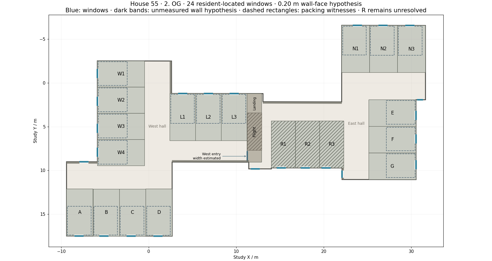

# House 55 · windows and wall-face feasibility

Updated 15 November 2026 for **2. OG / index 2**. The resident-confirmed **20 rooms** and hallway relationships remain fixed. The latest build adds **24 exterior windows** and tests a **0.20 m inward wall-face offset**. Window locations are resident-informed; the offset, wall construction and room dimensions remain unmeasured.



## What changed

The [green-marked drawing](../data/source/house55-2og-window-marks.png) identifies 17 room windows and four shared-area windows. The resident separately confirmed **one north-facing window for each of L1–L3**, bringing the inventory to **20 room windows + 4 shared windows = 24**. The marks in empty plotting space are ignored. The green door in the *earlier* drawing remains a door; the new green marks are windows.

Window centers are projected from the annotated orthographic diagram onto their existing source façade. The L windows are centered in the estimated bays because their count and side were confirmed verbally. Exact centers and dimensions remain approximate. Most openings use the earlier typical-sketch width of **1.05 m**; the two short return walls use explicit **0.85 m and 0.70 m** estimates so whole openings fit without crossing a corner. Their real widths need checking. The four shared windows are not assigned to a room, stairwell or access route.

The exterior and unfolded plan use the same 24 placement records. These replace the former repeated top-floor window pattern for House 55. Other houses and the lower exterior rows retain their existing appearance studies. Windows keep their sills and do not create door targets. Typical sill/height and appearance-only row guides are still not measured floor elevations.

The [wall-offset drawing](../data/source/house55-2og-wall-offsets.png) proposes using interior wall faces instead of forcing every divider to align with an outside corner. The implementation tests one explicit, reversible **0.20 m hypothesis**:

- **L1–L3 move left by 0.20 m**, preserving their three roughly **2.94 m gross bays** and fitted depth. L1's west divider now aligns with the inner face of the hypothetical west-return wall band.
- **The stairwell gains that 0.20 m on its west side**, staying flush to L3. Its east edge and schematic flight length remain in place. Its gross width changes from about **1.47 m to 1.67 m**.
- **R's east end extends 0.20 m toward the east hallway**, distributed across its three bays. R's gross width becomes about **2.76 m per bay**. Its right divider aligns with the proposed inner face of the east-return band. The exterior window wall stays in its original position and retains its original length.
- The three red return edges and two blue recess edges receive **possible wall bands**, with gaps at the marked windows. The blue edges adjoin excluded roof/void areas; the source does not establish their full-height wall construction.

The 0.20 m value is a sensitivity case, **not a measurement read from the strokes, a conversion of “one hand length,” or a value optimized to make R fit**. Counts and general relationships have much stronger evidence than these offsets. Fourteen rooms outside L/R are byte-for-byte unchanged against the preceding layout. Both lower-floor study objects and every official exterior vertex remain unchanged.

## What “overlap” can mean

An exterior roof edge, the outside face of a wall and its inside face need not share one plan line. A room divider can therefore appear to continue past an exterior corner while the clear hallway still feels straight. This is a plausible interpretation of the resident's drawing.

It does **not** permit two independent room interiors to occupy the same floor area. The current room, stair and hall polygons remain disjoint; possible wall material is drawn separately within their **gross** envelopes. A thicker wall itself consumes space. Any increased R envelope in this candidate comes from reallocating part of the estimated east hallway, not adding floor area or expanding the house.

LoD2 supplies exterior faces, not paired inside/outside wall faces or wall assemblies. Its additional stepped section margins occur at other roof ends; they do not prove extra width along R's existing south façade. The new bands illustrate a hypothesis and should not be read as surveyed masonry.

## What still does not fit

The existing R façade is approximately **8.079 m** in the study frame (**8.090 m** in the retained raw UTM model). The new candidate's gross R span is approximately **8.279 m**, because its east end uses 0.20 m of the estimated hall. Its south-facing windows still sit on the unchanged façade.

The public [older-room sketch](https://rommelwood.de/media/images/zimmerskizze.jpg), linked from [Rommelwood's layout page](https://rommelwood.de/wohnen/zimmergrundriss/), gives an approximate **2.70 × 3.30 m living zone**. It does not dimension the complete apartment, bathroom, kitchen or entrance. The operator's **16.4 m² category average** is also not a gross apartment rectangle.

For the same sensitivity test used previously, inset each gross room envelope by **0.10 m on every side**. This is a hypothetical wall allowance, not measured construction. Three 2.70 m clear widths then need at least:

**3 × (2.70 + 2 × 0.10) = 8.70 m of gross model width.**

That is approximately **0.62 m beyond the original R span**, or **another 0.42 m beyond the current 0.20 m candidate extension**. This is a necessary bounding-width condition, not a sufficient full-apartment design. The current R inset envelopes remain narrower than 2.70 m, so rotating the rectangle cannot fix the test. Their exact real widths, corner arrangement and applicability of the typical sketch remain open questions. The model does not prove that the physical apartments are impossible or a different type.

At the west connector, the current **W4 south divider extends about 0.45 m past the exterior return**. A 0.20 m inward band leaves about **0.25 m** of that difference. A roughly 0.45 m assembly could align those two particular lines, but no such thickness has been measured. W4 has not been resized to conceal this discrepancy.

## Current room dimensions

Comparison: [the layout immediately before the window/wall-face stage](../data/source/house55-2og-wall-offset-baseline.json), commit `7bbf21d`. Values are **projected gross extents before walls**, not measured living dimensions. Small source skew makes these extents differ slightly from a nominal bay interval. Areas subtract holes.

| Reference | Gross width before → after (m) | Gross depth after (m) | Gross area after (m²) | Living-zone test |
| --- | ---: | ---: | ---: | --- |
| A | 3.021 → 3.021 | 5.390 | 16.266 | Fits |
| B | 3.016 → 3.016 | 5.394 | 16.264 | Fits |
| C | 3.016 → 3.016 | 5.397 | 16.275 | Fits |
| D | 3.016 → 3.016 | 5.401 | 16.275 | Fits |
| E | 3.047 → 3.047 | 5.393 | 16.426 | Fits |
| F | 3.047 → 3.047 | 5.395 | 16.434 | Fits |
| G | 3.047 → 3.047 | 5.398 | 16.424 | Fits |
| W1 | 3.008 → 3.008 | 5.399 | 16.187 | Fits |
| W2 | 3.005 → 3.005 | 5.397 | 16.180 | Fits |
| W3 | 3.003 → 3.003 | 5.394 | 16.172 | Fits |
| W4 | 3.000 → 3.000 | 5.391 | 16.164 | Fits |
| L1 | 2.941 → 2.941 | 5.398 | 15.868 | Fits |
| L2 | 2.941 → 2.941 | 5.394 | 15.860 | Fits |
| L3 | 2.941 → 2.941 | 5.392 | 15.852 | Fits |
| R1 | 2.696 → 2.762 | 5.369 | 14.820 | Unresolved |
| R2 | 2.697 → 2.764 | 5.371 | 14.827 | Unresolved |
| R3 | 2.700 → 2.766 | 5.374 | 14.833 | Unresolved |
| N1 | 3.193 → 3.193 | 5.402 | 17.224 | Fits |
| N2 | 3.188 → 3.188 | 5.395 | 17.191 | Fits |
| N3 | 3.192 → 3.192 | 5.389 | 17.182 | Fits |

**17 rectangles fit; R1–R3 remain unresolved** under the declared inset. Dashed rectangles in the diagram are mathematical packing witnesses, not actual room layouts or window-facing living areas. The audit records their exact coordinates and verifies containment. No bath, kitchen, furniture or service section has been invented to fill the remainder.

The approximately **5.40 m gross depth** comes from the earlier least-squares fit to seventeen prior model envelopes, not a measurement. The original input vector is preserved and independently recomputed. Later source-edge and wall-face changes to L are reported separately; the historical depth is not silently recalibrated.

## Connectivity and numerical checks

There are **23 spaces and 21 door targets**: twenty rooms, a stairwell, two halls, twenty estimated room doors and the resident-marked west stairwell entry. The entry's **1.10 m displayed width** remains illustrative. Windows do not add connections.

- West hall connects to A–D, W1–W4, L1–L3 and the stairwell through their recorded entries.
- East hall connects to E–G, R1–R3 and N1–N3. Its connection into the stairwell remains unconfirmed.

The candidate stairwell is approximately **1.670 m gross wide**. Its separate flight retains about **4.305 m** of schematic run, with clear drawing regions above and below for landings. No clear stair width, number of risers or verified route between the halls is established.

| Diagnostic | Current result |
| --- | ---: |
| Gross separation between W and L | 2.882 m |
| Gross separation between stairwell and R | 1.105 m |
| Gross separation between R and E | 2.853 m |
| Room/stair/hall numerical overlap | 0.000000099 m² |
| Maximum exterior containment residual | 0.075 mm |
| Area outside annotated source region from rounding | 0.000440 m² |

The existing numerical containment limits remain **0.2 mm / 0.001 m²**; they express computational consistency, not construction accuracy. Shared serialized corners are retained to avoid sub-micrometre slivers. The schematic flight has a 0.000002 m computational inset, not an architectural clearance. Twenty room-approach probes and the marked stairwell approach pass within their own halls; this does not establish inter-hall connectivity or real clear circulation widths.

## Source scale and reproduction

The retained building is Bavaria LoD2 **`DEBY_LOD2_3166499`**. Its whole aligned raw-source extent is about **49.43 × 24.19 m**, versus **49.34 × 24.15 m** in the web study axes. These are enclosing extents, not a rectangular floor. The official height is **9.491 m**. The retained provisional top-floor plate is **561.339 m²** after the two resident-marked exclusions; the annotated room region is **510.616 m²**, leaving about **50.72 m²** of source-section margins unassigned.

The small raw/web conversion difference cannot supply a missing structural bay. See [the independent scale audit](HOUSE55-SCALE-AUDIT.md) and [dimension-source review](HOUSE55-DIMENSION-EVIDENCE.md). The original [hand-stroke baseline](../data/source/house55-2og-sketch-baseline.json), [dimensional baseline](../data/source/house55-2og-dimension-baseline.json) and newer [wall-offset baseline](../data/source/house55-2og-wall-offset-baseline.json) record different historical stages; none is a measured plan.

[Provenance](../data/source/house55-2og-study-provenance.json) retains the annotations, hashes, earlier derivation and current `windowWallStudy` stage. [The machine-readable audit](data/house55-dimension-audit.json) includes each current polygon, window, conditional width bound and door-graph result. Reproduce with:

```sh
node scripts/generate-house55-study.mjs /tmp/house55-study.json --write-study --write-provenance
uv run scripts/audit-house55-dimensions.py \
  --output docs/data/house55-dimension-audit.json \
  --plot docs/preview/house55-dimension-audit.png \
  --plan-plot docs/preview/house55-window-wall-study.png
```

These commands regenerate repository study artifacts; they do not change official geometry, approve an interior or publish a deployment. Current browser/build checks belong in [RELEASE-CHECKS.md](RELEASE-CHECKS.md).

The most useful next measurements are **the west-return wall assembly**, **one R living-zone clear width**, and **the R-to-east-hall corner relationship**. Those can distinguish this wall-face hypothesis from a different partition or service layout without changing the confirmed count.
