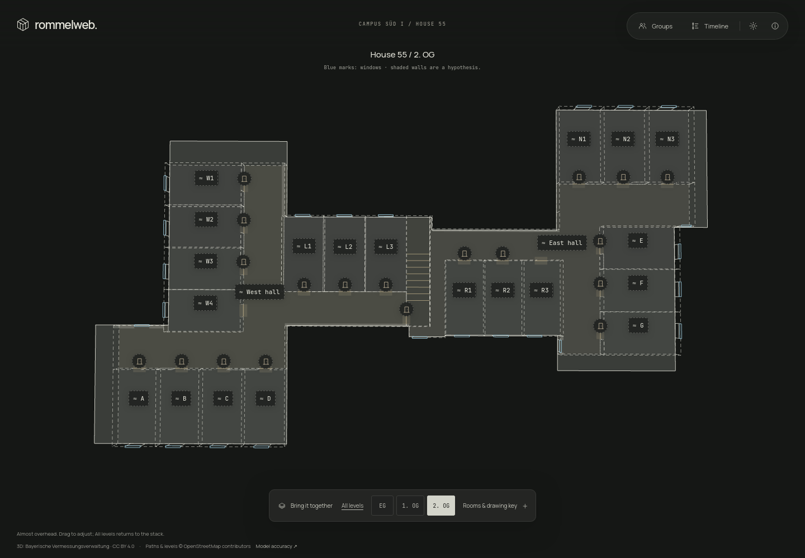

# Red House 55 · windows, wall-face study and earlier lower floors

Reviewed 15 November 2026. The user selected **older Red House 55, Campus Süd I, 2. Obergeschoss** as the first interior study. This corresponds to above-ground index **2** in the current schema. Their annotated model screenshot supplies a proposed arrangement and identifies missing roof areas and a central stair. They subsequently corrected the stair and R1–R3 alignment and requested extrapolation to **1. OG and EG (indexes 1 and 0)**. These are resident observations and explicitly requested layout assumptions, not a dimensioned floor survey.

The implementation stores all three study floors in `public/data/interior-studies.json`, separate from approved `public/data/interiors.json`, which remains empty. The official exterior is unchanged. The resident has confirmed **20 rooms on 2. OG**, across all six hallway runs. A dimensional fit and subsequent hallway correction revise their approximate envelopes; **all twenty top-floor room layouts remain estimated**, even where the original sketch supplied a count and divider strokes. The latest stage adds 24 resident-located windows and tests a 0.20 m wall-face offset: L moves left, the stairwell gains width, and R extends toward the east hall. The observed west stairwell entry is retained. The east hall's connection remains unknown. **EG and 1. OG retain the earlier twenty-room sketch extrapolation**, with additional wings unassigned. No physical room number, resident, measured door geometry, opening swing or surveyed interior wall has been established.

The resident describes the twenty rooms as broadly similar singles, with variation of “one hand length.” A roughly **0.20 m** variation was a working interpretation, not a measured tolerance; the latest non-R gross-width spread is about **0.252 m**. The [dimension refit](HOUSE55-DIMENSION-REFIT.md), [source-dimension evidence](HOUSE55-DIMENSION-EVIDENCE.md) and [independent scale audit](HOUSE55-SCALE-AUDIT.md) distinguish this study from proof of full apartment dimensions. The R run remains unresolved, and no building-scale change is used to disguise that constraint.



[1. OG extrapolation](preview/house55-first-floor.png) · [EG extrapolation](preview/house55-ground-floor.png) · [Daylight view](preview/house55-day-floor.png) · [Phone view](preview/house55-phone-floor.png)

## What the annotation shows

Locations here refer to the supplied screenshot, not compass directions inferred from its appearance.

- **Bottom-left run:** four bays are divided by red strokes.
- **Right-hand run:** three bays are divided by red strokes. Marks on the lower visible façade are not counted as additional second-floor partitions.
- **Original question-mark regions:** the left vertical run, center-left box, center-right box and upper-right run initially required count estimates. The resident has since confirmed their counts; divider positions remain estimated.
- **Green crosses:** the two marked regions are reported absent from this floor. They must not be filled with inferred rooms.
- **Blue central feature:** stairs are indicated, but tread/riser dimensions, landings, connections and clearances remain unmeasured.

The subsequent [hallway annotation](../data/source/house55-2og-left-correction.png) shifts the left block toward the stairwell and marks a narrower stair enclosure with a long northern wall. The resident clarified that its **green “Door” mark leads from the hallway into the stairwell**. Their half-room-width description is used as an approximate proportion, not a measured width. The red **“Thick wall?”** annotation did not establish thickness. The later [wall-offset drawing](../data/source/house55-2og-wall-offsets.png) motivates the current 0.20 m sensitivity case, which still does not establish construction type or measured thickness. The [new green marks](../data/source/house55-2og-window-marks.png) identify windows; the resident separately confirmed one north-facing window per L room.

These corrections establish counts and spatial relationships, not room identities, physical numbers, tenancy or precise apartment/partition boundaries.

## Earlier accepted revisions and their history

The resident's follow-ups establish the following revisions:

- **Stair against the left block:** the earlier alignment moved it approximately **0.447 m** to the then-labeled L2 wall, preserving width, run and orientation and producing about **2.98 m of shared boundary**. Dividing that block into three made the adjoining room **L3**. This is the frozen lower-floor baseline. The subsequent width fit shifted the top stair about **0.70 m plan-right**; the following hallway correction replaced that stair rectangle with a narrower enclosure and a separate flight. L3 adjacency is retained. These dimensions describe model revisions, not a survey.
- **R1–R3 toward the stair:** shift the block approximately **0.20 m** and align its rear wall and end edges with the source-plan boundary. The generator uses `RoofSurface` 39 vertices **6–7** and adjacent edges **5–6** and **7–8** to avoid small geometric protrusions. The resident has confirmed three rooms here; clear widths and internal wall locations remain unmeasured.
- **Twenty upstairs rooms:** after double-checking, the resident confirmed the existing counts in every hallway except the left block, which has **three rooms rather than two**. The first count correction divided the unchanged L outline into three; the later dimensional fit expands that inferred block. The current six counts remain **4 + 3 + 4 + 3 + 3 + 3 = 20**.
- **Earlier left hallway and stair enclosure:** the preceding markup aligned L's west edge with a source-plan elbow and its east edge with a southern source corner. Three equal estimated bays occupy that span. The stairwell beside L3 uses approximately half a bay's width and extends north to the source wall. Its green-marked west-side entry serves the west hall; the east hall's route into the stairwell remains unestablished.
- **Repeat the corrected shared arrangement below:** the user requested extrapolation to EG and 1. OG before the dimensional refit. These floors retain that earlier arrangement as an assumption; no independently observed lower-floor drawing or dimensions were supplied. The new top-floor candidate is not copied down automatically.

The original annotated screenshot remains archived unchanged. The [frozen earlier sketch](../data/source/house55-2og-sketch-baseline.json) records the twenty-room arrangement used below. A separate [dimension-fit baseline](../data/source/house55-2og-dimension-baseline.json), retained from commit `31e360f`, records the top floor before the earlier hallway correction. The newer [wall-offset baseline](../data/source/house55-2og-wall-offset-baseline.json), from commit `7bbf21d`, preserves the state before windows and the current wall-face study; fourteen non-L/R room polygons remain unchanged against it. [Provenance](../data/source/house55-2og-study-provenance.json) records each later change.

## Evidence and registration

| Evidence | Useful information | Limit |
| --- | --- | --- |
| [Original resident annotation](../data/source/house55-2og-resident-markup.png) | House 55, second upper floor, red divisions/unknown zones, blue stair and green exclusions | Hand strokes on a perspective model view; no scale, wall thickness, measured door locations or current room labels |
| Subsequent resident corrections, recorded in [study provenance](../data/source/house55-2og-study-provenance.json) | Stair against the left block, R1–R3 alignment, confirmed six hallway counts totaling 20 upstairs, requested repetition below | Count confirmation and alignment observations do not survey partition/door positions. Lower-floor repetition remains assumed |
| [Earlier hallway annotation](../data/source/house55-2og-left-correction.png) and resident clarification | Shifted L block, narrower stairwell with a northern enclosure wall, green west-hall entry into the stairwell | Half-room-width description is approximate; entry width/endpoints, landing dimensions and east-hall connection remain unknown. “Thick wall?” is a question |
| [Top-floor dimension-fit baseline](../data/source/house55-2og-dimension-baseline.json) | Historical candidate before the earlier L/stair correction | A model checkpoint, not independent evidence or the lower-floor source |
| [Official LoD2 exterior](GEOMETRY.md) | Existing metric coordinates provide reference points for registering the screenshot | Exterior/roof geometry does not supply internal partitions or occupied floor boundaries |
| [Older single-room sketch](https://rommelwood.de/media/images/zimmerskizze.jpg), from [Rommelwood's room-layout page](https://rommelwood.de/wohnen/zimmergrundriss/) | Approximately **2.70 × 3.30 m clear living zone**, with kitchen, bathroom and entrance outside that rectangle; approximately 2.50 m clear ceiling | Unassigned typical room, with variation/mirroring cautions. The 2.70 m width is not a measured structural bay pitch; clear ceiling height is not floor-to-floor height |
| [Current Süd I rental-category chart](https://werkswelt.de/data/uploads/wohnen/mietpreislisten/2026/erlangen/760-campus-sued-i-2026.pdf) | Single-apartment category average of **16.4 m²** | Category averages include the chart's allocation rules. Do not divide a floor area by 16.4 to obtain a room count or construct a rectangle from it |
| [Retained public-map aggregate](../public/data/room-markers.json), sourced from [Rommelwood's map](https://rommelwood.de/map/) | House 55 has **20 markers at source floor 2**, with 24 at floors 0 and 1 | Marker counts are not a verified current floor plan or occupancy count. Their coordinates were previously found unsuitable for precise interior placement |
| [Frozen earlier twenty-room sketch](../data/source/house55-2og-sketch-baseline.json) | Exact study version used to reproduce EG and 1. OG | An earlier unmeasured interpretation, not evidence that the current top-floor fit repeats below |

The original perspective screenshot's registration fits **17 manually observed corners on the same horizontal source-roof plane**, with an approximately **1.09 px RMS fitting residual** and **1.77 px maximum residual**, expressed in that archived image's pixels. The retained provenance records conversion from the manual digitization canvas to the original image. Four ridge controls from the earlier fit were excluded because they are not on the same plane. This measures fit consistency, **not partition accuracy**: hand-stroke placement, roof-versus-interior setbacks, wall thickness and the source model's own limits remain unresolved. The earlier hallway markup used source corners as provisional anchors. The newer window plot has independent affine X/Y scale-and-offset registration, snapping marked centers to the unchanged source walls. The L-window count and side were confirmed verbally; their centers remain estimated. None of these operations measures clear internal widths.

The source roof plane is used only for horizontal registration. All three study floors retain the existing provisional guides: approximately **0, 3.164 and 6.327 m above the source building base**. No surveyed floor elevation follows from the fitted roof plane or the repeated layout. [Retained provenance](../data/source/house55-2og-study-provenance.json) records the observed controls, transform, source references and interpretation choices.

## Resident-confirmed upstairs counts

The resident's latest check was: “I double checked. We have the correct count for all the hallways except for L1, L2. There should also be a third dorm there L3.”

| Hallway run / drawing labels | Confirmed 2. OG room count | Current partition-position evidence |
| --- | ---: | --- |
| Southwest / A–D | 4 | Evenly spaced estimated dividers replace unequal hand-stroke positions |
| East / E–G | 3 | Evenly spaced estimated dividers replace unequal hand-stroke positions |
| West / W1–W4 | 4 | Estimated 3.00 m gross bays extend into former corridor space |
| Left / L1–L3 | 3 | Estimated 2.94 m gross bays between source-plan corners; stairwell remains beside L3 |
| Right / R1–R3 | 3 | Estimated dividers within the corrected outer alignment |
| North / N1–N3 | 3 | Earlier estimated dividers retained; corridor boundary refitted to the common depth |
| **Total** | **20** | **Counts confirmed by the resident; geometry remains a study** |

The original study had 19 candidates because it inferred only two left-block rooms. Its alternative two-room interpretation of the R block is also superseded by the resident's confirmation. Those earlier alternatives describe the research history, not the current count.

The confirmed upstairs total now agrees with the public map's **20 floor-2 markers**. This resolves the count comparison, not the map-coordinate or room-number evidence. The map also reports **24 markers on each lower floor**. EG and 1. OG retain 20 shared-layout references from the earlier sketch as assumptions and leave extra wings unassigned; their full counts and additional spaces remain unverified.

The earlier inference assumed repeated rooms could be compared with one typical **2.70 m clear living-zone width**. That unassigned typology cannot override the resident's count or establish every room's width. The left and right runs need measured partition positions and room dimensions. Keep the boundary convention explicit when checking a measured run:

```text
run length ≈ n × clear room width
             + (n − 1) × partition thickness
             + end-wall/setback allowances
```

All terms must use the same boundary convention; the equation is not a reason to change a resident-confirmed count. The current 3.25 m façade-window pitch is an illustrative rendering parameter and supplies no independent interior measurement.

## Current top-floor window and wall-face study

The current stage affects **index 2 only**. It adds **24 resident-located windows**: one for each of twenty room references plus four unassigned shared-area windows. Exact centers and widths remain estimated. Three L windows follow an explicit verbal confirmation; the other placements follow green marks. The window inventory replaces the generic top-row repetition in House 55's exterior and appears as blue sill/window symbols in its floor cutaway. No window becomes a door or a resident assignment.

The wall-face hypothesis uses a **0.20 m offset** independent of the resident's qualitative hand-length description. L1–L3 move from X ≈ **2.611–11.433 m** to **2.411–11.233 m** in the study frame. Their roughly **2.941 m gross bays** and fitted south boundary remain. The stairwell stays against L3, gaining 0.20 m to about **1.670 m gross width**. Its schematic run remains about **4.305 m**, with landing regions distinct from the flight.

R's east end gains **0.20 m** inside the existing estimated hallway, divided across its three rooms. The candidate bays become approximately **2.76 m gross**; the original exterior window wall remains approximately **8.08 m**. Fourteen other room polygons and both lower-floor objects are unchanged. No source vertex, house scale or floor elevation changes.

Five resident-marked returns/recesses receive estimated finite-width bands. These are possible wall material inside gross envelopes, not additional usable area or overlapping room interiors. The blue recess marks do not prove a full-height structural wall. A 0.20 m band still leaves about **0.25 m** of W4's return discrepancy; complete alignment would require about **0.45 m** there. That thickness is unmeasured.

Seventeen approximate **2.70 × 3.30 m living rectangles** fit under a hypothetical **0.10 m inset**; R1–R3 remain unresolved. The current trial does not supply the roughly **0.42 m additional gross R run** required by that necessary width bound. This does not disprove similar real single-room types or validate exact dimensions from the public typical sketch. The fitted gross depth near 5.40 m remains a historical model prior. See [the current numerical audit and annotated plan](HOUSE55-DIMENSION-REFIT.md).

## Implemented display and its limits

The **2. OG** study uses the existing provisional second-floor envelope section and subtracts the complete plan projections of the two sloping roof wings marked green. This changes only that displayed study plate; every retained LoD2 source vertex remains unchanged. The bays and halls are limited to the annotated flat-roof plan. Stepped edge regions outside that annotation remain unassigned.

The **EG and 1. OG** studies retain their complete original exterior-section outlines, including lower wings beneath the two green-marked upper roof areas. They do not inherit the upper exclusions. Their geometry remains the earlier room/stair/corridor extrapolation, reproduced from `data/source/house55-2og-sketch-baseline.json`; **none of the new top-floor dimensional changes is inherited**. The additional areas have no assigned room, route or use. The generator retains the baseline's interior dividers and opening coordinates while clipping outer space edges to each floor's own source outline. This handles small source-coordinate differences without moving official vertices. Every lower-floor space and opening is `estimated`. `extrapolatedFrom: 2` identifies the originating floor; the source notes and frozen baseline identify the version. Floor-specific IDs prevent interactions from being attached to a different level.

The top floor now has **23 study spaces: twenty rooms, one stairwell and two halls**. The enclosure separates the **west hall** from the **east hall**. Only the west hall has a resident-located stairwell entry; the east hall's connection remains unknown. No second stair door or connecting route is invented. The lower floors retain their earlier corridor and stair arrangement.

Optional `space.stairFlight` stores a closed convex quadrilateral inside the study stairwell. The renderer draws symbolic treads only within that flight, leaving the landing regions clear. The field adds no approved-plan schema or measured tread, riser, landing, headroom or inter-floor connection data. The staircase geometry above and below remains different and unverified.

The **21 door targets** comprise twenty illustrative **0.90 m room openings** and the green-marked entry into the stairwell, rendered at an estimated **1.10 m** on its west side below the flight. The resident establishes that entry's relationship and approximate location; its exact endpoints and width remain estimated, as do all room-door positions. No hinge, swing, fire-door status or safe egress route is inferred. The later finite wall bands are explicitly estimated and do not change door connectivity.

Study `windows` records contain a source wall index, two plan endpoints, evidence notes and an optional room-space ID. `windowCoverage: "complete-floor"` replaces that floor's generic exterior pattern. Source-wall containment and same-floor room attachment are validated. Shared windows omit room ownership. `wallBands` contain only explicitly estimated geometry and notes, and cannot enter the independent room/stair/hall area calculation. Neither field accepts resident information or floor-height anchors.

The renderer uses a low 1.05 m display cutaway, which is not a measured wall or ceiling height. On 2. OG, all twenty room envelopes carry `estimated` confidence; any retained solid sketch boundary denotes that individual source line, not a surveyed room. Lower floors have no inherited `sketchBoundaries`. Their UI says “Extrapolated study · see source notes” so it does not imply that the latest top-floor fit repeats below. Selection shows the evidence note and a correction action; there is no resident-card placeholder for study cells. All labels and IDs are temporary study references, not physical room numbers.

The map uses compact labels **A–G**, **W1–W4**, **L1–L3**, **R1–R3**, and **N1–N3**. Upstairs they represent the 20 resident-confirmed rooms through estimated geometry; on lower floors they identify assumed repetitions of the earlier sketch. They are drawing references only. Room markers and small door buttons open the full label and evidence. Study-room cards also compute approximate spans along the building axes and polygon area minus holes, explicitly labeled **“Study envelope · before walls”** and **“Not measured living area.”** These measurements are taken from the current selected polygon, not a fixed target apartment size. Colliding markers hide until there is room to display them, while “Rooms & drawing key” retains a keyboard-accessible list of every space. The near-overhead camera aligns the long building axis horizontally on desktop and vertically on portrait phones without changing geometry.

`getDisplayLevel` prefers an approved floor if one is added later. Study records cannot create approval or floor-height anchors. Approving a future plan requires its own measurements, source/reuse review and independent layout check.

To reproduce the registration and derived study for review:

```sh
node scripts/generate-house55-study.mjs /tmp/house55-study-geometry.json
```

By default the generator writes a review JSON and SVG outside the repository. The JSON's `level` is the current 2. OG hallway study; `levels` contains EG, 1. OG and 2. OG, with registration, corrections and lower-floor assumptions retained in `metadata`. Top-floor reproduction preserves the earlier dimensional and hallway stages, checks the frozen `7bbf21d` baseline, then applies `scripts/house55-window-wall-study.mjs`. The current stage is recorded separately under `metadata.windowWallStudy`. Lower-floor reproduction reads its separate frozen sketch baseline, rather than copying the latest `level`. Baseline paths, digests and source commits are recorded in provenance. After review, `--write-study` updates House 55's study records, and `--write-provenance` refreshes the archived metadata. Neither option changes approved interiors or deploys the website. Computational checks are separate from release QA and do not validate the real-world layout. Current release verification belongs in [RELEASE-CHECKS.md](RELEASE-CHECKS.md).

## Smallest useful resident checks

1. Measure the west-return wall thickness, actual partition positions and clear widths in **L1–L3 and R1–R3**. Their counts are confirmed; equal spacing and typical-room dimensions remain assumptions.
2. Locate and measure each real door opening, recording its room reference and whether it serves a shared/service space. Supply physical room numbers only when confirmed.
3. Measure clear widths and distances across several consecutive partitions or door centers, recording the exact endpoints and wall-thickness convention.
4. Check the east hall's actual stairwell connection, then measure the enclosure, flight, landings and green-marked entry. Identify the floor elevation, corridor widths and occupied boundary beside both upper exclusions before approving geometry.
5. Check EG and 1. OG separately before applying any top-floor refit there: confirm which walls repeat, identify the additional wings and any shared/service spaces, and record their actual counts, doors and circulation. Upstairs count confirmation does not verify the lower floors.

The green mark locates one stairwell entry approximately; precise door geometry, other actual door positions, hinge sides and swings still need observation. Physical room numbers remain absent during this study. No resident names, tenancy, contact details or occupancy records are needed. Follow [INTERIOR-FORMAT.md](INTERIOR-FORMAT.md) when approved geometry is ready, and preserve wall-thickness gaps rather than snapping clear-room outlines into a shared partition.

## Publication and interpretation

The resident annotations, confirmed upstairs counts, accepted hallway relationships and estimated dimensions are implemented as clearly labeled studies; they must not silently populate the approved floor-plan dataset. Partition and door geometry remain unmeasured. Lower floors retain an assumed earlier sketch. The former upstairs 19/20 discrepancy and alternative R count are superseded, while the R width/type fit, east-hall stairwell connection, lower-floor completeness and all actual room-number assignments remain unresolved. A study cell is not an official room number or evidence of a resident, and an unassigned lower wing must not be presented as empty or occupied.

External room drawings and photographs are linked, not bundled or traced as an exact House 55 plan. See [INTERIOR-PLAN-EVIDENCE.md](INTERIOR-PLAN-EVIDENCE.md) for the earlier search and [ROOM-TYPOLOGY-RESEARCH.md](ROOM-TYPOLOGY-RESEARCH.md) for the distinction between living-zone dimensions and category-average areas.
