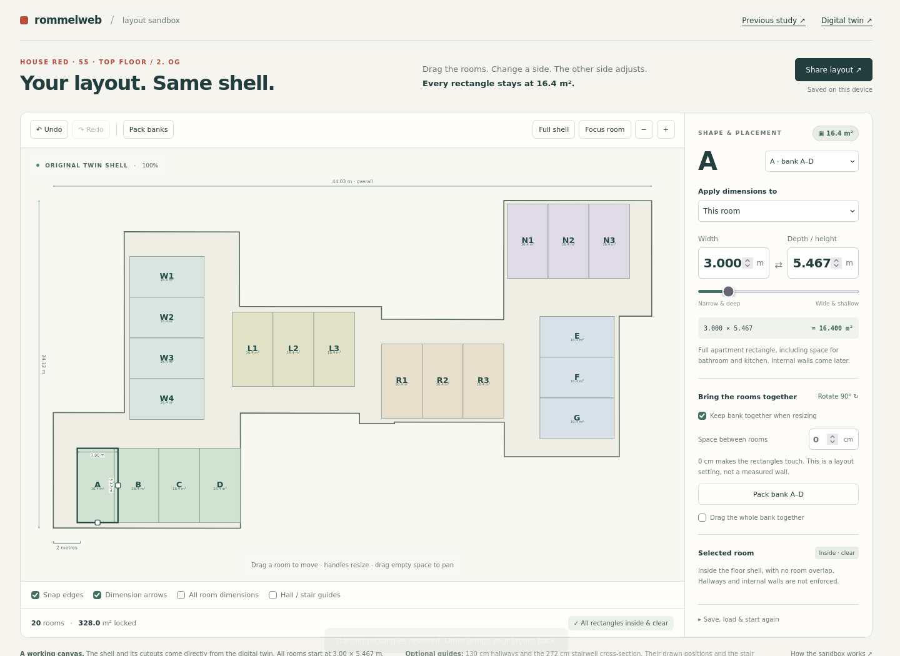

# House Red: the layout sandbox

**[Open the interactive sandbox](https://mteyra.github.io/rommelweb/house55-layout/)**

This is a hands-on canvas for arranging twenty apartment rectangles inside the House Red top-floor shell. The resident controls the dimensions and placement. Every rectangle has exactly **16.4 m²** of area; a change to width immediately sets depth to `16.4 / width`, and vice versa.



## Use it

1. Select a room on the plan or in the dropdown.
2. Set **Apply dimensions to** to this room, its bank, or all twenty rooms.
3. Type either side, move the width slider, or drag one of the selected room's two resize handles. Dimension arrows follow the rectangle.
4. Leave **Keep bank together when resizing** on to repack that row after a change. **Pack this bank** and **Pack banks** bring the rectangles together with the chosen spacing. A gap of zero means they touch; no wall thickness is assumed.
5. Drag a room to position it. Turn on **Drag the whole bank together**, or hold Shift, to move the row. Edge snapping is optional; hold Alt while dragging to bypass it.
6. Use **Focus room**, zoom buttons, or the mouse wheel to inspect an area. Drag empty space to pan. The room and resize handles also support arrow keys; Shift increases the step from 1 cm to 10 cm.
7. Use **Share layout** to make a link containing this exact version. Send that link back in the conversation to discuss it. **Download layout** and **Load layout** preserve full-precision coordinates in a JSON file.

Undo and redo include resizing, packing, dragging, rotation, importing and resetting. Changes also save in this browser. A shared link is a snapshot: later edits do not change a previously copied link.

## What is fixed

- The active digital twin's House 55, level-index 2 floor outline, including both existing cutouts. These cutouts are already part of the concave outside boundary.
- Twenty established room labels: A–D, W1–W4, L1–L3, E–G, R1–R3 and N1–N3.
- Exactly **16.4 m² per apartment rectangle**, totalling **328 m²**. This is the resident's requested experiment, not a claim that every real room has the same area.

The shell is exported from the same `floorOutline` used by the campus floor-plate renderer. The exporter preserves every vertex in the existing common metre coordinate frame. It does not simplify, straighten, stretch or rebuild the shell around the rectangles.

All starting rectangles are **3.00 × (16.4 / 3.00) m**. Their centres and orientations come from the established room banks, followed by simple row packing. This starting arrangement is not a fitted result.

## What remains free

Width and depth can range from **1.64 to 10 metres**, with their product fixed at 16.4. The app retains full precision; displayed dimensions are rounded. Rooms can move and rotate in 90° steps.

Packing closes gaps within each bank along its established row axis. It does not solve the whole building or automatically invent corridors. Overlap and shell-crossing are allowed while editing and highlighted in orange. Containment checks use the complete concave polygon, rather than only checking the four room corners. Positive-area room overlaps count as conflicts; touching edges do not.

The optional hallway and stair guides show **1.30 m hallway widths** and **2.72 = 1.43 + 1.29 m** across the stairwell. These widths are measured. Their depicted positions and the stairwell length come from the previous candidate. Guides are off initially and do not block room placement. Bathroom/kitchen partitions, wall thicknesses, doors, heights and roof clearance are outside this rectangle experiment.

The former guessed percentage alignment supplies no constraint to this editor.

## Files and reproduction

- [Shell exporter](../scripts/export-house55-layout-shell.py)
- [Published shell and provenance](../public/house55-layout/shell.json)
- [Rectangle geometry](../public/house55-layout/geometry.js)
- [Geometry checks](../tests/house55-layout.test.mjs)
- [Browser and independent geometry verification](evidence/house55-layout-checks.json)
- [Previous fitted study](HOUSE55-MEASURED-PLAN.md)

```sh
python scripts/export-house55-layout-shell.py
node --test tests/house55-layout.test.mjs
npm run build
```

Saved and shared layouts identify the shell by its SHA-256 fingerprint. Imports require exactly the established room labels, finite coordinates, valid rotations, and the fixed room area. The editor does not upload layouts to a server; shared coordinates are contained in the link fragment.
