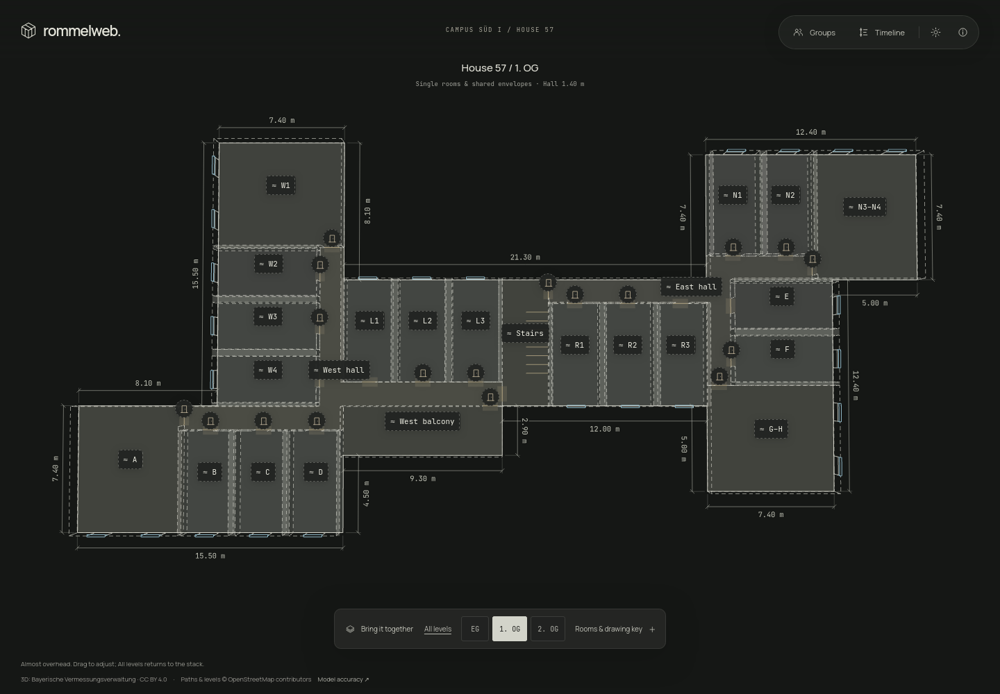
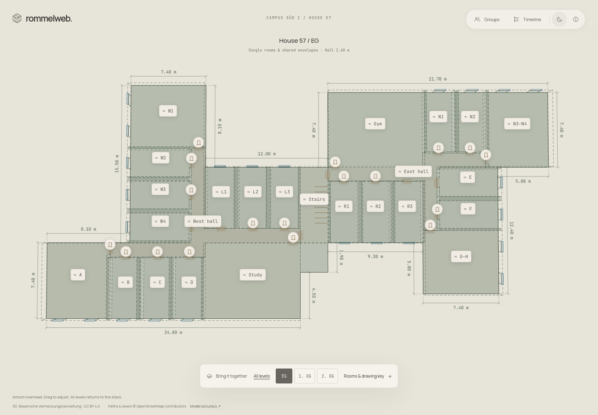

# White House 57 — completed module floors

On 15 November 2026, the resident confirmed that White House has the same internal layout as Red House, with three exceptions: no east-hall balcony on 1. OG, a Gym in place of the ground-floor cinema, and a Study in place of the laundry.

White now uses Red’s completed local floor geometry. Its previous fitted outlines and surplus gray margins no longer constrain the drawing. A single rigid rotation and translation place all three floors at House 57; rooms are neither resized nor shifted individually.

## Floors

| Floor | Single rooms | Shared apartments | Common sections | Footprint |
| --- | ---: | ---: | --- | ---: |
| 2. OG | 20 | 0 | Same halls and stairwell as Red | 478.78 m² |
| 1. OG | 16 | 4 | West balcony only | 597.51 m² |
| EG | 16 | 4 | East/R Gym; west/L Study | 716.01 m² |

Single rooms retain **2.70 × 6.00 m clear dimensions**, a **3.10 m module pitch** with a **0.20 m allocation on each side**, and **1.40 m halls**. The four lower-floor shared apartments—A, W1, N3–N4 and G–H—retain Red’s **6.20 × 7.40 m gross envelopes**. The stairwell aligns across all floors.

On **1. OG**, the complete east balcony footprint, enclosure and doorway are removed. This subtracts **9.30 × 2.90 = 26.97 m²** from Red’s 624.48 m² first floor. The east hall remains intact. The west balcony retains its enclosing walls and single doorway near the stair.

On **EG**, Gym and Study each occupy **9.30 × 7.40 = 68.82 m²**, with the same enclosing walls and single hallway doorway as Red’s corresponding sections. The **7.83 m² stair-side extension** remains unassigned, as it does in Red.

The resident confirmation establishes this floor arrangement. The room and wall dimensions retain the same measurement and assumption basis as Red; internal shared-apartment partitions, service layouts, exact opening positions and physical floor heights have not gained new measurements.

## Sources and implementation

The three canonical Red plans remain the source:

- [Top-floor dimensions](HOUSE55-MODULE-LAYOUT.md), from `public/data/house55-module-layout.json`.
- [First-floor derivation](HOUSE55-FIRST-FLOOR-LAYOUT.md), from `public/data/house55-first-floor-layout.json`.
- [Ground-floor derivation](HOUSE55-GROUND-FLOOR-LAYOUT.md), from `public/data/house55-ground-floor-layout.json`.

`scripts/house57-module-layout.mjs` produces White’s canonical `public/data/house57-module-layouts.json` and updates only House 57 in `public/data/interior-studies.json`. The canonical file records source hashes, the shared coordinate frame and the three resulting local plans. Every White interaction ID names House 57 and its floor.

The campus floors use `layoutBasis: "resident-module-layout"` and their own `floorOutline` and `layoutWindows`. Layout-window symbols follow the shared floor plan. White’s existing source-façade evidence stays separate; Red’s observed exterior windows are not transferred. Both folded buildings retain their existing exterior geometry and appearance.

The provisional placement catalog now contains only Houses **51, 53 and 59**. Both older-house generators preserve completed independent floors. The previous White fitting is retained in `tests/fixtures/house57-before-resident-layout.json` for historical regression coverage.

## Reproduce and verify

```sh
npm run layout:white-house
npm test
npm run build
```

Regeneration is deterministic and does not mutate its inputs. The full suite passes **247 tests**, including exact local geometry comparisons with Red, balcony subtraction, containment and non-overlap, doorway routes, aligned stairs, source isolation and protection against legacy regeneration.

The [preservation receipt](evidence/house57-layout-preservation.json) compares against commit `11599891918e630cbd675c135446a720d993c3dd`: all 64 protected source/exterior files, the complete Red study, and every other house remain unchanged.

The [browser receipt](evidence/house57-layout-browser.json) checks all **72 White space cards**, direct room and door selection, fold/unfold camera restoration, day/night presentation, and desktop and phone layouts. See [release checks](RELEASE-CHECKS.md) for publication verification.




