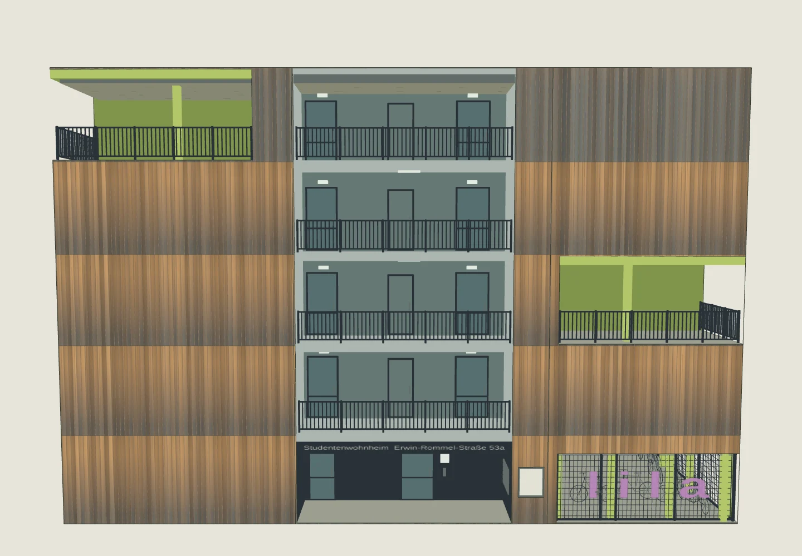
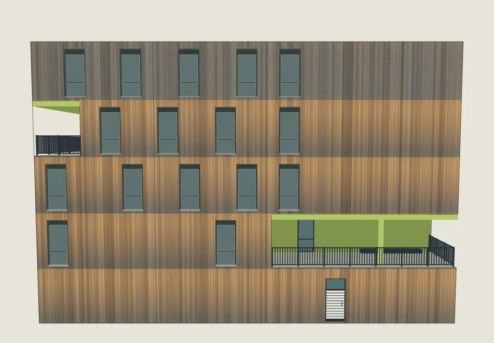
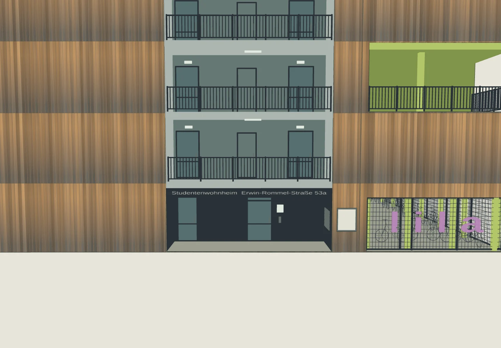
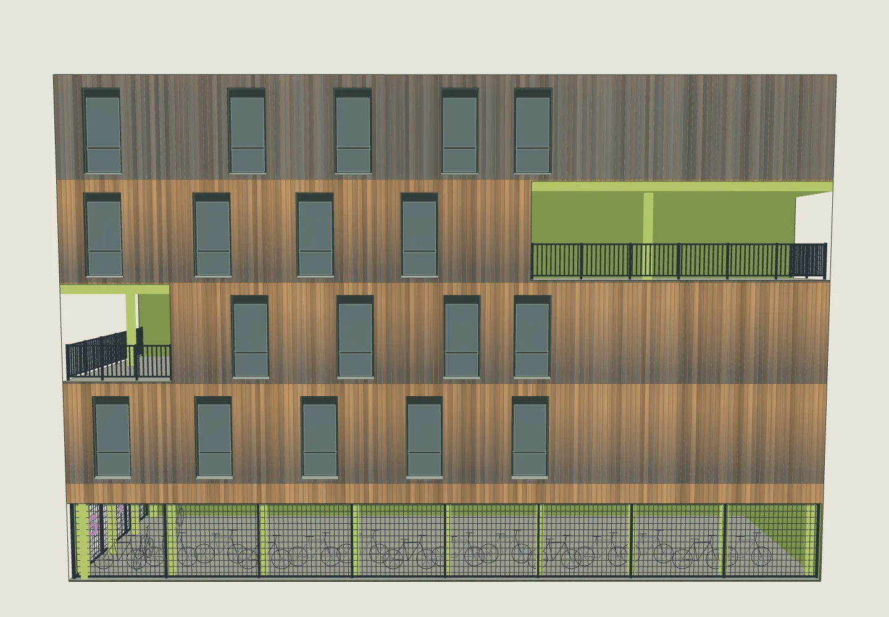
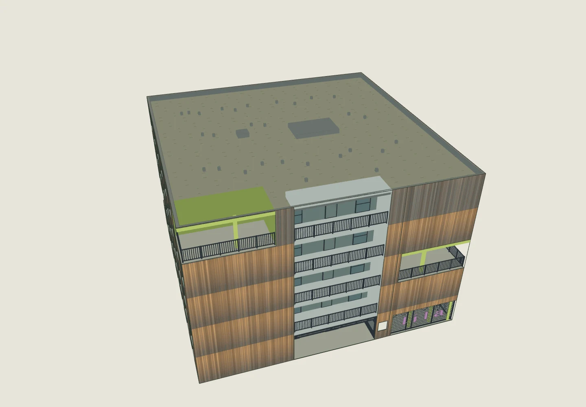
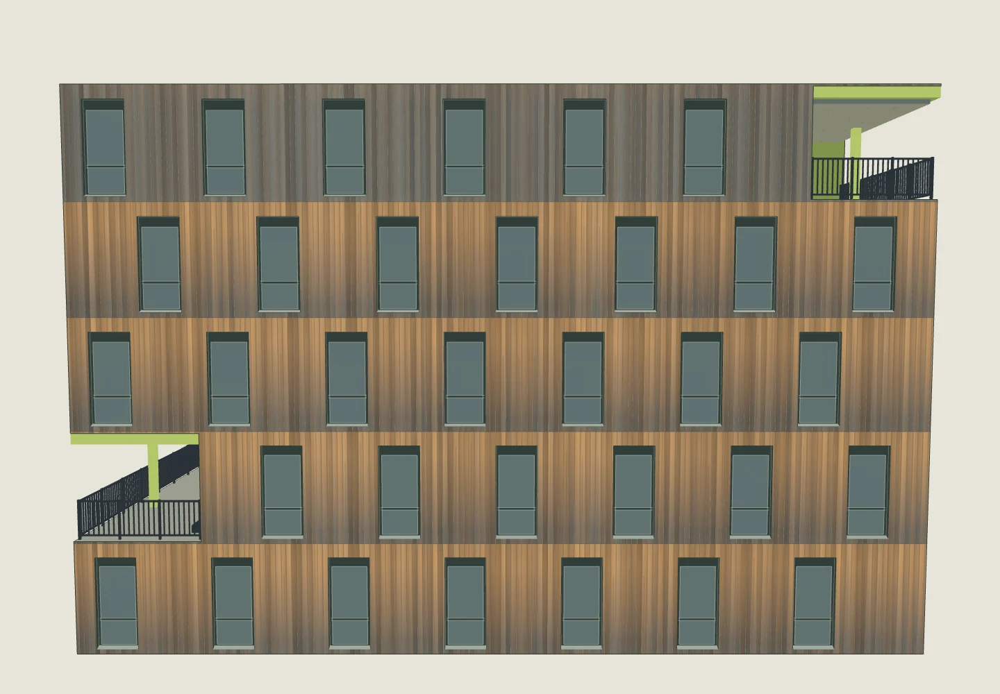
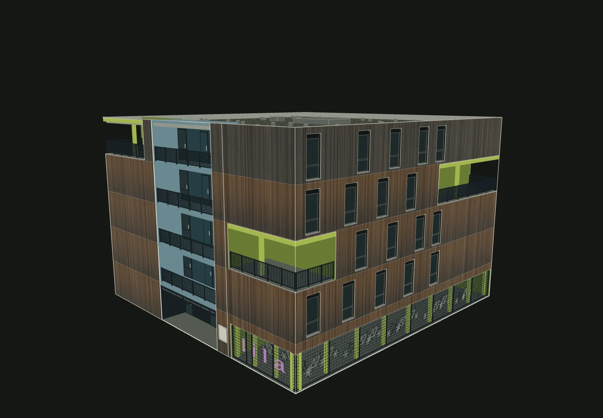

# Lila / Haus 53a exterior

The eight resident photographs supplied on 16 November 2026 guide this exterior reconstruction of **Lila, Erwin-Rommel-Straße 53a**. Together they show all four elevations, the entrance, bicycle storage and the roof. The changes belong to the folded exterior display.

The original LoD2 source remains unchanged: **15.111 m building height**, **289.589 m NHN ground altitude**, **304.700 m NHN roof altitude**, campus **baseY 0.000 m**, the complete eight-edge footprint and all **10 source surfaces**. The existing **five storeys**, floor elevations, interior floorplans, room geometry and interior window records retain their previous values. No building was resized to fit the photographs.

## Photograph registration

Compass labels describe the building's rotated elevations, not the image edges. The campus coordinate frame has X east, Y up and Z south. The existing source corners establish the registration; provisional interior floorplans are not treated as proof of window locations.

| Photo | Registered view | Evidence used |
| --- | --- | --- |
| 1 | Aerial view of SSW room side and ESE entrance side | Five storeys, roof planting and equipment, top southeast loggia, northeast loggia, room-window rhythm and blank entrance wings |
| 2 | WNW elevation, northwest at image left and southwest at image right | Upper window offsets, broad blank timber spans, northwest balcony return and southwest first-floor balcony |
| 3 | SSW elevation viewed from the southwest | Southwest balcony return, alternating window rows, additional ground openings and distant southeast top balcony |
| 4 | ESE entrance elevation | Four upper galleries, recessed ground entrance, readable address fascia, right-hand bicycle gate and northeast balcony |
| 5 | Closer ESE entrance elevation | Door and sidelight positions, mailbox return, light fixtures, gallery slabs and blank timber panels |
| 6 | Northeast corner, ESE entrance return and NNE bicycle side | Two-sided bicycle enclosure, purple lettering, northeast balcony and north-facing windows |
| 7 | Wider northeast corner | Complete north elevation, northwest balcony, window offsets and bicycle frontage |
| 8 | Closer northeast corner | Confirms photo 7's window groups, blank spans, balcony edges, cage mesh and lime supports |

The ESE source façade comprises wall surfaces **9, 4, 1 and 3**; SSW is **2**; NNE is **7**; WNW comprises **5 and 8**. Fragment boundaries in the LoD2 model are not apartment boundaries.

## Four corner balconies

The photographs reveal a fourth balcony omitted from the earlier exterior: the **southwest first-floor loggia**. The four corners occupy different upper floors.

| Floor | Corner | Long opening | Estimated long arm | Estimated return | Supporting photos |
| --- | --- | --- | ---: | ---: | --- |
| 1. OG | Southwest | WNW | 10.00 m | 3.40 m on SSW | 2, 3 |
| 2. OG | Northeast | ESE | 6.10 m | 3.25 m on NNE | 1, 4–8 |
| 3. OG | Northwest | NNE | 8.85 m | 2.50 m on WNW | 2, 6–8 |
| 4. OG | Southeast | ESE | 6.50 m | 3.30 m on SSW | 1, 3–5 |

Both exterior faces are opened at each corner. The model includes lime fascia beams, shaded lime soffits and rear walls, inset supports, floor slabs and fine dark vertical rails. The northwest long opening is wider than in the previous model; the southeast opening leaves the photographed timber pier beside the gallery. A rear door and bench-like element appear in the southwest recess, where photo 2 provides direct evidence.

Corner identity and floor are well supported. Arm lengths, depths, beam thicknesses, rail spacing and concealed construction remain visual estimates. These exterior cutouts do not regenerate the provisional interior plans.

## Entrance and galleries

The ESE entrance face has four horizontal open galleries above a separate ground portal. Its timber wings contain **no ordinary room-window grid**. Light slab edges and soffits, dark vertical balustrades, recessed doors and compact cool lights follow photos 4 and 5. The earlier conspicuous diagonal stair cues have been removed from this frontage.

The ground entrance has a charcoal surround, a glazed door with a toplight slightly right of the gallery centre, a narrow left glazed opening, a square wall light and mailboxes on the right reveal. The use of the left opening is not inferred from appearance alone. The illuminated fascia reproduces the visible address:

**Studentenwohnheim Erwin-Rommel-Straße 53a**

The gallery's approximately 7.20 m width and 2.06 m display recess are unmeasured estimates. Door subdivisions, concealed rear surfaces and mailbox count are appearance details, not a claim about internal circulation.

## Bicycle enclosure

The bicycle cage extends across almost the entire NNE ground elevation and returns approximately 6 m onto the ESE face beside the entrance. It is one connected corner frontage, with a substantial timber belt above it. Fine dark welded mesh, gate framing, lime supports and illustrative parked bicycles distinguish it from a glazed room.

The large purple lowercase **lila** letters sit on the ESE gate return, matching photos 4–8. The opposite ground-level entrance wing remains solid timber. Bicycle count and parking positions are decorative.

## Windows, cladding and roof

Exterior window rows are registered independently for the three room elevations. They alternate horizontally between floors rather than following one repeated vertical grid. Explicit empty rows suppress generic windows on the entrance wings and in the north ground-floor bicycle cage. Broad blank timber spans on the north and west elevations are retained.

The north upper rows contain **5, 4, 4 and 5 openings** from 1. OG to 4. OG. The overlapping south views expose **seven ground openings** previously represented by a partial two-opening row. The west photographs distinguish a five-opening top row, four-opening third-floor row and five-opening second-floor row. Only two first-floor west openings are recorded where trees conceal the middle bays; the empty hidden span is not evidence that no windows exist there. The west ground service door is separate from the ordinary window inventory. Individual uncertainties belong with the window-layout records rather than being treated as surveyed totals.

Narrow dark frames, lower transoms, shutter heads, sills and shallow reveals give the openings depth. Closed shutters remain window openings. The exterior positions do not reassign apartments or alter interior window records.

Vertical timber boards and weathering preserve the mix of grey upper surfaces and warmer streaks below storey joints. Floor flashing stops at open galleries, balconies and bicycle frontage.

Photo 1 supports the retained planted roof character, perimeter coping, a broad central equipment block and scattered short vents. Equipment dimensions and exact positions remain estimates. Roof details are constructed inside and below the retained LoD2 cap so that the source height and outer envelope remain unchanged.

## Evidence limits

The eight views provide much stronger façade coverage than the earlier study, but they are not calibrated survey photographs. Perspective, night glare, shadows, trees and closed shutters limit exact measurement. Obscured lower west openings and concealed balcony surfaces have less direct support than the clearly visible entrance, corner sequence and bicycle cage.

Photographic façade observations take precedence over the provisional room-bank rhythm for this exterior pass. They do not establish a one-window-per-apartment relationship. Source dimensions, storey heights and all interior layouts remain independent of the appearance estimates.

## Implementation and review

- [Lila exterior generator](../src/lila-photo-details.js): four loggias, galleries, entrance, two-sided bicycle cage, lettering and façade registration.
- [Lila window layouts](../src/lila-window-layout.js): separate photographic rows, blank spans and uncertainty records.
- [Exterior integration](../src/exterior-details.js): Lila-only dispatch and roof appearance within the retained shell.
- [Geometry checks](../tests/lila-photo-details.test.mjs): corner/floor registration, empty entrance window rows, gallery apertures, bicycle wrap, source-plane window cutouts and façade selection through recessed openings.
- [Preservation audit](../scripts/check-lila-preservation.mjs): compares protected data and source files, all eleven interior scene trees and the other ten dorm exteriors against the pre-Lila GitHub baseline.

The full test suite passed **389 tests** before integration of the concurrent Black, Grau and White exterior releases. After the final entrance-header adjustment, the focused Lila suite passed **7 tests**, including rays through all **67 exterior room openings** and a 15-point address-sign occlusion check. Final integration passed **30 focused tests** covering Lila, White, exterior integration and geometry, Red feature locality and window picking, plus the production build. The earlier Black/Grau integration passed its **35 focused tests**. The [preservation receipt](evidence/lila-photo-preservation.json) compares against [the integrated White release, 4b8037d](https://github.com/mteyra/rommelweb/commit/4b8037d5cb2aeac7cbf161b98fd1dfb5d90b9aab) and confirms **151 protected files unchanged**, all eleven interiors unchanged, and the other ten dorm exteriors unchanged in both themes.

The [browser review receipt](evidence/lila-photo-browser-review.json) records eight exterior views in day and night and all five floors in the real application at **1440, 390 and 320 px** widths. Selection, unfolding, refolding, theme switching and horizontal-overflow checks passed without browser errors, including a repeat after Black/Grau integration. All **21 exterior and interior render captures** remained byte-identical in the final version incorporating Black, Grau and White. The receipt identifies the tested source files by SHA-256 and preserves the baselines for the earlier checks.

The review views above inspect all four elevations. The night corner view below checks the relationship between gallery lighting, lime recesses, dark timber and the bicycle frontage. These are generated model previews; the resident's original photographs are not bundled with the repository.

