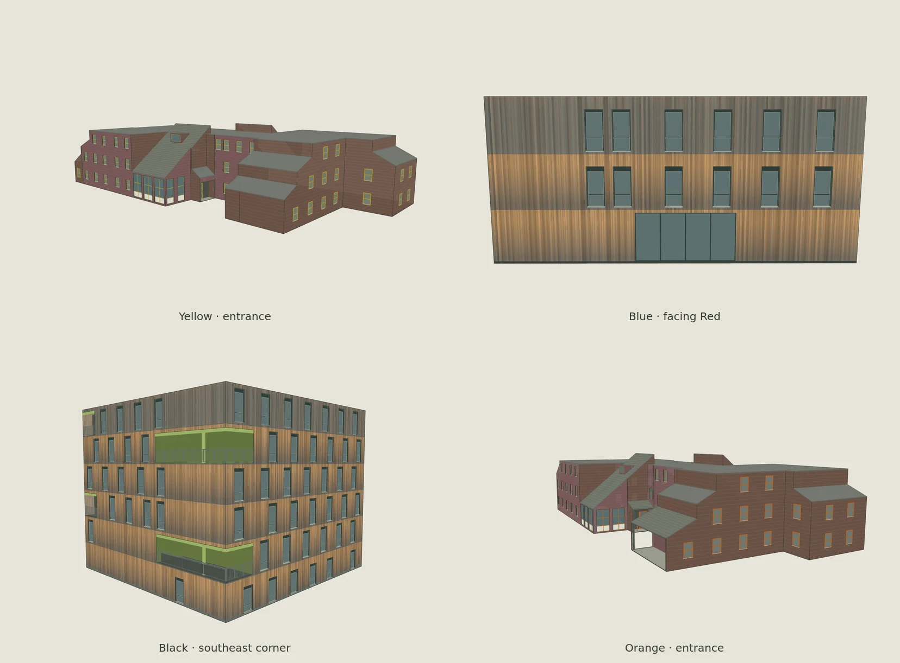

# Photographed exterior refinement — 16 November 2026

This pass uses the eight original photographs attached to the resident's message in the mteyra personal webpage conversation, sent 15 November at 23:44 UTC (16 November at 00:44 Europe/Berlin). The original images were recovered and inspected; they are kept in a private local archive and are not published with the website.

## Protected model

The resident permits only window-position corrections inside the floorplans. This pass makes **no interior edits, including no interior window edits**. Room dimensions, counts, polygons, names, apartment envelopes, corridors, stairs, shared spaces, doors, floor elevations and study records retain their existing values.

All 18 files in `public/data` and all existing source records remain byte-identical to the working tree captured before this pass. The official 11 buildings, 289 LoD2 surfaces, ground polygons, coordinates, heights and floor sections are unchanged. Existing accepted Red refinements are preserved.

The new meshes belong exclusively to the folded exterior display. Wall and roof cutouts are temporary presentation geometry: they are never written into the source model or used to compute floor sections. Numerical opening offsets, recess depths, roof fixtures and balcony widths are appearance estimates, not surveyed dimensions or new evidence about rooms.

The newer-house generator previously derived its reservations from the live exterior meshes. That dependency would have allowed later mesh changes to resize its proposed room arrangement during regeneration. Its reservation loader now uses an exact archive of the pre-edit inputs, bound to the retained source hashes and elevations. This changes no generated floorplan: the entire saved 34-floor layer must still reproduce exactly. Other layout generators remain unchanged.

## Photograph registration and changes

Source surface indices below refer to the unchanged `public/data/lod2.json`.

| Photograph | House and elevation | Changes |
| --- | --- | --- |
| 1 | Yellow 51, rear opposite entrance; wall 22, low roof 39 | Five upper and six lower window columns, three divided glazing groups with white lower panels and opaque piers, roof courses and rainwater details. |
| 2–3 | Yellow 51 entrance; wall 4, roof 12, return 6, entry 36/canopy 20, entrance bank 25 | Four upper and five lower wing columns; only visible rows of bank 25 overridden; divided yellow glazing, recessed door and address sign, upright dormer, maintenance ladder and roof courses. |
| 4 | Blue 51a, wall 2 facing Red | Six aligned columns on both upper rows; four ground glazing bays placed between substantial blank timber spans. The full photograph supersedes the earlier ground-opening guess that extended toward a corner. |
| 5 | Black 49, southeast corner; south wall 1 and east wall 9 | Photographed window rhythm, lime corner loggias on 1. OG and 4. OG, column, physical rail sections, lower opaque screens, plinth/flashing. Only the visible south-face ends of the far loggias on 2. OG and 5. OG are depicted. |
| 6–7 | Orange 53 entrance; walls 26/36/46, canopy 21, room bank 22, roof 30, shelter roof 42 | Grouped orange glazing and white panels, recessed entry and sign, notice case, upright dormer, drainage, and bicycle repair post beneath the retained shelter roof. |
| 8 | Orange 53 left end; wall 33 and blank low end 0/4 | Three upper/four lower columns with the extra low-end column; photographed blank end stays blank. |

Photographed window openings receive inset frames, connecting reveals and sloped metal sills. Window coordinates in the interior layouts remain untouched. Refined procedural timber weathering is limited to Blue wall 2 and Black walls 1/9; other elevations retain their existing treatment.

The separate Yellow bicycle canopy is visible in the photographs but lies outside the retained building footprint. This pass does not extend the dorm outline to incorporate it.

## Unresolved Black balcony/interior relationship

The photograph clearly shows open corner loggias, whereas the current provisional apartment packing does not reserve their complete space. Each estimated main loggia footprint overlaps approximately 16.745 m² of the current E7 envelope and 4.037 m² of the hall envelope on 1. OG and 4. OG.

These intersections describe a conflict between two models, not measured balcony areas or authorization to resize either interior space. E7, the hall and every other interior element are unchanged. Rear balcony doors and internal access paths are not invented. A balcony depth measurement, closer return photographs and later explicit interior authorization would be needed to reconcile this relationship.

## Remaining photographs

- Yellow: the remaining end elevations, an unobstructed entrance bank/door, and closer dormer/roof views.
- Blue: the three other elevations and a closer view of the photographed ground glazing.
- Black: complete north/west elevations, the far balcony returns, and closer views into the southeast loggias.
- Orange: the rear/opposite elevation, a close view of the repair station and shelter ends, and close views of the entry and dormer.
- Red and other dorms: additional photographs identifying the particular elevation before any further mesh changes.

Unphotographed elevations are retained. This is a photographic refinement pass, not a claim that every exterior is complete.

## Verification

- Compare source/interior file hashes with the captured pre-edit working tree.
- Compare generated exterior details, windows and default timber geometry for all seven untouched houses: 53a, 55, 55a, 57, 57a, 59 and 59a.
- Compare unphotographed window/mask output on the four modified houses.
- Compare all 11 interior scene mesh trees, and exact before/after floor-render PNGs for Yellow, Blue, Black, Orange and Red.
- Exercise 142 actual selection rays through recessed windows, including openings that previously became click-through holes.
- Check finite, source-contained details, coplanar cutouts, positive remaining surfaces, observed window rows and default weathering stability.
- Regenerate the newer layout in memory and compare the complete result with the saved data; reject mismatched reservation-source inputs instead of silently adapting rooms to new meshes.

The machine-readable preservation receipt is [photo-exteriors-preservation.json](evidence/photo-exteriors-preservation.json).

Final validation: 365 tests pass; production build and path-data check pass. Browser checks cover all four modified houses in day/night mode, unfold/fold controls, and 390 px/320 px phone layouts with no console errors or horizontal overflow.
