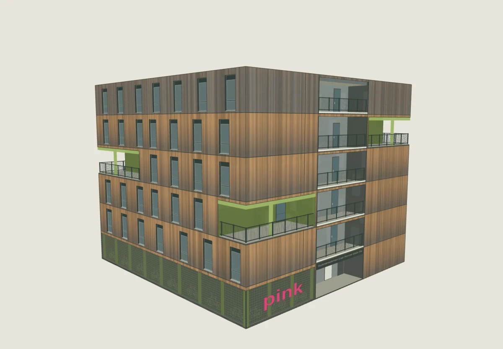

# Pink / Haus 59a exterior

The four resident photographs supplied on 16 November 2026 define this exterior pass. Pink retains its original footprint, 18.333 m height, base elevation and six storeys. All interior floorplans, room geometry, stairs and interior window records remain unchanged. The new recesses and openings belong to the folded exterior display.

## Registering the photographs

The entrance and repeated lit windows establish the following correspondence. World X points east and world Z points south.

| Photo | Elevation | Evidence used |
| --- | --- | --- |
| 1 | West, northwest at image left | Staggered tall windows, residential ground floor, northwest lime balcony, partial southwest balconies |
| 2 | North entrance, northeast at image left | Five open galleries, blank timber wings, recessed ground entrance, bicycle cage and pink lettering |
| 3 | East, southeast at image left | Southeast balcony, extensive ground bicycle cage, tall windows partly hidden by trees |
| 4 | Northeast corner | Confirms the entrance, northeast balcony and east window positions seen in photo 3 |

Photos 3 and 4 overlap on the east elevation. They do not provide a direct south elevation. South windows and roof geometry therefore retain their previous assumptions; only the corner balcony returns affect the south shell.

## Implemented exterior

The north frontage has five recessed upper galleries over an open ground porch. Light slab edges and soffits, dark vertical railings, recessed doors and small cool fixtures reproduce the visible structure. The entrance has a pale gray rear door, shaded side passages, mailboxes and a narrow dark address fascia. The wings have no generic bedroom-window grid.

The corner balcony sequence is:

| Floor | Corner | Longer opening | Confidence |
| --- | --- | --- | --- |
| 1. OG | Southwest | South | Partial west view; unseen south arm estimated |
| 2. OG | Northeast | North | Supported by photos 2 and 4 |
| 3. OG | Southeast | East | Supported by photo 3 |
| 4. OG | Northwest | North | Supported by photos 1, 2 and 4 |
| 5. OG | Southwest | South | Partial cropped west view; unseen south arm estimated |

Each balcony cuts both exterior planes and includes its lime soffit, fascia, column, shaded rear walls and picket rails. The northeast balcony also has the tall rear glazed opening visible near the gallery. These details do not establish or alter interior access.

The bicycle enclosure occupies the east ground floor and wraps onto the northeast entrance wing. It contains a fine mesh, pale supports, framing and illustrative bicycles. The lowercase pink wordmark sits on that north cage frontage. The west ground floor remains residential, with six tall windows.

West window rows alternate horizontally instead of using one vertical grid. East rows follow their own visible offsets, including the close upper pair. Frames, lower transoms, narrow heads and shallow reveals give the openings depth. The two revised room elevations contain 66 exterior windows after balcony masking. This is the model's opening count, not a surveyed inventory.

Vertical timber weathering and storey flashing cover the three photographed faces. The flashing stops at open recesses. No rooftop equipment is inferred from these street-level photographs.

## Limits and future evidence

Night glare, tree cover and dark glazing obscure some east windows. Their provisional positions are recorded in `inferredCenters` on the photo-window feature rather than presented as confirmed counts. The south elevation needs a direct photograph before its window allocation can be corrected confidently.

Balcony depths and widths, rail spacing, concealed rear details and bicycle positions remain photographic estimates within the source envelope. The southwest south-facing balcony arms have the weakest direct evidence. Provisional interior floorplans were not used to claim these exterior details as measured truth.

## Implementation and review

- [Pink exterior generator](../src/pink-house-photo-details.js): face registration, opening layouts, galleries, balconies and signs.
- [Bicycle enclosure generator](../src/pink-bicycle-details.js): connected east/north cage and bicycle silhouettes.
- [Geometry regression tests](../tests/pink-photo-details.test.mjs): correct corner/floor masks, blank entrance wings, cage location, source containment, uncertainty metadata and rays through every revised recessed window.
- [Preservation audit](../scripts/check-pink-preservation.mjs) and [saved receipt](evidence/pink-exterior-preservation.json): all 115 protected files and all 11 interior scene trees match the stable baseline. A separate current-source comparison disconnects only Pink and confirms the other ten exteriors remain identical, accounting explicitly for concurrent Blue and Turquoise work.

Seven viewing directions were rendered in both themes and reviewed. The final close-up pass corrected the address backing, gray entrance door and northeast balcony glazing.

The [regression receipt](evidence/pink-exterior-regression.json) records **372 passing tests**: the stable baseline's 365 tests plus seven Pink tests. The production build and path-data check also pass. This frozen integration separates Pink's result from unfinished tests belonging to concurrent exterior tasks in the shared checkout.

The [browser receipt](evidence/pink-exterior-browser-checks.json) records 14 exterior renders and successful actual-app checks at 1440, 390 and 320 pixels. Both the frozen Pink integration and a fresh shared-checkout run pass theme switching, floor unfolding/selection and folding, with no JavaScript errors or horizontal overflow.

[Night overview](evidence/pink-exterior-night.webp) · [West elevation](evidence/pink-exterior-west.webp) · [East elevation](evidence/pink-exterior-east.webp)
