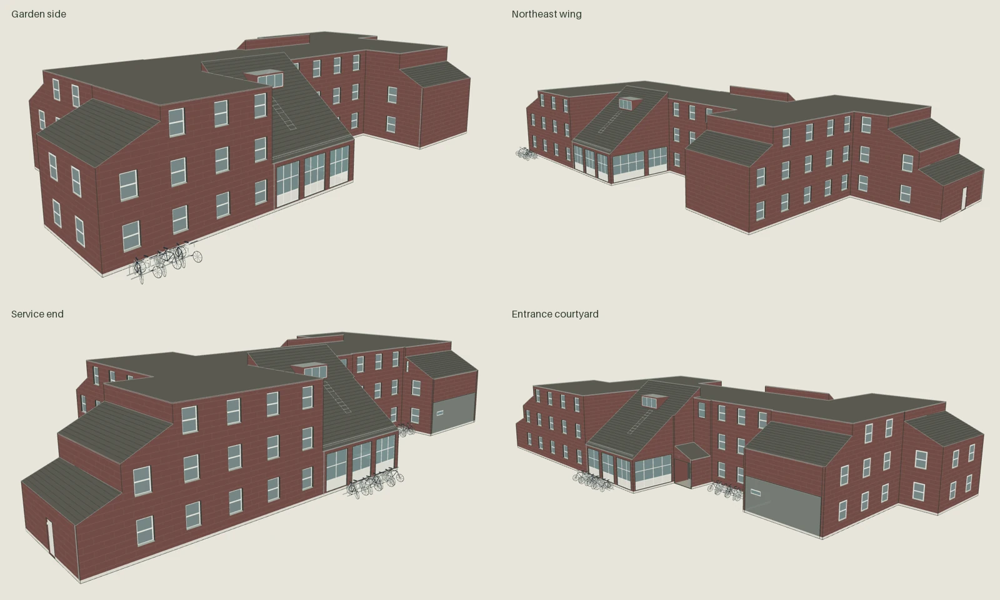
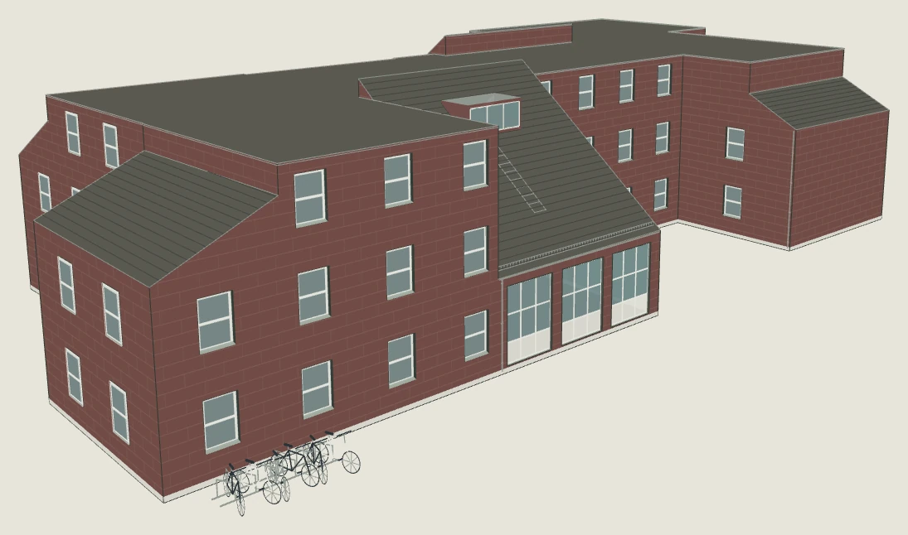
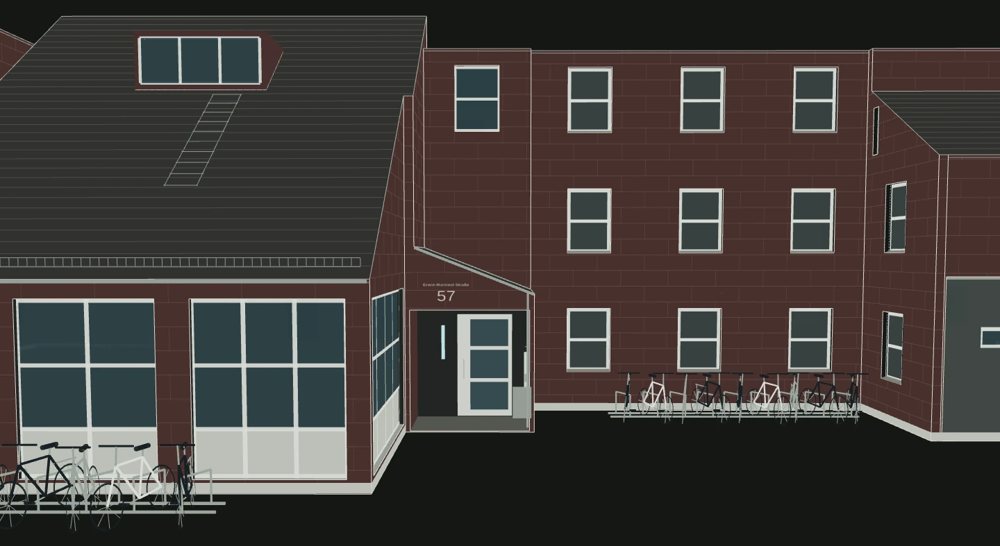

# White / House 57 — exterior from seven resident photographs

White now has its own photographed exterior: white window frames on red-brown cladding, distinct window patterns on each wing, two glazed common-room corners, upright roof dormers, and one recessed entrance marked **Erwin-Rommel-Straße 57**.

The existing **9.672 m height**, **2.641 m base elevation**, **43 LoD2 surfaces**, complete footprint and three storeys remain unchanged. Every interior floorplan, room, corridor, stair, door, interior window record and floor elevation is preserved. The changes belong to the folded exterior display and its outdoor bicycle scenery.



## Reading the photographs

Photo numbers follow the order of the seven images in the resident's 16 November 2026 message. Source indices below refer to the unchanged House 57 surfaces in `public/data/lod2.json`. They let another contributor find the same face without relying on a camera angle or an interior room label.

| Photo | Matched exterior | Observations used |
| --- | --- | --- |
| 1 | Southeast long elevation, wall 40; roof 9 | Four windows on each lower row and three above; the extra lower column sits beneath the left roof step. Three separate white common-room glazing groups occupy the low right-hand portion. A three-pane upright dormer, maintenance rungs, snow guard and downpipe dress the slope. Bicycles stand outside the left part of the elevation. |
| 2 | Southeast garden court, wall 4; return 1; blank end 5 | Four vertically aligned columns across the court. The recessed right return has one opening on each lower row and a blank upper portion. The broad projecting end wall is solid cladding. The left common-room glazing continues around the corner. |
| 3 | Garden common-room corner, walls 40 and 33; court wall 4 | Confirms three distinct front glazing groups, wide cladding piers, opaque white lower panels and glazing on the return. Also confirms the roof dormer and the repeated court columns behind the trees. |
| 4 | Northeast outer wing, wall 23; stepped return 21 | Five lower window columns and four upper columns. The stepped return has two lower columns and one upper opening, followed by a blank low end. Roof levels step down; there are no room windows on the raised end fascias. |
| 5 | Northwest long elevation, wall 36; service end 35 | Five lower columns and four upper columns. The lowest end has one plain white service door. Common-room glazing and outdoor bicycles sit at the other end. This service leaf is separate from the residential entrance. |
| 6 | Northwest common-room corner, walls 36 and 10; entrance 14 under roof 7 | Three separate front glazing groups and one return bank. The entrance is recessed beside this corner: a white three-pane door, wide handle stile, dark soffit, small entry light, right-side intercom and pipe, and the address on the original canopy fascia. Roof 29 has an upright three-pane dormer. |
| 7 | Entrance court, walls 11, 32 and 18; low frontage 12 | Three columns beside the entrance align across all three rows. A fourth upper opening sits above the canopy on wall 32, without a matching lower stack. The narrow return has two aligned lower openings and a partly visible upper slot. Outdoor bicycles stand beside the gray foreground frontage with its small horizontal window. |

## Window and glazing design

The counts below are checked on the final window meshes after source clipping and recess masking, so a declared window cannot silently disappear beneath a roof.

| Source wall | EG | 1. OG | 2. OG | Pattern |
| --- | ---: | ---: | ---: | --- |
| 40 — southeast long wing | 4 | 4 | 3 | Upper row omits the low-step column |
| 4 — garden court | 4 | 4 | 4 | Four aligned stacks |
| 1 — garden return | 1 | 1 | 0 | Blank upper return |
| 23 — northeast outer wing | 5 | 5 | 4 | Upper row omits the low-step column |
| 21 — stepped return | 2 | 2 | 1 | Upper opening only in the taller portion |
| 36 — northwest long wing | 5 | 5 | 4 | Room columns stop before common-room glazing |
| 11 — entrance court | 3 | 3 | 3 | Three aligned stacks |
| 32 — above entrance canopy | 0 | 0 | 1 | Separate upper opening |
| 18 — narrow court return | 1 | 1 | 1 partial | Upper slot fitted beneath the retained slope |

The windows have shallow physical recesses, white frames, horizontal transoms and sills. Closed blinds in the photographs are evidence of an opening, not evidence of a blank wall; the model uses neutral glazing rather than treating a temporary blind position as permanent geometry.

The common-room banks have their own apertures. The garden front has three groups with three vertical panes each. The entrance front has three groups with three, two and two panes. The return glazing is modeled separately, retaining the broad opaque cladding piers and white lower infill. No common-room function is inferred from this glazing.



## Entrance, roofs and bicycle areas

The residential entrance is tied to the original **roof 7 / wall 14** canopy recess. The single door sits 1.76 m behind its opening as a visual depth estimate. Its address is oriented toward the entrance court, and the right-side downpipe and small utility cabinet remain attached to that same entrance. The plain service door on wall 35 receives no residential sign.



Both steep common-room roofs, **9 and 29**, now have upright three-pane dormers with solid cheeks, a thin cap, maintenance rungs and low snow guards. Their feet intersect the retained slope and their caps remain below the original ridges. Tile courses follow each separate slope and stop at the dormer apertures. The small stepped roofs retain their original geometry. The pale plinth follows the existing ground perimeter, with gaps at the doors.

Three outdoor bicycle groups follow photos 1, 5 and 7. They use separate scenery layers, with racks, wheels and bicycle frames, and disappear with the folded exterior when the floors open. They do not enlarge the dorm footprint, alter paths or establish bicycle capacity. No enclosed bicycle cage or open balcony is inferred.

The gray foreground face in photo 7 is represented on the existing low courtyard face, with its small high horizontal opening. Its actual depth and ownership are unresolved; no new shed footprint or interior room is created.

## What remains estimated

The photographs establish visible counts, alignment, blank spans, frame color, the entrance identity and the relationship between the stepped volumes. They do not provide a calibrated survey. Opening widths, frame sections, mullion spacing, recess depth, dormer dimensions, pipe diameters and bicycle positions remain estimates within the retained scale.

The narrow upper slot on wall 18 is only partly visible. Its fitted width and height are less certain than the main window rows. The short outer-west faces **31, 34 and 42** are not resolved well enough by these views to replace their previous opening patterns. Their cladding and frame materials follow the rest of White.

The provisional interior drawings were used only for orientation. They were not treated as evidence for an exterior opening and were not regenerated or edited. White's existing enclosed west balcony and absent east first-floor balcony remain exactly as recorded in its interior layouts.

## Implementation and checks

- [White exterior generator](../src/white-house-photo-details.js): registered faces, window rows, glazing, entrance, service door, roof details and materials.
- [Outdoor bicycle generator](../src/white-house-bicycle-details.js): separate nonstructural scenery.
- [Geometry tests](../tests/white-photo-details.test.mjs): final opening counts, alignment, intact piers, entrance orientation, roof containment and source isolation.
- [Preservation audit](../scripts/check-white-preservation.mjs): executes both the baseline and current renderers and compares their output.

The complete suite passes **402 tests**, and the production build and path-network check pass. The existing Vite bundle-size advisory remains.

Against baseline commit `03720d4ad2cd044f4a5493c9975313cc1d12da3b`, including the latest Black and Grau exteriors, the [preservation receipt](evidence/white-photo-preservation.json) confirms:

- All **112 protected files** are byte-identical, including the source shell, data, interior renderers and existing layout generators.
- All **eleven interiors** have identical scene geometry and materials in both themes: **22 matching scene trees**.
- All **ten other exteriors** have identical scene trees in both themes, as well as identical detail, window and timber output.
- White retains its complete original source object and dimensions.

All three White interior screenshots are also [pixel-identical](evidence/white-photo-interior-pixels.json) to their initial before captures from `cda73a8` at 1440 × 1000. The [browser receipt](evidence/white-photo-browser.json) records the exterior views and normal-app checks.

```sh
npm ci
node --test --test-concurrency=2 tests/*.test.mjs
npm run build
node scripts/check-white-preservation.mjs 03720d4 docs/evidence/white-photo-preservation.json
```
