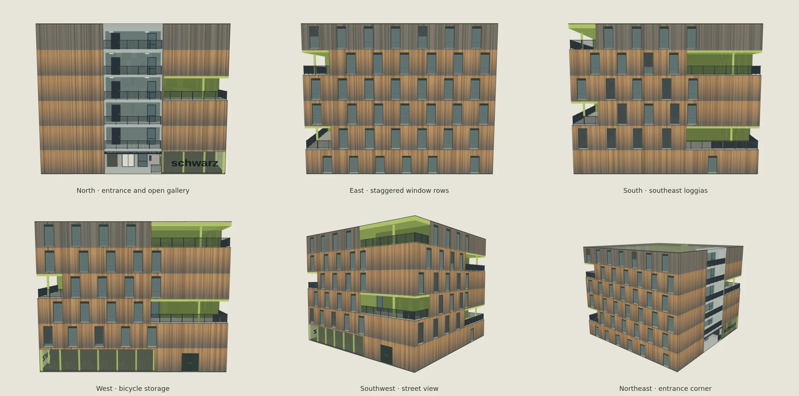

# Black / 49 — all four exterior elevations

This pass uses the resident's six photographs supplied on 16 November 2026. It replaces the earlier two-face study with an exterior covering every side, including the main entrance. Photo numbers follow the order in that request.

## Registration and preserved dimensions

The overlapping lime balconies, window rows and entrance identify the views:

| Photo | View | Visible evidence |
| --- | --- | --- |
| 1 | South elevation, southwest at left | Long southeast balconies, short southwest returns, alternating window rows, mostly blank ground cladding |
| 2 | Southwest corner, west at left and south at right | Both arms of the southwest balconies, west bicycle frontage and south ground window |
| 3 | West elevation, northwest at left | Southwest balconies, northwest balcony return, bicycle cage, separate double service door |
| 4 | Northeast corner, east at left and north at right | North entrance and five open landings, blank timber wings, northwest balcony, short north bicycle frontage |
| 5 | North entrance close-up | Address fascia, left passage, pale paired panels, right glazed stair opening, intercom, side-wall mailboxes and ceiling lights |
| 6 | Southeast corner, south at left and east at right | Southeast balconies, dark privacy screens, repeated east window rows and six tall ground windows |

The source remains **18.097 m high**, approximately **22.580 × 22.833 m**, with the same base elevation, ten LoD2 surfaces, six floor elevations and ground polygon. Recesses cut only a rendered copy of the exterior shell. Interior rooms, corridors, doors, stairs, floorplans and interior window records are untouched. The retained roof-bed study is unchanged; the new street photographs do not establish roof equipment.

## Balconies and gallery

| Corner | Floors | Long open side | Short return |
| --- | --- | --- | --- |
| Southeast | 1. OG, 4. OG | South | East |
| Southwest | 2. OG, 5. OG | West | South |
| Northwest | 3. OG | North | West |

All five balconies have open corner returns, lime fascias, recessed soffits, a square column and dark vertical railings. Opaque screens follow the photographed lower southeast balcony and the corner end of the middle southwest balcony. The southwest recesses replace the old shallow, incomplete south-only ends.

The top balcony and gallery ceilings sit beneath the retained roof bed. Street-level upward views are checked so the gray roof surface cannot show through those soffits.

The north gallery follows source wall 0, the existing central band approximately seven metres wide. Five open landings have concrete slab edges, recessed dark doors/glazing and cool light fixtures. The original timber plane is removed continuously through this band, including behind the slab fronts. Neither timber belts nor a generic bedroom-window grid close the gallery. The north wings stay blank except for the photographed northwest balcony and bicycle opening.

## Window patterns

The appearance inventory counts permanent openings, including closed roller shutters. Fractions are registered to each façade, not inferred from provisional apartment allocations.

| Floor | South | East | West | North |
| --- | ---: | ---: | ---: | --- |
| EG | 1 | 6 | Bicycle cage and separate double service door | Entrance and short bicycle frontage |
| 1. OG | 4 | 6 | 5 | Gallery openings only |
| 2. OG | 4 | 7 | 4 | Gallery openings only |
| 3. OG | 5 | 7 | 4 | Gallery and northwest balcony |
| 4. OG | 4 | 6 | 5 | Gallery openings only |
| 5. OG | 4 | 7 | 4 | Gallery openings only |

Three missing south 1. OG openings are restored: their closed shutters were previously omitted. East 3. OG and 5. OG retain matching columns, while adjacent rows remain staggered. The west windows occupy the northern part of the elevation, leaving the broad southwest timber spans shown in photos 2 and 3. The two west source-wall segments share one registered inventory and do not generate duplicate windows.

Recessed jambs, charcoal frames, low transoms, shutter heads and selected partly or fully closed shutters provide depth. Shutter poses illustrate the photographs; they do not imply permanent closure. The timber weathering now covers all four photographed elevations, retaining narrow vertical boards and darker exposed upper cladding.

## Entrance and bicycle storage

The main entrance is on the **north**, directly beneath the five galleries. Its fascia reads **Studentenwohnheim Erwin-Rommel-Straße 49**. The warmer porch includes the left open passage, central pale paired panels, right glazed opening, a small intercom, side-wall mailboxes, ceiling strips and a guard at the right edge. The pale panels receive no invented internal function; no personal names from the mailbox area are reproduced.

The bicycle enclosure wraps the **northwest** ground corner. Its longer arm occupies about 62% of the west wall, while its shorter arm occupies the north wing to the right of the entrance. Lime supports, dark see-through welded mesh, modest bicycle silhouettes and the lowercase **schwarz** wordmark identify it. The wide charcoal service door farther south on the west façade is separate from the signed main entrance.

Detail views: [north entrance at night](../screenshots/house-49-black/black-photo-entrance-night.webp) · [southwest from street level](../screenshots/house-49-black/black-photo-southwest.webp) · [southeast balconies](../screenshots/house-49-black/black-photo-southeast.webp).

## Evidence limits and checks

Corner identities, balcony floors, open landings, blank wall areas and entrance identity are supported by overlapping views. Window positions are approximate, particularly on the west behind trees. Detail widths, recess depths, rail sections, parked bicycles and concealed rear openings are appearance estimates, not surveyed dimensions. Temporary construction barriers, glare and landscaping in the photographs are not part of the dorm mesh.

The mesh is implemented in [`src/black-house-photo-details.js`](../../src/black-house-photo-details.js). The only shared-renderer additions are two Black porch colours.

- **All 386 tests pass.** Automated checks cover photographed opening counts, alternating east alignment, absence of north bedroom windows, continuous gallery cutouts, entrance sign orientation, bicycle-corner placement, finite geometry and containment within the original footprint and height.
- The [preservation receipt](../evidence/black-photo-preservation.json) compares directly with Git commit `cda73a8`: all 108 protected files, all eleven source shells, all 22 day/night interior mesh trees, and all 20 other-dorm exterior mesh trees remain unchanged. Other dorm window, detail and timber outputs also match.
- The [browser receipt](../evidence/black-photo-browser.json) records exterior views, six original-versus-updated interior pixel comparisons, and desktop/mobile interaction checks.
- The production build and path-network check pass. Vite retains its existing bundle-size advisory.
- Reproduce the preservation check with `node scripts/check-black-preservation.mjs`; run the repository suite with `npm test` and the production build with `npm run build`.

The resident photographs are not bundled in the public repository.
