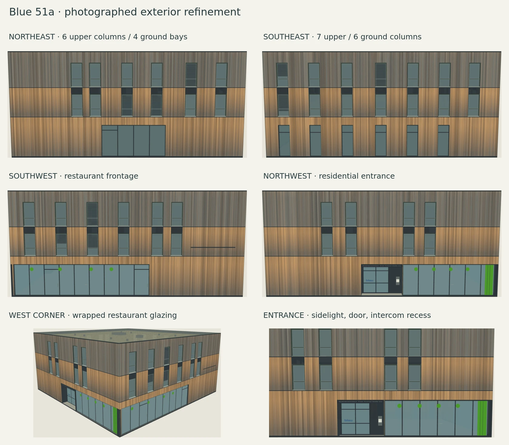

# Blue 51a — four photographed elevations

This exterior pass uses the seven resident photographs supplied on 16 November 2026. It extends the earlier single-elevation Blue study to the complete building. Photograph numbers below follow the order in that message.

## Retained shell and interiors

Blue retains its original ground polygons, eight LoD2 surfaces, base elevation of **2.751 m**, height of **10.351 m**, and three floors. Floor elevations, room and corridor geometry, doors, stairs, interior window records, and saved floorplans are unchanged. The new openings and recesses are temporary exterior presentation geometry.

The photographic cladding seams sit at approximately 39% and 66.6% of the retained height. These are separate exterior guides: moving the timber bands does not move any floor or section guide. The pre-existing roof treatment remains because these ground-level photographs provide no new roof evidence.

## Photograph registration

All horizontal positions are described left to right while looking at the elevation from outside.

| Elevation | Source walls | Photos | Upper windows on each of two storeys | Ground treatment |
| --- | --- | --- | --- | --- |
| Northeast, E → N | 2 | 1 | Six columns; closer first pair, broad blank span at left | Four adjoining glazed bays across approximately 39–66.5% of the wall, with broad timber at both ends |
| Southeast, S → E | 4 | 2, 3 | Seven columns | Six separate tall windows directly beneath the first six upper columns; solid timber beneath the seventh |
| Southwest, W → S | 6 | 3, 4, 7 | Six columns; broad blank span at right | Restaurant glazing across approximately the first 60%; solid timber on the right |
| Northwest, N → W | 3, 1, 5 | 5, 6, 7 | Four columns arranged as two pairs; no upper opening over central wall 1 | Blank timber at left, residential entrance on wall 1, restaurant frontage continuing around the west corner |

Both upper rows use matching horizontal centres. Charcoal connector panels bridge the windows across the storey boundary. Recessed frames, transoms, sills and selected roller-shutter positions distinguish closed shutters from missing windows.

The southeast bicycles in photos 2–3 are parked outside the building. The supplied views show no Blue balcony or open bicycle enclosure. The shallow horizontal strip on the southwest middle band is represented without a platform or railing.

## Entrance and restaurant corner

The residential entrance follows the existing central northwest wall segment, approximately 4.04 m wide. It has a flat recessed portal, a gray soffit, a threshold, a left fixed sidelight carrying “blau”, one glazed entry leaf, and an opaque charcoal panel with the intercom on the right. The intercom attaches to the rear panel and the entrance light attaches to the soffit.

The entrance header reads **Studentenwohnheim Erwin-Rommel-Straße 51a**. The adjacent restaurant glazing turns around the west corner, with green circular window marks, a bright green vertical infill panel, a charcoal corner post, and simplified Dönereria lettering.

Window counts, alignment, blank wall areas, entrance identity and the restaurant corner are supported by overlapping photographs. Horizontal fractions, window widths, mullion divisions, hardware dimensions and the 0.90 m entrance recess are visual estimates. No dimensions have been inferred from provisional room allocations.

## Implementation and validation

The Blue geometry and photograph registration live in [`src/blue-courtyard-photo-details.js`](../../src/blue-courtyard-photo-details.js). Integration in `exterior-details.js` selects the six photographed wall surfaces. The scene consumes optional exterior cladding elevations and Blue-specific glass, shutter and green-panel colours.

- **368 tests pass in the isolated Blue release**, including physical window counts and vertical alignment, six distinct southeast ground apertures, entrance placement, source containment, and unchanged floor guides. The earlier shared-checkout run also passed all 383 tests, including the concurrent Pink and Turquoise tests.
- The production build and path-network check pass. Vite retains its existing bundle-size advisory.
- Eighteen exterior views were reviewed in day/night themes. The live app passed 1440, 390 and 320 px checks, all three floor selections, and fold/unfold controls, with no console errors or horizontal overflow.
- All three Blue interior PNGs are byte-identical to the before captures.
- All 115 protected functional files remain unchanged. All eleven dorm interiors match in both themes, covering 22 mesh trees.
- Blue's changes preserve the ten other dorms' detail, window, timber and exterior scene output.

The shared checkout also received independent Pink and Turquoise exterior work during this pass. The [raw preservation receipt](../evidence/blue-photo-preservation-raw.json) retains those concurrent differences. The [isolated preservation receipt](../evidence/blue-photo-preservation.json) records an explicitly constructed comparison with only the Blue changes removed, while retaining the original protected-file hashes. Two concurrently edited audit scripts are recorded separately from functional source and interior data.

The [release preservation receipt](../evidence/blue-photo-release-preservation.json) compares the isolated Blue publication directly with commit `662a1e1`, using all 115 protected hashes from Git. Every protected file, all 22 interior scene trees, all 20 other-dorm exterior trees, and all ten other-dorm detail/window/timber outputs match without exceptions. The release includes only Blue geometry plus the shared material and sign-rendering support it requires.

Pink and Turquoise reached `main` during publication preparation. Blue was integrated on top of their combined commit `b852026`, retaining both releases. The final combined build and **383 tests pass**. The [integrated preservation receipt](../evidence/blue-photo-integrated-preservation.json) confirms that Blue's addition preserves all 115 protected functional files, both existing audit scripts, every interior and all ten other exteriors against that exact published base.

Browser results, source hashes and the interior pixel comparisons are retained in [blue-photo-browser.json](../evidence/blue-photo-browser.json).
