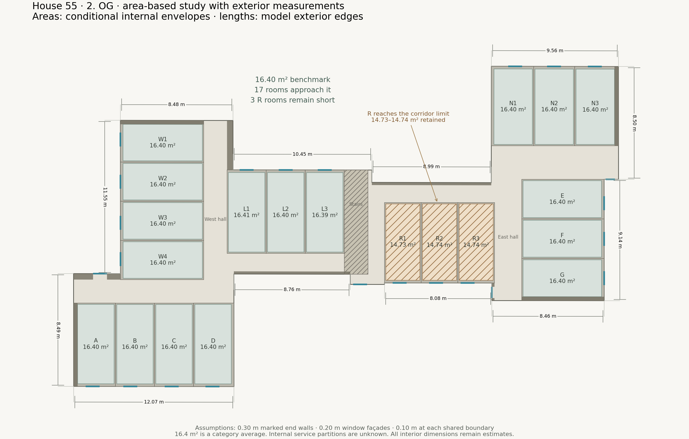

# House 55 · historical area-based apartment study

**Historical stage, before the R-bank alignment.** The R areas, widths, residual circulation and allocation totals below belong to the earlier area candidate. The [current R-bank and stair-flight report](HOUSE55-R-ALIGNMENT.md) records the later alignment, its approximately 16.07–16.08 m² conditional R areas and explicitly unassigned stair-side strip. The original source exterior and the seventeen non-R area-stage room polygons remain in force.

Updated **15 November 2026**, **2. OG / index 2**. Seventeen room envelopes approach a conditional **16.4 m²** benchmark after assumed perimeter-wall allowances. R1–R3 remain approximately **1.66 m² short each**: reaching the benchmark would constrict their northern hall connector beyond the chosen study guard.

This is a calculated reconstruction scenario, not a measured floor plan. Room order, the source exterior, twenty room references, 24 window observations, the W4/L1 overlap and the confirmed staircase alignment are retained.



## What the area target means

The [operator's Campus Süd I page](https://www.werkswelt.de/index.php?id=wohnanlage-campus-sud-i) lists **16.4 m²** for single apartments with their own bathroom and kitchenette. The [2026 chart](https://werkswelt.de/data/uploads/wohnen/mietpreislisten/2026/erlangen/760-campus-sued-i-englisch-2026.pdf) calls this an average living area. Its category notes do not establish an individual apartment's measured clear area or a known communal-area share.

Here, **16.4 m² is an assumed internal-envelope benchmark**. It covers the candidate apartment inside its assumed perimeter allowances, before unknown bathroom, kitchen and service-partition footprints. It is not certified usable or rental area. The separate **2.70 × 3.30 m** resident-sketch reference describes only a living zone. See [the source review](HOUSE55-DIMENSION-EVIDENCE.md).

## Explicit assumptions and method

| Boundary | Assumed allowance |
| --- | ---: |
| Four resident-marked thicker ends: W1 north, A west, N3 east, G south in the plan | 0.30 m |
| Window façades and other exterior ends | 0.20 m |
| Each apartment's allocation at a shared divider or hall boundary | 0.10 m |
| Exterior recess beside the northern R connector | 0.20 m |

The 0.10 m allocation is half of a hypothetical 0.20 m shared partition. None of these values measures masonry, insulation or construction. The [resident's four marks](../../data/source/house55-2og-area-wall-marks.png) identify the proposed locations, not their thickness.

The calculation clips each gross room polygon by its offset boundary planes, then measures the resulting polygon. Intersecting the planes avoids double-counting wall allowances at corners. Each room bank keeps a straight hall-facing front; moving that front increases depth until its area target is reached. Small inferred divider adjustments distribute the extra end-wall allowance in A–D, W, E–G and N; the largest adjustment is approximately **0.148 m**. L and R dividers stay fixed. Room order, external bank ends and window segments are held, rather than every earlier estimated partition coordinate.

**The previous 5.395 m depth is not a target in this solve.** No preferred apartment width or depth is fitted. Existing frontage and the confirmed relative arrangement remain constraints; area and the explicit wall allowances determine the new hall-facing boundaries. The halls are recomputed from the remaining annotated region, preserving the recorded door connections.

## Prior-stage calculated result

Values below come from the [area-stage audit](../data/house55-area-stage-historical-audit.json) and the retained `areaStudy` parameters in [provenance](../../data/source/house55-2og-study-provenance.json). They must not be read as the later `rAlignment` results.

| Room bank | Rooms | Hall-facing growth from preceding candidate | Conditional internal area per room |
| --- | ---: | ---: | ---: |
| A–D | 4 | 0.888 m | 16.400 m² |
| W1–W4 | 4 | 0.873 m | 16.400 m² |
| E–G | 3 | 0.808 m | 16.400 m² |
| N1–N3 | 3 | 0.583 m | 16.400 m² |
| L1–L3 | 3 | 0.890 m | 16.393–16.407 m² |
| R1–R3 | 3 | 0.684 m, capped | 14.730–14.743 m² |

L's small spread follows its fixed dividers and slightly skewed source boundaries. Displayed precision describes this calculation, not measurement accuracy.

| Unresolved room | Conditional internal area | Shortfall against 16.4 m² |
| --- | ---: | ---: |
| R1 | 14.730 m² | 1.670 m² |
| R2 | 14.737 m² | 1.663 m² |
| R3 | 14.743 m² | 1.657 m² |

Forcing the R bank's mean to the target requires another **0.649 m** of depth. Its northern connector would then have approximately **0.551 m** left after the declared wall allowances. The retained candidate leaves **1.500 m gross / 1.200 m after assumed allowances** there. The **1.20 m guard is a modeling constraint, not a legal or accessibility standard**. It applies to that northern connector only. The separate stairs-side separation remains about **1.24 m gross**, and the east hall's actual stairwell connection remains unknown.

Longer R rooms also do not establish whether their narrow frontages match the published living-zone example. The remaining mismatch needs an actual R apartment outline, the surrounding hall geometry, and wall measurements.

## Prior-stage area conservation and exterior dimensions

The study redistributes the same **510.616 m² annotated region**; it does not enlarge the building.

| Allocation | Area |
| --- | ---: |
| Gross apartment envelopes, including their wall allocations | 370.389 m² |
| Two hall envelopes | 126.250 m² |
| Stairwell envelope | 13.977 m² |
| Fixed annotated region | 510.616 m² |

The independent audit reports zero polygon overlap and a rounding/conservation residual below **0.00002 m²**. The conditional apartment interiors total **323.010 m²**, versus the hypothetical **328 m²** for twenty exact targets. These internal areas are already inside the gross envelopes and must not be added to them. Unassigned margins of the source floor section remain outside this accounting region.

The plan labels twelve actual exterior segments from House 55's `RoofSurface` 39. Examples are the A–D frontage **12.07 m**, W frontage **11.55 m**, R frontage **8.08 m**, E–G frontage **9.14 m**, and N frontage **9.56 m**. Their vertex pairs and unrounded lengths are in the audit. These are **model exterior-edge lengths**, not clear room spans, wall thicknesses or end-to-end dimensions across a stepped boundary.

The **3D floor view measures a different boundary**: the whole shell section at the estimated floor elevation. The area diagram uses the registered flat-roof core boundary from `RoofSurface` 39.

| Frontage | Shell-section length in the floor view | Flat-roof core length in this diagram |
| --- | ---: | ---: |
| A–D | 13.764 m | 12.066 m |
| W | 13.315 m | 11.550 m |
| N | 10.874 m | 9.564 m |
| E–G | 10.346 m | 9.140 m |

The shell section includes **50.723 m² of unassigned low sloping end-roof strips** beyond the core. At the provisional section plane, model `Y = 9.149 m`, roofs 30, 27, 29 and 20 rise at most **0.862, 0.762, 0.812 and 0.662 m** above it, respectively, tapering to zero. Flat `RoofSurface` 39 is at model `Y = 11.401 m`. These outer-roof offsets do not measure floor, slab or interior headroom. The extra strips are neither established apartment area nor an insulation allowance; their larger shell lengths must not be substituted into the apartment-area fit.

EG and 1. OG repeat the updated core as explicitly unverified extrapolations, retaining their own complete source plates and unassigned additional wings. Top-floor window observations and wall bands are not copied down. There are still no approved interiors or physical room numbers.

## Reproduction and history

The area step is implemented in [house55-area-study.mjs](../../scripts/house55-area-study.mjs) and starts from the frozen [preceding aligned candidate](../../data/source/house55-2og-area-baseline.json), commit `9738610`. The [earlier dimensional report](HOUSE55-DIMENSION-REFIT.md) is retained as history.

```sh
node scripts/generate-house55-study.mjs /tmp/house55-study.json --write-study --write-provenance
uv run scripts/audit-house55-area.py
```

The generator now continues through the later R-alignment step; its current output is not a reproduction of this historical final state alone. The archived audit and diagram above describe the retained area-stage calculation; the audit command now checks the current R-aligned study. Inspect `metadata.areaStudy` and the [frozen area-stage baseline](../../data/source/house55-2og-r-alignment-baseline.json) when comparing that stage. Neither generation nor an audit approves an interior. Build and browser validation are recorded separately in [RELEASE-CHECKS.md](RELEASE-CHECKS.md).
