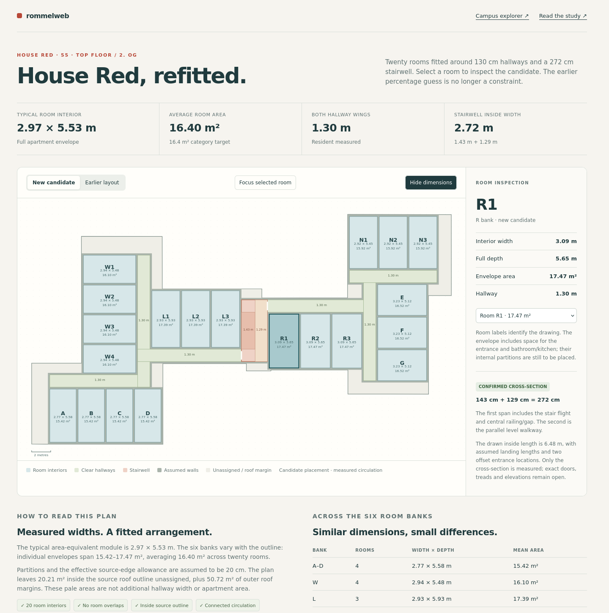

# House Red: a room-size candidate fitted to the measured circulation

**15 November 2026 · House 55 · 2. OG · Twenty apartments**

**[Open the interactive plan](https://mteyra.github.io/rommelweb/house55-study/)** · [Candidate data](../data/house55-measured-plan-candidate.json) · [Independent verification](../data/house55-measured-plan-independent-audit.json)

The joint fit gives an area-equivalent nominal apartment interior of **2.96615 × 5.52906 m**, or approximately **3.0 × 5.5 m**. Twenty bank-specific rectangles fit the retained floor outline with **1.30 m clear hallways in both wings**, a **2.72 m inside stairwell width**, and **0.20 m assumed partitions**. Their combined envelope area is **328.00 m²**, averaging **16.40 m²**.

This is one workable candidate in an explicitly defined layout family. It is not a survey of the actual partitions. The preview lets the resident compare it with the earlier estimate, show dimensions, and select each room.



## What is fixed, what is fitted

The resident has confirmed the twenty-room arrangement, the **1.30 m** hallway width on both sides, and the stairwell cross-section:

```text
1.43 m flight plus central railing/gap
+ 1.29 m parallel level walkway
= 2.72 m inside wall to inside wall
```

The 1.43 m band is not a separate measurement of the clear stair flight. Separate L and R doors connect to the top-floor landing circulation.

**The earlier percentage alignment is removed from the fit.** No 20/80 or 25/75 share about an extended exterior line is used. The former exact W4/L1 overlap, proposed R-bank endpoint alignment and generated window-centre positions are also excluded as hard constraints. They were earlier estimates, not independent dimensions.

The source exterior and both recorded no-floor cutouts remain unchanged. The candidate uses the source roof edges as reference lines, with a stated **0.20 m inward allowance**, and **0.20 m full separation between clear room faces and adjacent rooms, halls or stairs**. These wall/reference allowances are assumptions.

The operator's **16.4 m² category average** is imposed as the mean target at the resident's request. It does not establish that these twenty actual apartments average exactly that figure. Internal bathroom, kitchen and entrance partitions remain unresolved, so the calculated area is the full interior envelope.

## The resulting room dimensions

Each bank has equal bays within this candidate; different banks adapt to their available geometry.

| Room bank | Count | Clear width × full depth | Envelope area per room |
|---|---:|---|---:|
| A–D | 4 | **2.765 × 5.576 m** | **15.419 m²** |
| W1–W4 | 4 | **2.937 × 5.484 m** | **16.105 m²** |
| L1–L3 | 3 | **2.932 × 5.931 m** | **17.388 m²** |
| E–G | 3 | **3.226 × 5.122 m** | **16.523 m²** |
| R1–R3 | 3 | **3.093 × 5.650 m** | **17.475 m²** |
| N1–N3 | 3 | **2.921 × 5.448 m** | **15.917 m²** |

The full-precision mean is **16.400000 m²**; the population standard deviation is **0.752892 m²**, or **4.59%** of that mean. The extra displayed digits support reproduction of the calculation, not measurement accuracy. Rounded width/depth products can differ slightly from rounded areas.

The nominal module is defined transparently:

```text
mean of twenty clear widths = 2.966147657 m
area-equivalent nominal depth = 16.4 / 2.966147657 = 5.529057180 m

nominal reference ≈ 2.97 × 5.53 m ≈ 16.4 m²
```

It is a useful shared apartment reference; the table gives the rectangles actually placed in the plan. Every unpartitioned room envelope can geometrically contain a **2.70 × 3.30 m** rectangle. This does not establish bathroom/kitchen placement or furnishability after internal partitions are added.

## Why the bank variants are necessary

Within this particular six-bank, rectilinear model and the stated 0.20 m allowances, four A–D rooms limit a shared clear width to **2.765070 m**. The R-side source depth and measured hall limit a shared depth to **5.649861 m**. Therefore an identical rectangle used in every bank would obey:

```text
w ≤ 2.765070 m
d ≤ 5.649861 m
w × d ≤ 15.622263 m²
```

That upper bound is below 16.4 m². Some dimensional variation is necessary in this model. The bound does not prove that its maximum rectangle itself fits everywhere, or that an entirely different arrangement of nonrectangular rooms could not work. It explains why a nominal size plus bank variants is more defensible than forcing twenty identical 16.4 m² rectangles.

## How the joint calculation works

The fitting variables are the A, W, E and N hall positions and the stairwell's transverse position. The L/R hallway positions follow source-edge references and the measured clear width. The former bank overlap and stair percentages impose no equations.

For a bank of `n` rooms spanning `S` metres between its extreme clear faces, with party walls `t = 0.20 m`:

```text
clear bay width = (S − (n − 1)t) / n
room envelope area = clear bay width × clear depth
Σ room areas = 20 × 16.4 = 328.0 m²
```

SciPy SLSQP finds a local optimum that minimizes room-area differences and regularizes widths/depths toward similar shapes. With numerical dimensions expressed in metres and areas in square metres, the chosen objective is:

```text
Σ rooms [
  ((area − 16.4) / 1 m²)²
  + 2((width − 2.8) / 1 m)²
  + ((depth − 5.86) / 1 m)²
]
```

The similarity targets and their weights are modelling choices. They are not measurements or a statistical accuracy model. The solution reached the exact requested mean target in thirteen iterations. Its selected positions in the retained study U/V frame are:

| Parameter | Candidate coordinate |
|---|---:|
| A hallway centre V | 10.891240 m |
| W hallway centre U | 0.673443 m |
| E hallway centre U | 24.367252 m |
| N hallway centre V | −0.072216 m |
| Stairwell left clear face U | 10.918396 m |

All twenty polygon coordinates, corridor polygons, wall bands and assumptions are in the [candidate receipt](../data/house55-measured-plan-candidate.json).

## Staircase and remaining floor

The candidate stairwell is **2.72 × 6.479991 m inside**. Only its width is measured. The length comes from joining the two fitted corridor levels in plan. The drawing proposes 1.30 m landing lengths, a continuous 1.29 m side walkway and a flight/guard band between the landings.

The two depicted door positions are indicative **0.90 m spans within 1.30 m open hallway mouths**. Their jambs and leaves have not been modelled. Their offset locations are a candidate arrangement, not recovered measurements of the actual two doors. A stair-length measurement and door/end-wall distances can now test this proposal directly.

The complete source-plate area account is:

| Allocation | Area |
|---|---:|
| Twenty interior room envelopes | 328.000000 m² |
| Union of clear hallway branches | 80.823795 m² |
| Inside stairwell envelope | 17.625576 m² |
| Assumed wall bands | 63.955370 m² |
| Explicitly unassigned plate | 70.933824 m² |
| **Retained floor plate** | **561.338565 m²** |

The unassigned area comprises **20.211418 m² inside the reference flat-roof outline** and **50.722406 m² of outer roof margins**. The pale regions in the preview show these areas. Proposed end partitions close the measured hallway strips; the remaining pockets are not silently counted as wider hallways or apartment area. Wall bands are a geometric allowance, not a construction material takeoff.

## Independent checks

A second implementation uses standard-library triangulation, polygon intersections and segment distances; it does not accept the optimizer's feasibility flags as proof. Its [saved receipt](../data/house55-measured-plan-independent-audit.json) passes all eleven checks:

- All twenty established room labels and six bank counts.
- All **190 room pairs** disjoint.
- No room/hall/stair overlaps.
- Exact retained floor and both recorded no-floor cutouts preserved.
- All clear polygons and wall bands inside both the floor mask and reference roof outline.
- At least **0.20 m** separation at the tested room, corridor, stair and exterior faces.
- All six straight hallway branches exactly **1.30 m** wide.
- Stair cross-section exactly **2.72 = 1.43 + 1.29 m**.
- Connected L landing → side walkway → R landing route.
- An eligible hall frontage for each room and the two indicative hall connections.
- A 2.70 × 3.30 m rectangle fits inside every unpartitioned room envelope.

Numerical residuals near 10⁻¹³ are floating-point roundoff, not surveying tolerances. The browser preview was checked at desktop, 390 px and 320 px widths: room selection, dimension display, previous/candidate comparison, table values and page overflow.

## Reproduce and continue

```sh
uv run --with scipy --with shapely python scripts/fit-house55-measured-plan.py \
  --output docs/data/house55-measured-plan-candidate.json
python scripts/audit-house55-measured-plan.py --repo . \
  --output docs/data/house55-measured-plan-independent-audit.json
python scripts/export-house55-previous-plan.py
python scripts/export-house55-study-page.py
npm run build
```

The candidate is a separate reviewable study at **[rommelweb/house55-study](https://mteyra.github.io/rommelweb/house55-study/)**. The existing 3D campus retains its earlier estimated interiors. This proposal has not been applied to other houses or lower floors.

Next, compare the drawn stair length and offset door arrangement with the real landing, then measure one apartment from each differing bank. Those measurements can replace the 0.20 m wall assumptions, the average-area target and equal-bay choices incrementally. Preserve published preview/document links in future replies so every revision remains reviewable.
