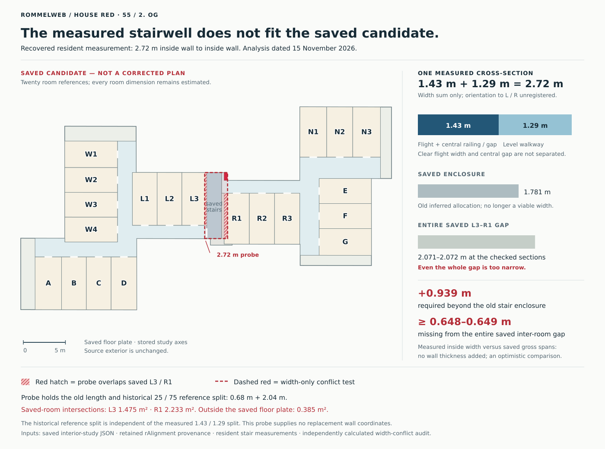

# House Red: measured staircase and top-floor reconciliation

**15 November 2026 · House 55 · 2. OG / index 2**

**Superseded diagnostic:** the resident has since confirmed **1.30 m hallways in both wings** and withdrawn the guessed staircase reference percentages. Every 20/80 or 25/75 scenario below is retained only as a historical failed-fit calculation. None is a constraint on the [new measured-width candidate](HOUSE55-MEASURED-PLAN.md).

The recovered measurement **2.72 m wall to wall** invalidates the saved central staircase allocation. Its inferred width is only **1.780710 m**. Even all the space between the current L3 and R1 banks, including the unassigned strip, is only **2.070997–2.072321 m**. Consequently, the current central room placement cannot remain unchanged.

This is a mathematical diagnosis and evidence recovery. The published app remains at `d27c1a2`, with the `rAlignment` interior stage from `7665017`. No corrected whole-floor geometry is claimed by this report. In particular, increasing the stair width while preserving all other coordinates produces collisions, rather than a valid replacement.



## Recovered context and new measurements

Both the original conversation and its failed recovery were checked through their final user messages. Seven stair/hallway photographs survive, including two tape photographs missed by the interrupted written analysis. They and exact source messages are preserved privately in `/home/haunted/Projects/rommelweb-recovery/2026-11-15/`.

The resident reported:

> Total side to side is 272cm (143cm + 129cm)

The current conversation confirmed the endpoints:

| Observation | Recorded value | Meaning |
|---|---:|---|
| Total inside width | **2.72 m** | Stair-side wall to opposite wall |
| Stair-side zone | **1.43 m** | Flight **plus central railing/gap** |
| Parallel level walkway | **1.29 m** | From that zone to opposite wall |
| Hall connections | **Two separate doors** | One to L, one to R, directly onto the same top-floor landing |
| Western hallways | **1.30 m** | Every L, W and A–D-side hallway; treating this as clear wall-to-wall width |

The exact clear flight width and central guard/gap width remain separate unknowns. The photographs support flight-on-L3-side as a candidate orientation, but do not register that orientation or wall coordinates conclusively. No instrument tolerance was supplied; centimetre reporting does not imply a statistical confidence interval.

The [canonical measurement record](../../data/source/house55-2og-stair-measurements.json) separates confirmed dimensions, connection topology and unregistered details. The older quarter/three-quarter relation is about an extended exterior reference line; **it is not the 143/129 division**.

The resident subsequently stated: **“EVERY hallway in the ‘L’, ‘W’, and ‘A-B-C-D’ side of the dorm measure 130cm wide.”** The [separate hallway record](../../data/source/house55-2og-hallway-measurements.json) preserves that scope. The 1.30 m width supplies a new constraint on western room fronts; it is not inferred for R, and the stair walkway remains its independently measured 1.29 m. Exact measurement faces and the treatment of junction/end pockets still need registration.

The recovered requirements also retain:

- Twenty top-floor rooms: A–D, W1–W4, E–G, L1–L3, R1–R3, N1–N3. These are drawing labels.
- The green-marked regions have no floor at this level.
- L3 adjoins the stair; L1 was to match W4's projected overlap.
- L hallway glazing overlooks the laundry volume below. Analogous R glazing overlooks the cinema, according to the resident. These are windows, not passage doors.
- Twenty-four located exterior window observations, including one per L room.
- Preserve source exterior dimensions. Lower-floor and other-house repetition remains unverified.
- Quiet house → floor → room interaction and the existing compact Groups/Timeline controls.
- The resident's instruction: **“Do not force it if it doesn't make sense.”**

## What is calculated about the saved twenty-room plan

The room envelopes can be reconstructed from their boundary half-planes. For inward unit normal `n`, source boundary constant `c` and assumed perimeter allowance `t`, retain:

```text
n · p ≥ c + t
```

Intersect these half-planes, then calculate polygon area with:

```text
A = ½ |Σ (uᵢ vᵢ₊₁ − uᵢ₊₁ vᵢ)|
```

The [independent reconstruction](../data/house55-recovery-audit.json) contains all twenty internal polygons, bounds, areas, input hashes, overlap tests and conservation checks. The study axes are an orthonormal rotation through 47.47195594° of the campus coordinates.

**These dimensions describe the saved candidate before stair reconciliation.** They do not describe twenty measured apartments, nor a complete solution satisfying the new width. Width is along each bank's bay direction; depth is the full envelope, including unknown entrance/service layout.

| Bank | Count | Conditional internal width × depth | Conditional area per apartment |
|---|---:|---|---:|
| A–D | 4 | 2.741–2.747 × 5.978–5.989 m | 16.400 m² |
| W1–W4 | 4 | 2.752–2.757 × 5.964–5.972 m | 16.400 m² |
| E–G | 3 | 2.779–2.781 × 5.901–5.906 m | 16.400 m² |
| L1–L3 | 3 | 2.744 × 5.982–5.987 m | 16.407 / 16.400 / 16.393 m² |
| R1–R3 | 3 | 2.796–2.800 × 5.752–5.757 m | 16.068 / 16.076 / 16.083 m² |
| N1–N3 | 3 | 2.889–2.895 × 5.672–5.684 m | 16.400 m² |

Small source skews mean area need not equal the product of axis-aligned bounding extents. Unknown internal bathroom/kitchen partition footprints have not been deducted.

The saved allocation conserves its annotated core:

```text
374.616433 m² gross apartment envelopes
+59.653161 m² west hall
+59.446948 m² east hall
+13.977191 m² stair enclosure
+ 2.922438 m² unassigned strip/pocket
=510.616171 m²
```

Independently intersecting the core gives **510.616159 m²**; the difference is **0.0000124 m²**, a numerical residue. Conditional internal apartment envelopes total **327.027422 m²**, averaging **16.351371 m²**.

Area accounting is internally consistent, but does not validate physical placement. Seventeen rooms were intentionally fitted near **16.4 m²**, using assumed 0.20 m ordinary exterior, 0.30 m marked-end and 0.10 m shared-boundary allowances. The operator's 16.4 m² is a category average. Matching it is therefore not independent evidence. The published 2.70 × 3.30 m sketch describes a living zone, excluding the remaining apartment spaces.

## The measured cross-section disproves the central fit

Confirmed arithmetic:

```text
1.43 + 1.29 = 2.72 m
```

The divisions occupy **52.5735% and 47.4265%** of the inside width. This says nothing by itself about where an extended roof edge cuts that cross-section.

Comparison with the saved enclosure:

```text
2.720000 − 1.780710 = 0.939290 m missing
2.720000 / 1.780710 − 1 = 52.7481% increase
```

The saved symbolic flight is approximately **1.580710 m** wide, already **0.150710 m wider than the entire measured 1.43 m flight/guard zone**. It also leaves no representation of the actual 1.29 m walkway.

At the shared longitudinal interval of L3/R1, their saved allocation boundaries leave:

```text
G = 2.070997–2.072321 m
2.72 − G = 0.647679–0.649003 m
```

These sections are measured along the study's transverse axis, almost parallel to the staircase's transverse normal; the small angular difference is recorded in the scenario audit and cannot explain the roughly 65 cm conflict.

This already includes the residual strip and deducts no walls. If `tL` and `tR` are the nonnegative distances needed between allocation lines and the stair's inner wall faces, a physically consistent allocation requires:

```text
Grequired = 2.72 + tL + tR
```

Thus the measured clear width cannot fit between both saved room banks unchanged. Relabeling the unassigned strip as a walkway does not solve the deficit.

## Three widening experiments, all invalid as finished plans

The [scenario calculation](../data/house55-stair-measurement-audit.json) widens the old enclosure to 2.72 m while keeping its longitudinal coordinates. It uses the measured **inside** width directly, without adding wall thickness, as an optimistic collision probe.

The old extended reference line divides the saved width into:

```text
L3 side = 0.4451775375 m
R1 side = 1.3355323011 m
```

Keeping that reference line and a 25%/75% split with the measured width would require:

```text
L3 side = 0.25 × 2.72 = 0.68 m
R1 side = 0.75 × 2.72 = 2.04 m
```

That moves the L-side boundary **0.234822 m** into the existing allocation and the R-side boundary **0.704468 m** outward. Keeping the L-side boundary instead gives `0.4451775375 / 2.72 = 16.3668%`, which no longer matches the old quarter relation.

| Held placement condition | L-side outward motion | R-side outward motion | L3 collision | R1 collision | Outside saved floor plate |
|---|---:|---:|---:|---:|---:|
| Current L-side boundary | 0 m | 0.939 m | ~0 m² | 3.501 m² | 0.604 m² |
| Earlier 25%/75% split | 0.235 m | 0.704 m | 1.475 m² | 2.233 m² | 0.385 m² |
| Earlier 20%/80% split | 0.099 m | 0.840 m | 0.621 m² | 2.967 m² | 0.512 m² |

All three expand the test enclosure area from **13.977191 to 21.349891 m²**, an increase of **7.372699 m²**. The audit also records intersections with halls and the unassigned region. These collision areas are not measured losses of real apartment area.

The outside-plate results show that the saved stair length/end positions and exact outline interpretation also need review under these anchors. They do not prove that the real stair extends outside the building, or that any particular photographed void has been correctly registered. **The widened outline in the figure is a failed-fit diagnostic, not a proposed rebuild.**

## Vertical and coordinate consistency

The current top-floor guide is `2 × 9.491 / 3 = 6.327333 m` above the exterior base. The flat exterior roof is only **2.251667 m** above that guide before any roof construction is deducted. If the unassigned typical-room sketch's 2.50 m clear ceiling applied here, these assumptions would conflict. Actual floor/landing elevations must replace equal division of the maximum exterior height.

Source UTM coordinates are reprojected into a spherical campus frame. The inspected web edges are approximately **0.13–0.17% shorter** than the retained UTM grid edges, as documented in [the scale audit](HOUSE55-SCALE-AUDIT.md). The subsequent study-axis rotation preserves those web lengths. This millimetre-scale effect across the stair width cannot explain a roughly 65–94 cm discrepancy. Future metric refinement should transform all source layers coherently rather than resizing individual houses.

## The new 1.30 m western hallway constraint

The [western hallway calculation](../data/house55-west-hall-measurement-audit.json) evaluates normal distances between opposing planes. It retains **0.10 m on each internal room side**, or **0.10 m room-side plus 0.20 m at a source exterior boundary**, solely to diagnose the existing offset model.

```text
clear hallway = gross separation − allowance on side 1 − allowance on side 2
```

Under those assumptions, the saved western widths are inconsistent with the resident's 1.30 m observation:

| Regular run | Saved conditional clear width | Room-depth change to obtain 1.30 m if the opposite face stays fixed |
|---|---:|---:|
| W hallway opposite the L1 end wall | 1.559687–1.563315 m | W grows 0.259687–0.263315 m |
| A–D hallway opposite the W4 end wall | 1.564833 m | A–D grows 0.264833 m |
| L hallway opposite source edge 39[2→3] | 1.253068–1.269614 m | L shrinks 0.030386–0.046932 m |

These are normal cross-section calculations, with boundary positions and allowances held conditionally. They do not yet apply the staircase changes or measure real apartment dimensions.

Examples limited to rooms whose complete front opposes the sampled run:

| Room | Old conditional area | Conditional area with 1.30 m hall | Conditional full internal depth |
|---|---:|---:|---:|
| W3 | 16.400 m² | **17.119603 m²** | 6.229561 m |
| C | 16.400 m² | **17.125844 m²** | 6.250265 m |
| L2 | 16.400 m² | **16.292640 m²** | 5.948332 m |
| L3 | 16.393 m² | **16.301701 m²** | 5.951638 m |

The direction of the correction is significant: the regular W/A hallways become narrower and their adjacent rooms deeper, while the L hallway becomes slightly wider and its rooms shallower. An exact 16.4 m² target for all apartments is not supported by this measurement. These examples are neither a simultaneous whole-floor fit nor new measured rental areas.

The current model also contains wider end segments beside the source recesses: **1.904524–1.909402 m** on W and **1.914548–1.919134 m** on A, under the same assumptions. If these segments are also ordinary 1.30 m hallways, fixing both the old opposing planes and old offsets would introduce about **0.35 m steps** in the inferred room fronts where the opposite boundary changes.

Another explanation is that the source roof edge is offset from the actual hallway wall face. Continuing the conditionally fitted straight fronts requires effective source-to-clear-hall-face offsets of approximately **0.548 m at W1** and **0.552 m at A**, instead of the previous 0.20 m allowance. Such offsets would include any roof projection/registration difference and cannot simply be labeled masonry thickness. Junctions, end pockets and partially opposed room fronts need explicit registration before choosing either explanation.

The measured hallway width therefore constrains **both room depth and the interpretation of roof-derived boundaries**. It does not justify applying one arbitrary depth increment to every western room. The audit identifies fully opposed versus partially opposed examples and retains the calculation's fixed-face assumptions.

## Coupling the W hallway to the wider staircase

The fixed-opposite-face examples above are diagnostic alternatives. **W rooms do not necessarily need to deepen by 26 cm**: moving the L bank toward W to accommodate the staircase also narrows their intervening hallway.

Let `δ` be the westward translation of the whole L bank, `ε` the increase in W-room depth and `τ` the combined distances from stair allocation boundaries to the measured inside wall faces. Retaining the earlier approximate 25%/75% reference alignment gives:

```text
δ = 0.25 × (2.72 + τ) − 0.4451775375
  = 0.2348224625 + 0.25τ

δ + ε ≈ current W clear width − 1.30
      = 0.259687–0.263315 m

ε ≈ 0.024865–0.028493 − 0.25τ
```

The exact projection between the two relevant normals is effectively 1. The [hallway audit](../data/house55-west-hall-measurement-audit.json) records the vectors, planes and example polygons.

| Illustrative combined offset τ | Whole L-bank translation west | Remaining W-room depth change | Conditional W3 area |
|---|---:|---:|---:|
| 0 m | 0.234822 m | 0.024865–0.028493 m deeper | 16.474410 m² |
| 0.20 m | 0.284822 m | 0.021507–0.025135 m shallower | 16.337027 m² |

Neither value of `τ` is measured. The zero-offset case is an optimistic allocation probe; 0.20 m illustrates sensitivity to a possible combined offset. A rigid L translation preserves its untrimmed apartment shapes, but does not establish that their new positions fit inside the real floor.

This one-dimensional relationship is a useful candidate for a joint reconstruction. It does **not** yet satisfy the W4/L1 projected-overlap condition, R-bank placement, source-end containment, other hallway branches or longitudinal stair/door geometry. The earlier widening probes already show why all these constraints must be solved together. The approximate historic 25%/75% placement must remain revisable against physical measurements.

## What should determine the next layout

Preserve the confirmed twenty-room topology, source exterior, measured 2.72 m cross-section, 1.30 m western hallway widths and both landing doors. Re-evaluate the inferred room fronts and L/R bank boundaries, registration to source edges, longitudinal stair extent and earlier approximate ratio together.

The highest-value next measurement is **stairwell inside length**, accompanied by distances from its end walls to the first/last tread and both door jambs. Width is established; these longitudinal dimensions distinguish candidate landing arrangements and identify which old boundaries must move. Then an identified L/R apartment's full outline and independent floor heights can constrain the adjoining banks and vertical voids.

A width measurement supplies an independent constraint; it does not identify a unique placement, complete apartment layout, or riser geometry. Fit actual observations first. Retain wall allowances and equal-area preferences as explicit assumptions, and permit them to change when they conflict with measurements.

## Reproduction and checks

From the repository:

```sh
python scripts/audit-house55-recovery.py --repo . \
  --output docs/data/house55-recovery-audit.json
python scripts/audit-house55-stair-measurement.py --repo . \
  --output docs/data/house55-stair-measurement-audit.json
python scripts/audit-house55-west-hall-measurement.py --repo . \
  --output docs/data/house55-west-hall-measurement-audit.json
python scripts/render-house55-measurement-audit.py
```

The reconstruction and scenarios use standard-library half-plane clipping, shoelace areas and signed triangle intersections. Input hashes are retained. The diagram is generated from saved polygon coordinates and scenario output.

Fresh application checks passed: **164 tests**, production build and outdoor path-cache validation. Local `main`, GitHub and five checked deployed datasets agree. Passing software checks does not convert a failed measured-geometry constraint into a physically accurate model.

The [system audit](SYSTEM-AUDIT-2026-11-15.md) records 11 exteriors, 15 estimated interior floors and zero approved measured interior floors, plus the approved-plan containment/overlap validation gap. The [context recovery](CONTEXT-RECOVERY-2026-11-15.md) retains the fuller project history.
