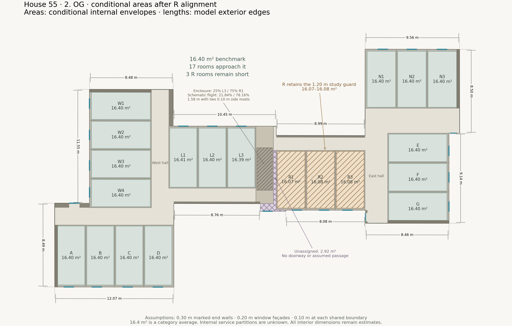

# House 55 · R-bank alignment and stair-flight study

**Historical stage, superseded:** the resident has withdrawn the guessed stair reference percentages. The measured constraints are now 1.30 m hallways in both wings and a 2.72 m stairwell cross-section. Use the [new fitted-plan study](HOUSE55-MEASURED-PLAN.md); the alignment and ratios below document an earlier estimate only.

Updated **15 November 2026**, **2. OG / index 2**. The latest candidate aligns the two estimated sides of R1–R3 to the endpoints of the opposite source recess. The official exterior, twenty resident-confirmed room references, 24 window records, gross stairwell and west stair entry are retained. Absolute apartment dimensions, partitions, clear stair widths and east stair access remain unverified.

This step follows the [earlier conditional area scenario](HOUSE55-AREA-STUDY.md). Its source is [house55-r-alignment.mjs](../../archive/scripts/house55-r-alignment.mjs), with computed inputs and results under `rAlignment` in [study provenance](../../data/source/house55-2og-study-provenance.json). Values below describe the calculation, not measurement accuracy or statistical confidence.



The [independent area audit](../data/house55-area-audit.json) reconstructs the offset polygons and conserves the full annotated region.

## Three different lengths

| Reference | Model length | Meaning |
| --- | ---: | --- |
| Opposite recess, `RoofSurface` 39 vertices 16–15 | 8.989 m | Unchanged source edge supplying the two alignment endpoints |
| Aligned R-bank extent along the retained façade plane | 8.979 m | Extent of the estimated room bank; not an added exterior wall |
| Original R exterior segment, vertices 6–7 | 8.079 m | Unchanged source-shell edge |

The two side lines retain their small earlier slopes and pass through the opposite recess endpoints. Interpolating those side lines into three bays gives the new dividers. Their intersection with the retained façade plane differs slightly from the recess length. **Neither longer value replaces the 8.079 m shell edge or measures clear apartment widths.** The source plate clips every resulting room polygon, and the existing window segments remain attached.

## Conditional apartment areas

The existing perimeter assumptions remain: **0.20 m** at an ordinary exterior boundary and **0.10 m per apartment** at an allocation boundary. The earlier four marked outer ends elsewhere retain their **0.30 m** hypothesis. These are model allowances, not verified masonry or insulation.

| Room | Gross envelope | Inside assumed perimeter allowances | Shortfall against 16.4 m² |
| --- | ---: | ---: | ---: |
| R1 | 18.117 m² | 16.068 m² | 0.332 m² |
| R2 | 18.125 m² | 16.076 m² | 0.324 m² |
| R3 | 18.133 m² | 16.083 m² | 0.317 m² |

These are approximately **16.07–16.08 m²**, not exact 16.4 m² apartments. The operator's **16.4 m² is a category average**, used here only as a conditional benchmark. Unknown bathroom and service-partition footprints are not deducted. The [source-dimension review](HOUSE55-DIMENSION-EVIDENCE.md) explains why neither that average nor the separate 2.70 × 3.30 m living-zone sketch establishes a complete individual apartment.

The seventeen non-R room polygons are unchanged from the immediately preceding area-stage baseline. R's hall-facing boundary retains the **1.20 m northern connector study guard** after its declared allowances; that guard is not a legal or accessibility standard. The alignment does not force the three area results to the benchmark.

## Residual strip and access

The wider estimated R bank leaves a narrow strip beside the stairwell and its connected blind end pocket. Together they occupy approximately **2.922 m²**. The checked strip cross-sections are about **0.290–0.292 m gross**.

This region is explicitly **unassigned**, with no doorway, route, occupancy or installed service inferred. Its schema kind is `service` solely to distinguish it from rooms and halls; the label and source note state that its function is unknown. The two hall regions remain separate, and the observed west stair entry supplies no evidence of an east entrance.

The top study now contains **24 spaces: twenty rooms, two halls, one stairwell and one unassigned region**, with **21 door targets**. The unassigned region adds no door. The lower two floors repeat this corrected core as estimates on their own complete source outlines; the top-floor window observations, wall bands and upper exclusions are not copied down. Their additional wings and actual complete room counts remain unverified.

## Enclosure ratio versus symbolic flight

The gross stairwell stays approximately **1.781 m wide**, divided by the specified exterior-edge extension as **25% L3/west and 75% R1/east**. Its absolute width is derived within the candidate.

With the west side and reference line fixed, the L3-side distance is fixed. If only the right side moves inward, total width decreases and the L3 fraction increases:

```text
L3 fraction = fixed L3-side distance / remaining total width
```

Starting at 25%, a right-only enclosure shrink therefore cannot produce a L3 share of 20–25%. The gross enclosure is retained.

The separate **symbolic flight** receives an explicit **0.10 m inset on each side**. That produces approximately **1.581 m flight width**, with a calculated **21.8369% L3 / 78.1631% R1** split. Flight length, landing arrangement and the west entry are retained. This is a schematic flight allowance; it does not implement a measured right-wall shrink or establish construction thickness, usable stair width, tread/riser dimensions or compliant circulation.

## Reproduction and remaining evidence

The stage reads the [frozen area-stage baseline](../../archive/data/source/house55-2og-r-alignment-baseline.json), commit `0064399`, and checks its digest before applying the alignment. The normal generator runs the earlier stages, then this one:

```sh
node scripts/generate-house55-study.mjs /tmp/house55-study-geometry.json
```

The review output retains current `level`, all three `levels`, and `metadata.rAlignment`, including separate `alignment`, `rooms`, `staircase` and `unassigned` records. It does not itself publish or approve an interior. Release checks are recorded separately in [RELEASE-CHECKS.md](RELEASE-CHECKS.md).

The next useful evidence is an identified R-room outline, actual clear apartment and stair widths, wall thicknesses, and the east hall's real connection. Relative alignment observations help constrain a candidate; they do not justify a claim of 95% geometric certainty.
