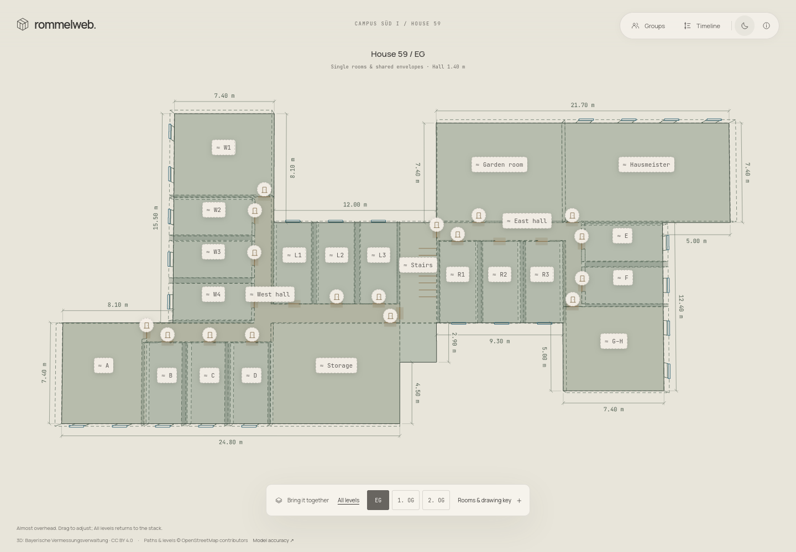
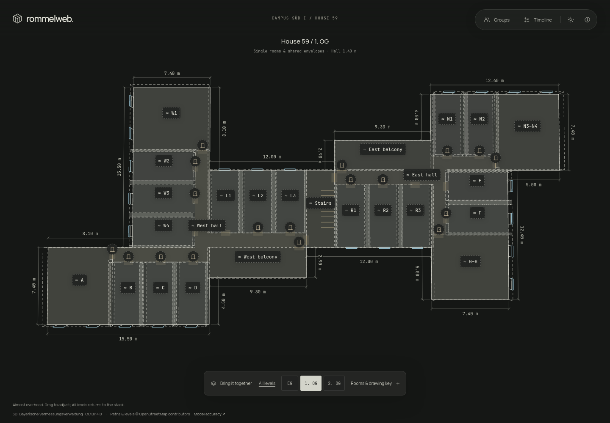

# Green House 59 — completed module floors

The resident confirmed that Green’s **2. OG and 1. OG match Red House 55**, and supplied a separate [ground-floor annotation](../../data/source/house59-eg-resident-annotation.png). The screenshot is explicitly labelled **House 59 / EG**; it defines the ground-floor changes described here.

Green now uses the completed Red floor geometry in its own rigid campus frame. Its previous fitted outlines and individual room-bank offsets no longer constrain these independent floor drawings.

## Floors

| Floor | Single rooms | Shared apartments | Common sections | Footprint |
| --- | ---: | ---: | --- | ---: |
| 2. OG | 20 | 0 | Red’s halls and stairwell | 478.78 m² |
| 1. OG | 16 | 4 | East and west balconies, as in Red | 624.48 m² |
| EG | 14 | 3 | Hausmeister, Garden room and Storage | 716.01 m² |

The upper floors repeat Red’s exact local outlines, room polygons, wall allowances, halls, stairwell and entrances. Both enclosed balconies remain on **1. OG**. The same registration and stair geometry align all three floors.

Singles retain **2.70 × 6.00 m clear interiors**, **3.10 m modules**, a **0.20 m side-wall allocation on each side**, and **1.40 m halls**. Shared apartments retain **6.20 × 7.40 m gross envelopes**.

## Ground-floor annotation

The **red box** becomes one **Hausmeister** enclosure occupying the entire N wing: former N1, N2 and N3–N4, including the short bank hallway. Its **12.40 × 7.40 m** gross footprint is **91.76 m²**. The former apartment partitions and their three entrances are removed. A single **0.90 m** illustrative doorway connects the enclosure to the east hall at the wing junction. The red “H” is interpreted as the room label; it does not establish internal partitions.

The adjoining eastern/R enclosure becomes the **Garden room**, **9.30 × 7.40 m** or **68.82 m²**, separated from the hall. Its single **0.90 m** illustrative door is placed about one third of the way along the hallway-facing wall from the stair end, following the green mark. The exact door offset is an interpretation of the sketch.

The western/L enclosure becomes **Storage**, also **9.30 × 7.40 m** or **68.82 m²**, with its own hallway door near the stairs.

Using Red’s complete A-bank arrangement restores the missing single apartment beside the storage area. The bank now contains shared apartment A and singles B, C and D. The other ground-floor shared apartments, W1 and G–H, retain Red’s geometry.

The ground-floor shell follows Red’s **716.01 m²** module outline. The small notch in the annotation belongs to the earlier shifted room-bank fit and is resolved by the continuous Red hall junction. The **7.83 m² stair-side spur** remains unassigned, as in Red.

## Sources and implementation

[`scripts/house59-module-layout.mjs`](../../scripts/house59-module-layout.mjs) derives Green’s plans from the completed Red [top-floor](HOUSE55-MODULE-LAYOUT.md), [first-floor](HOUSE55-FIRST-FLOOR-LAYOUT.md) and [ground-floor](HOUSE55-GROUND-FLOOR-LAYOUT.md) canonical data. It writes `public/data/house59-module-layouts.json` and updates only House 59 in `public/data/interior-studies.json`.

White and Red retain their existing complete study records. Folded building geometry, façade appearance and source opening evidence remain separate. The layout’s window symbols are schematic; the four N-wing symbols now belong to the unified Hausmeister enclosure.

The resident has confirmed the arrangement and room uses. Existing assumptions about room dimensions, doorway sizes, floor heights, service fittings and shared-apartment partitions retain the same status as Red’s. The annotation does not supply new measured dimensions.

The current provisional fitting catalog contains only **Houses 51 and 53**. Earlier Green fitting data is preserved for historical regression checks, and legacy generators skip Green’s completed independent floors.

## Reproduce

```sh
npm run layout:green-house
npm test
npm run build
```

All **260 tests pass**, including exact upper-floor reproduction, Hausmeister coverage, removed dividers, the restored single, doorway routes, aligned stairs, valid window references, historical fitting coverage and deterministic generation.

The [preservation receipt](../evidence/house59-layout-preservation.json) verifies 76 protected files and the complete Red and White records against commit `b4af250847d77a7cb2ae48f2151f91b44d23e20c`. The [browser receipt](../evidence/house59-layout-browser.json) covers all 71 Green space cards, the three new common-area entrances, day/night views, desktop and phone sizes, and fold/unfold camera restoration.

See [release checks](RELEASE-CHECKS.md) for the complete verification record.




