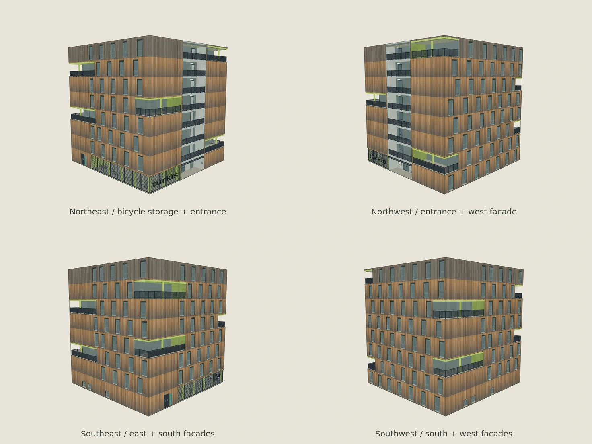

# Türkis / Haus 57a exterior

The four resident photographs supplied on 16 November 2026 now drive the folded exterior of Haus 57a. The source footprint, 23.458 m building height, eight floor guides and all interior plans remain unchanged. Recesses are cut from temporary display surfaces; their geometry does not feed back into the apartment layouts.

## Photo registration

The entrance identifies the north side. In its frontal photograph, the bicycle enclosure is on the viewer’s left, at the northeast corner.

| Supplied photo | View | Main evidence |
| --- | --- | --- |
| 1 | Northwest corner, predominantly west | Dense staggered tall windows; low and top northwest balconies |
| 2 | North entrance | Seven open landings; solid timber wings; separate entrance and bicycle gate |
| 3 | Northeast corner | Long east bicycle frontage; northeast balcony; east window strips |
| 4 | Southeast corner | Alternating south/east balconies; shorter south ground windows; east service door |

Cross-face comparison matters: the northeast balcony is on **4. OG**, even though the perspective in photo 2 initially makes it appear higher.

## Exterior design

The north gallery has seven recessed horizontal landings, concrete slab edges, dark vertical railings, rear doors and cool lamp strips. The ground entrance sits directly below it with its address fascia, a glazed door and sidelight, notice case and intercom. The photographs do not expose a zigzag staircase; none is added to the exterior.

There is one corner balcony on each upper floor:

| Floor | Corner | Longer open face |
| --- | --- | --- |
| 1. OG | Northwest | North |
| 2. OG | Southwest | South |
| 3. OG | Southeast | East |
| 4. OG | Northeast | North |
| 5. OG | Southwest | South |
| 6. OG | Southeast | East |
| 7. OG | Northwest | North |

Each balcony opens around its corner and has a lime fascia, soffit and column. The lower northwest and middle southeast fronts carry the observed dark privacy screens. Concealed balcony doors are not treated as evidence about the rooms behind them.

A continuous bicycle enclosure wraps the northeast ground corner. It includes a wire grid, lime backing and columns, a separate gate, illustrative bicycles and the dark **türkis** wordmark. The service door and turquoise plaque occupy the solid southeast ground return.

The window rows are defined separately for each face, replacing the generic facade grid. The north wings have no bedroom-window rows. West has the denser tall-window rhythm; south and east have fewer openings and wider blank timber spans. South ground windows are short and low. The current display contains **117 room-window openings: 52 west, 33 south and 32 east**, excluding entrance and gallery doors.

## Confidence and retained constraints

Balcony corners, floor identities, entrance orientation and bicycle frontage have support from overlapping views. Window offsets follow the visible row patterns; trees, glare and dark glazing obscure some positions. An unlit window is not assumed to be a blank wall.

Opening widths, balcony depths, rail spacing, concealed rear details and individual bicycle positions remain photographic estimates. This pass improves the exterior likeness without claiming surveyed dimensions or using the provisional interior plans as ground truth.

Implementation lives in [turquoise-photo-details.js](../../src/turquoise-photo-details.js) and [turquoise-window-layout.js](../../src/turquoise-window-layout.js). The shared renderer adds the required material roles and single-line signs.

## Verification

All eight Turquoise geometry tests pass. They check the seven-balcony schedule, all seven gallery openings, bicycle frontage, blank north wings, opening survival after masking and selection rays through all 117 windows. Visibility regressions cover the entrance fascia, concrete slab edges and service plaque.

The [preservation receipt](../evidence/turquoise-photo-preservation.json) records the source hashes and comparison scope. It checks protected source/interior files, the complete interior scene in both themes, and the other dorm exteriors. Concurrent exterior work is identified explicitly when isolated for this comparison.

The [browser receipt](../evidence/turquoise-browser.json) records all eight viewing directions in both themes and 14 floor checks across desktop, 390 px and 320 px layouts. The first-floor before/after images are pixel-identical. The isolated Turquoise publication checkout passes all **373 regression tests**, the preservation audit and the production build.

Additional views: [entrance close-up](../screenshots/house-57a-turquoise/turquoise-entrance-day.webp) · [northeast at night](../screenshots/house-57a-turquoise/turquoise-north-east-night.webp).
